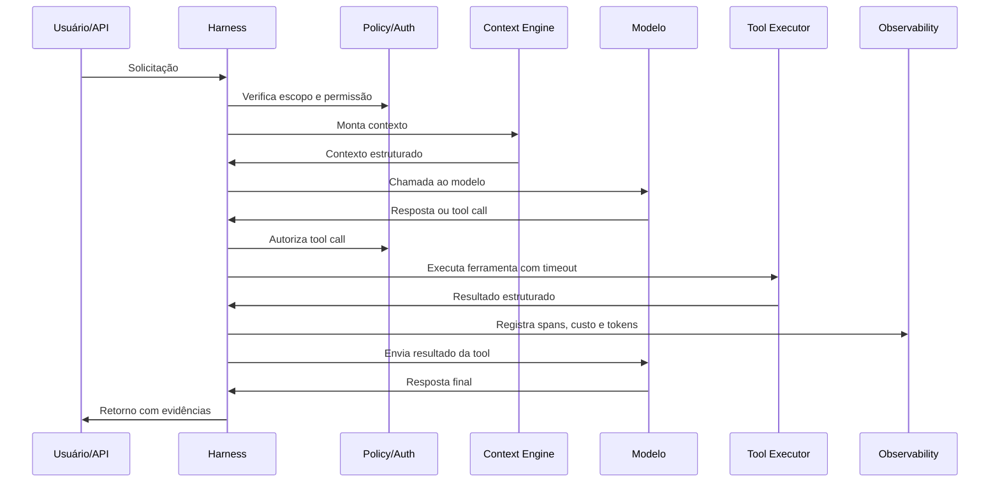
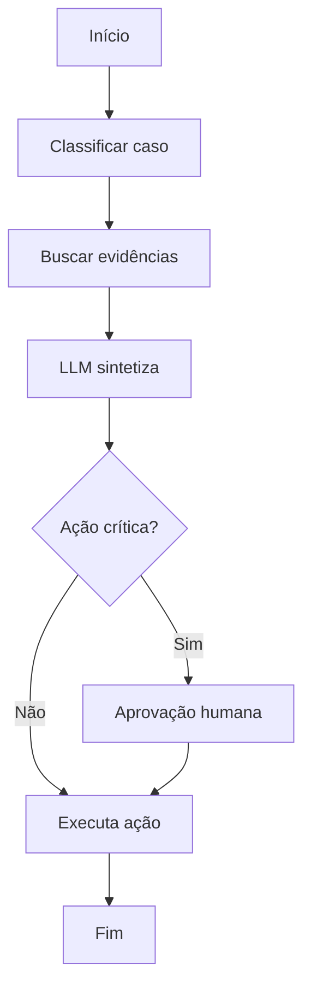

# 🧠 Engenharia de IA em Produção

> **De modelos a agentes - sistemas de IA como software crítico.**

> Rascunho técnico aberto sobre como projetar, operar e governar sistemas de IA em ambientes corporativos. Cobre **ML tradicional**, **LLMs**, **RAG**, **Agentic AI**, segurança, governança, observabilidade, FinOps e deployment, com tratamento mais curto e explicitamente emergente para **MCP** e **A2A**.

**Autor.** Ruan Pato.

**Status.** Rascunho técnico aberto, em construção, no caminho para uma `v0.1` pública. Esta versão não se apresenta como livro final nem como referência definitiva - é um handbook em evolução, com limitações declaradas no próprio texto.

---

## 📌 Prefácio

### 🎯 Por que este livro existe

Existe muito material sobre Machine Learning, LLMs e Agentic AI. A maior parte foca em demos, frameworks da semana ou propaganda de fornecedor. Pouca coisa explica, com seriedade técnica, como esses sistemas são operados em ambientes corporativos: dados ruins, latência apertada, custos sob escrutínio, auditoria obrigatória, regulação real e usuários que não aceitam respostas inventadas.

O material reunido aqui diversas notas pessoais sobre arquitetura, MLOps e operação de sistemas de IA - decisões, padrões, anti-padrões e cicatrizes - agora compiladas e reorganizadas em forma de livro/handbook público.

A tese é simples e atravessa o material inteiro:

> **Sistemas de IA em produção não são apenas modelos.** São sistemas sociotécnicos que precisam ser projetados, operados, observados, auditados e depreciados como **software crítico**.

Tudo o que vem a seguir é consequência dessa tese. Para evitar repetição, ela é estabelecida aqui e nas Partes 0 e 4, e depois referenciada de forma curta nos capítulos. Quando uma técnica não sustenta uma garantia, esse limite aparece **no próprio texto**.

### 👥 Para quem é este livro

- Arquitetos de IA, engenheiros de ML/LLM, engenheiros de dados, MLOps, LLMOps e AgentOps.
- Líderes técnicos que precisam decidir entre ML tradicional, LLMs, RAG, agentes, workflow determinístico ou combinações híbridas.
- Especialistas em segurança, governança e FinOps que precisam aplicar suas disciplinas a sistemas probabilísticos.

O livro assume conhecimento prévio em engenharia de software, APIs, cloud, dados e segurança. Ele **não** ensina Python, SQL ou conceitos básicos de computação.

### 🚫 Para quem este livro **não** é

- Para quem busca tutoriais "do zero ao deploy" em uma única ferramenta.
- Para quem quer um manual de prompt engineering "criativo".
- Para quem quer ranquear frameworks por hype.

### 🧾 O que este livro **não** promete

Esta obra é explícita sobre limitações. Ela **não** afirma que:

- LLMs são fontes de verdade.
- RAG elimina alucinação.
- Guardrails ou prompts garantem segurança.
- Metadata de tool impede uso indevido.
- Fine-tuning substitui base de conhecimento dinâmica.
- Multi-agent resolve problemas complexos automaticamente.
- IA pode ser declarada "100% segura".

Sempre que uma técnica não garantir um comportamento, este livro diz isso **explicitamente**.

### 📚 Como ler este material

Há três modos sugeridos de leitura, e nenhum deles é obrigatório:

1. **Linear.** Da Parte 0 à Parte 9, como um curso. Ideal para quem está construindo carreira na área.
2. **Por trilha.**
   - ML tradicional -> Partes 0, 1, 5 (observabilidade), 6 (custos), 7 (deployment).
   - LLM/RAG -> Partes 0, 2, 4, 5, 6.
   - Agentic AI -> Partes 0, 3, 4, 5, 7.
3. **Por consulta.** Capítulos têm formato padronizado (objetivo, conceito, produção, trade-offs, riscos, observação, teste, checklist), o que facilita pesquisa pontual sem perder contexto.

Há também um **fio condutor narrativo** - o estudo de caso **Hermes Logística** - apresentado na Parte 0 e revisitado em várias partes. Não é exemplo executável; é uma história plausível usada para conectar decisões.

### 🧰 Sobre os exemplos práticos

O livro **referencia** exemplos práticos por código (`EX-RAG-01`, `EX-AGT-02`, etc.) e a matriz completa fica em [`docs/examples-map.md`](./docs/examples-map.md).

> ⚠️ **Status honesto.** Nesta versão, **os exemplos práticos ainda não foram implementados**. Eles são **planejados**, com prioridade e stack declarada, e serão entregues em ciclos posteriores. O texto foi escrito para que essa ligação fique natural quando os códigos existirem; nada aqui depende de o leitor rodar um exemplo agora. A v0.1 prioriza estrutura, conteúdo e mapa técnico, não código rodável.

Quando os exemplos forem implementados, viverão em `examples/`, favorecendo stack open-source: Python 3.11+, FastAPI, scikit-learn, pytest, Ollama (modelos locais), Qdrant ou Chroma (vector DBs locais), OpenTelemetry + Jaeger (tracing), OPA/Rego (policy-as-code), Docker e Docker Compose. Quando um exemplo precisar de modelo na nuvem, terá alternativa local documentada.

### 👤 Sobre o autor

**Ruan Pato** trabalha com software e sistemas de IA em produção: arquitetura, MLOps/LLMOps/AgentOps, segurança, observabilidade e operação contínua. O fio condutor do trabalho dele é que IA enterprise é **software crítico** e que a maior parte do valor real aparece no sistema, não no modelo isolado.

Este material é resultado de notas pessoais reorganizadas em forma pública. Não é manifesto nem peça promocional; é o tipo de handbook que se demonstra útil para quem está começando a subir sistemas em produção ou quem quer revistar conceitos fácilmente.

- GitHub: <https://github.com/ruanpato>
- LinkedIn: <https://www.linkedin.com/in/ruanpato/>
- Site pessoal: <https://ruanpato.com>

### 🤝 Como contribuir futuramente

Detalhes em [`docs/contributing.md`](./docs/contributing.md). Em resumo: correções editoriais e técnicas são bem-vindas via issue ou PR; conteúdo de marketing disfarçado de neutralidade não é aceito; referências precisam ser fontes técnicas verificáveis (papers, docs oficiais, specs, RFCs, blogs de engenharia).

### 🗒️ Convenções e estado deste rascunho

- **Texto em português brasileiro.**
- **Emojis em headers e marcadores** fazem parte do estilo do projeto: são usados como identidade visual e navegação, não como decoração.
- **Tópicos emergentes** (A2A, MCP Authorization, FinOps for AI, parte do tool lifecycle) têm a **maturidade declarada** no próprio capítulo.
- **Profundidade desigual.** Algumas partes estão mais maduras que outras; trechos ainda em forma de outline serão expandidos em ciclos futuros. Capítulos curtos seguem o mesmo padrão editorial dos longos apenas quando isso ajuda a leitura por consulta.
- **Tese central evita repetição literal.** Ela aparece no Prefácio e na Parte 0, e os capítulos subsequentes usam referências curtas (ex.: "como discutido na Parte 0") em vez de reapresentá-la inteira.

---

## 🗂️ Sumário

- [🧠 Engenharia de IA em Produção](#-engenharia-de-ia-em-produção)
  - [📌 Prefácio](#-prefácio)
    - [🎯 Por que este livro existe](#-por-que-este-livro-existe)
    - [👥 Para quem é este livro](#-para-quem-é-este-livro)
    - [🚫 Para quem este livro **não** é](#-para-quem-este-livro-não-é)
    - [🧾 O que este livro **não** promete](#-o-que-este-livro-não-promete)
    - [📚 Como ler este material](#-como-ler-este-material)
    - [🧰 Sobre os exemplos práticos](#-sobre-os-exemplos-práticos)
    - [👤 Sobre o autor](#-sobre-o-autor)
    - [🤝 Como contribuir futuramente](#-como-contribuir-futuramente)
    - [🗒️ Convenções e estado deste rascunho](#️-convenções-e-estado-deste-rascunho)
  - [🗂️ Sumário](#️-sumário)
  - [🧭 Parte 0 - Fundamentos de Sistemas de IA](#-parte-0---fundamentos-de-sistemas-de-ia)
    - [🧩 Capítulo 0.1 - Modelo, produto e sistema](#-capítulo-01---modelo-produto-e-sistema)
      - [🎯 Objetivo do capítulo](#-objetivo-do-capítulo)
      - [🧠 Conceito principal](#-conceito-principal)
      - [🏗️ Como isso aparece em produção](#️-como-isso-aparece-em-produção)
      - [⚖️ Trade-offs](#️-trade-offs)
      - [🚨 Modos de falha](#-modos-de-falha)
      - [🛡️ Controles e mitigações](#️-controles-e-mitigações)
      - [🔭 Como observar e medir](#-como-observar-e-medir)
      - [🧪 Como testar](#-como-testar)
      - [🧰 Exemplo prático relacionado *(planejado)*](#-exemplo-prático-relacionado-planejado)
      - [📌 Checklist](#-checklist)
      - [📚 Referências](#-referências)
    - [🧩 Capítulo 0.2 - Sistemas probabilísticos em ambientes determinísticos](#-capítulo-02---sistemas-probabilísticos-em-ambientes-determinísticos)
      - [🎯 Objetivo do capítulo](#-objetivo-do-capítulo-1)
      - [🧠 Conceito principal](#-conceito-principal-1)
      - [🏗️ Como isso aparece em produção](#️-como-isso-aparece-em-produção-1)
      - [⚖️ Trade-offs](#️-trade-offs-1)
      - [🚨 Modos de falha](#-modos-de-falha-1)
      - [🛡️ Controles e mitigações](#️-controles-e-mitigações-1)
      - [🔭 Como observar e medir](#-como-observar-e-medir-1)
      - [🧪 Como testar](#-como-testar-1)
      - [🧰 Exemplo prático relacionado *(planejado)*](#-exemplo-prático-relacionado-planejado-1)
      - [📌 Checklist](#-checklist-1)
      - [📚 Referências](#-referências-1)
    - [🧩 Capítulo 0.3 - IA como sistema sociotécnico](#-capítulo-03---ia-como-sistema-sociotécnico)
      - [🎯 Objetivo do capítulo](#-objetivo-do-capítulo-2)
      - [🧠 Conceito principal](#-conceito-principal-2)
      - [🏗️ Como isso aparece em produção](#️-como-isso-aparece-em-produção-2)
      - [⚖️ Trade-offs](#️-trade-offs-2)
      - [🚨 Modos de falha](#-modos-de-falha-2)
      - [🛡️ Controles e mitigações](#️-controles-e-mitigações-2)
      - [🧰 Exemplo prático relacionado *(planejado)*](#-exemplo-prático-relacionado-planejado-2)
      - [📌 Checklist](#-checklist-2)
      - [📚 Referências](#-referências-2)
    - [🧩 Capítulo 0.4 - Demos vs produção](#-capítulo-04---demos-vs-produção)
      - [🎯 Objetivo do capítulo](#-objetivo-do-capítulo-3)
      - [🧠 Conceito principal](#-conceito-principal-3)
      - [🚨 Modos de falha](#-modos-de-falha-3)
      - [🛡️ Controles e mitigações](#️-controles-e-mitigações-3)
      - [🧰 Exemplo prático relacionado *(planejado)*](#-exemplo-prático-relacionado-planejado-3)
      - [📌 Checklist](#-checklist-3)
    - [🧩 Capítulo 0.5 - Trade-offs enterprise](#-capítulo-05---trade-offs-enterprise)
      - [🎯 Objetivo do capítulo](#-objetivo-do-capítulo-4)
      - [🧠 Conceito principal](#-conceito-principal-4)
      - [🏗️ Como isso aparece em produção](#️-como-isso-aparece-em-produção-3)
      - [🧪 Heurística simples](#-heurística-simples)
      - [📌 Checklist](#-checklist-4)
    - [🧩 Capítulo 0.6 - Controle determinístico vs mitigação probabilística](#-capítulo-06---controle-determinístico-vs-mitigação-probabilística)
      - [🎯 Objetivo do capítulo](#-objetivo-do-capítulo-5)
      - [🧠 Conceito principal](#-conceito-principal-5)
      - [🚨 Modos de falha](#-modos-de-falha-4)
      - [🛡️ Mitigações](#️-mitigações)
      - [📌 Checklist](#-checklist-5)
    - [🧩 Capítulo 0.7 - O que IA faz bem (e o que não deveria controlar sozinha)](#-capítulo-07---o-que-ia-faz-bem-e-o-que-não-deveria-controlar-sozinha)
      - [🎯 Objetivo do capítulo](#-objetivo-do-capítulo-6)
      - [🧠 Conceito principal](#-conceito-principal-6)
      - [📚 Referências](#-referências-3)
    - [🧩 Capítulo 0.8 - Matriz de decisão arquitetural](#-capítulo-08---matriz-de-decisão-arquitetural)
      - [🎯 Objetivo do capítulo](#-objetivo-do-capítulo-7)
      - [🧠 Matriz](#-matriz)
      - [🔭 Matriz expandida - dimensões operacionais](#-matriz-expandida---dimensões-operacionais)
      - [🧭 Regra de bolso](#-regra-de-bolso)
      - [🧪 Exemplos arquiteturais estudados](#-exemplos-arquiteturais-estudados)
      - [📌 Checklist](#-checklist-6)
    - [🧩 Capítulo 0.9 - Estudo de caso fio condutor: "Hermes Logística"](#-capítulo-09---estudo-de-caso-fio-condutor-hermes-logística)
      - [🎯 Objetivo do capítulo](#-objetivo-do-capítulo-8)
      - [🏢 Cenário](#-cenário)
      - [🧭 Restrições principais do caso](#-restrições-principais-do-caso)
      - [🧪 Como este caso é usado no livro](#-como-este-caso-é-usado-no-livro)
      - [🚧 O que o caso **não** é](#-o-que-o-caso-não-é)
      - [📌 Como acompanhar o caso](#-como-acompanhar-o-caso)
    - [🧭 Síntese da Parte 0](#-síntese-da-parte-0)
  - [📊 Parte 1 - ML Tradicional em Produção](#-parte-1---ml-tradicional-em-produção)
    - [🧩 Capítulo 1.1 - Pensamento sistêmico para ML](#-capítulo-11---pensamento-sistêmico-para-ml)
      - [🎯 Objetivo](#-objetivo)
      - [🧠 Conceito](#-conceito)
      - [🏗️ Como isso aparece em produção](#️-como-isso-aparece-em-produção-4)
      - [📌 Checklist](#-checklist-7)
    - [🧩 Capítulo 1.2 - Dados reais, qualidade e modos de falha](#-capítulo-12---dados-reais-qualidade-e-modos-de-falha)
      - [🎯 Objetivo](#-objetivo-1)
      - [🧠 Origens de dados](#-origens-de-dados)
      - [🚨 Modos de falha de dados](#-modos-de-falha-de-dados)
      - [🛡️ Controles](#️-controles)
      - [📝 Exemplo de data contract](#-exemplo-de-data-contract)
      - [🧰 Exemplo prático relacionado *(planejado)*](#-exemplo-prático-relacionado-planejado-4)
      - [📌 Checklist](#-checklist-8)
      - [📚 Referências](#-referências-4)
    - [🧩 Capítulo 1.3 - Estatística prática para ML](#-capítulo-13---estatística-prática-para-ml)
      - [🎯 Objetivo](#-objetivo-2)
      - [🧠 Conceitos centrais](#-conceitos-centrais)
      - [📏 Métricas de classificação](#-métricas-de-classificação)
      - [📐 Métricas de regressão](#-métricas-de-regressão)
      - [📊 Métricas de ranking e recomendação](#-métricas-de-ranking-e-recomendação)
      - [🚨 Modos de falha](#-modos-de-falha-5)
      - [🛡️ Mitigações](#️-mitigações-1)
      - [📚 Referências](#-referências-5)
    - [🧩 Capítulo 1.4 - Loss functions e alinhamento de objetivos](#-capítulo-14---loss-functions-e-alinhamento-de-objetivos)
      - [🎯 Objetivo](#-objetivo-3)
      - [🧠 Conceitos](#-conceitos)
      - [🛡️ Boas práticas](#️-boas-práticas)
      - [🚨 Modos de falha](#-modos-de-falha-6)
      - [📌 Checklist](#-checklist-9)
    - [🧩 Capítulo 1.5 - Feature engineering e feature stores](#-capítulo-15---feature-engineering-e-feature-stores)
      - [🎯 Objetivo](#-objetivo-4)
      - [🧠 Conceito](#-conceito-1)
      - [🏗️ Padrões](#️-padrões)
      - [🚨 Modos de falha](#-modos-de-falha-7)
      - [🧰 Exemplo prático relacionado *(planejado)*](#-exemplo-prático-relacionado-planejado-5)
      - [📌 Checklist](#-checklist-10)
      - [📚 Referências](#-referências-6)
    - [🧩 Capítulo 1.6 - Treinamento, validação e leakage](#-capítulo-16---treinamento-validação-e-leakage)
      - [🎯 Objetivo](#-objetivo-5)
      - [🧠 Conceitos](#-conceitos-1)
      - [🚨 Tipos de leakage](#-tipos-de-leakage)
      - [🛡️ Mitigações](#️-mitigações-2)
      - [📌 Checklist](#-checklist-11)
    - [🧩 Capítulo 1.7 - Experiment tracking e model registry](#-capítulo-17---experiment-tracking-e-model-registry)
      - [🎯 Objetivo](#-objetivo-6)
      - [🧠 Conceito](#-conceito-2)
      - [🚨 Modos de falha](#-modos-de-falha-8)
      - [📝 Templates obrigatórios](#-templates-obrigatórios)
      - [🧰 Exemplo prático relacionado *(planejado)*](#-exemplo-prático-relacionado-planejado-6)
      - [📌 Checklist](#-checklist-12)
      - [📚 Referências](#-referências-7)
    - [🧩 Capítulo 1.8 - Model serving](#-capítulo-18---model-serving)
      - [🎯 Objetivo](#-objetivo-7)
      - [🧠 Modalidades](#-modalidades)
      - [🏗️ Padrões](#️-padrões-1)
      - [🚨 Modos de falha](#-modos-de-falha-9)
      - [🛡️ Mitigações](#️-mitigações-3)
      - [🧰 Exemplo prático relacionado *(planejado)*](#-exemplo-prático-relacionado-planejado-7)
      - [📚 Referências](#-referências-8)
    - [🧩 Capítulo 1.9 - Monitoramento, drift e retreinamento](#-capítulo-19---monitoramento-drift-e-retreinamento)
      - [🎯 Objetivo](#-objetivo-8)
      - [🧠 Tipos de drift](#-tipos-de-drift)
      - [🛡️ Estratégias de retreinamento](#️-estratégias-de-retreinamento)
      - [🚨 Modos de falha](#-modos-de-falha-10)
      - [🧰 Exemplo prático relacionado *(planejado)*](#-exemplo-prático-relacionado-planejado-8)
      - [📌 Checklist](#-checklist-13)
      - [📚 Referências](#-referências-9)
    - [🧩 Capítulo 1.10 - MLOps, DataOps e FinOps aplicado a ML](#-capítulo-110---mlops-dataops-e-finops-aplicado-a-ml)
      - [🎯 Objetivo](#-objetivo-9)
      - [🧠 Conceitos](#-conceitos-2)
      - [🏗️ Padrões](#️-padrões-2)
      - [📌 Checklist](#-checklist-14)
    - [🧩 Capítulo 1.11 - Explainability, interpretabilidade e fairness](#-capítulo-111---explainability-interpretabilidade-e-fairness)
      - [🎯 Objetivo](#-objetivo-10)
      - [🧠 Conceitos](#-conceitos-3)
      - [⚠️ Limites](#️-limites)
      - [🧠 Fairness](#-fairness)
      - [📌 Checklist](#-checklist-15)
      - [📚 Referências](#-referências-10)
    - [🧩 Capítulo 1.12 - Quando ML tradicional é melhor que LLM (e quando combiná-los)](#-capítulo-112---quando-ml-tradicional-é-melhor-que-llm-e-quando-combiná-los)
      - [🎯 Objetivo](#-objetivo-11)
      - [🧠 Quando ML tradicional vence](#-quando-ml-tradicional-vence)
      - [🤝 Quando combinar ML + LLM + agente](#-quando-combinar-ml--llm--agente)
      - [🚨 Modos de falha](#-modos-de-falha-11)
      - [📌 Checklist](#-checklist-16)
    - [🧭 Síntese da Parte 1](#-síntese-da-parte-1)
  - [🤖 Parte 2 - LLMs em Produção](#-parte-2---llms-em-produção)
    - [🧩 Capítulo 2.1 - Fundamentos de LLMs](#-capítulo-21---fundamentos-de-llms)
      - [🎯 Objetivo](#-objetivo-12)
      - [🧠 Tokenização](#-tokenização)
      - [🧠 Embeddings internos vs embeddings de retrieval](#-embeddings-internos-vs-embeddings-de-retrieval)
      - [🧠 Arquitetura Transformer (vista de produção)](#-arquitetura-transformer-vista-de-produção)
      - [🧠 Context window](#-context-window)
      - [🧠 Inferência: prefill e decode](#-inferência-prefill-e-decode)
      - [🧠 KV cache](#-kv-cache)
      - [🧠 Sampling, temperatura e determinismo limitado](#-sampling-temperatura-e-determinismo-limitado)
      - [🚨 Limites reais de LLMs](#-limites-reais-de-llms)
      - [🏢 Hermes Logística - onda 1.5](#-hermes-logística---onda-15)
      - [📚 Referências](#-referências-11)
    - [🧩 Capítulo 2.2 - Quantização e compressão de modelos: de 4-bit ao deployment real](#-capítulo-22---quantização-e-compressão-de-modelos-de-4-bit-ao-deployment-real)
      - [🎯 Objetivo](#-objetivo-13)
      - [🧠 Conceito principal](#-conceito-principal-7)
      - [🧮 Formatos e onde aparecem](#-formatos-e-onde-aparecem)
      - [🧠 Inferência vs fine-tuning quantizado](#-inferência-vs-fine-tuning-quantizado)
      - [🧪 Métodos principais](#-métodos-principais)
      - [Post-Training Quantization (PTQ)](#post-training-quantization-ptq)
      - [Quantization-Aware Training (QAT)](#quantization-aware-training-qat)
      - [bitsandbytes](#bitsandbytes)
      - [QLoRA](#qlora)
      - [⚖️ Trade-offs](#️-trade-offs-3)
      - [🏗️ Como isso aparece em produção](#️-como-isso-aparece-em-produção-5)
      - [🚨 Modos de falha](#-modos-de-falha-12)
      - [🛡️ Controles e mitigações](#️-controles-e-mitigações-4)
      - [📈 Métricas](#-métricas)
      - [🧪 Distillation (revisão curta)](#-distillation-revisão-curta)
      - [🧪 Fine-tuning (revisão curta)](#-fine-tuning-revisão-curta)
      - [⚠️ Quando NÃO usar fine-tuning](#️-quando-não-usar-fine-tuning)
      - [📌 Checklist](#-checklist-17)
      - [🧰 Exemplos práticos relacionados *(planejados)*](#-exemplos-práticos-relacionados-planejados)
      - [📚 Referências](#-referências-12)
    - [🧩 Capítulo 2.3 - Prompt engineering e context engineering](#-capítulo-23---prompt-engineering-e-context-engineering)
      - [🎯 Objetivo](#-objetivo-14)
      - [🧠 Mudança de mentalidade](#-mudança-de-mentalidade)
      - [🏗️ Camadas de contexto](#️-camadas-de-contexto)
      - [🚨 Anti-padrões de contexto](#-anti-padrões-de-contexto)
      - [🛡️ Prompt caching](#️-prompt-caching)
      - [📚 Referências](#-referências-13)
    - [🧩 Capítulo 2.4 - Structured outputs e function calling](#-capítulo-24---structured-outputs-e-function-calling)
      - [🎯 Objetivo](#-objetivo-15)
      - [🧠 Conceito](#-conceito-3)
      - [🛡️ O que structured output garante](#️-o-que-structured-output-garante)
      - [⚠️ O que NÃO garante](#️-o-que-não-garante)
      - [🏗️ Padrão recomendado](#️-padrão-recomendado)
      - [📚 Referências](#-referências-14)
    - [🧩 Capítulo 2.5 - AI gateways, model gateways e governança de chamadas](#-capítulo-25---ai-gateways-model-gateways-e-governança-de-chamadas)
      - [🎯 Objetivo](#-objetivo-16)
      - [🧠 O que é um AI Gateway / Model Gateway](#-o-que-é-um-ai-gateway--model-gateway)
      - [🔁 API gateway tradicional vs AI gateway](#-api-gateway-tradicional-vs-ai-gateway)
      - [🧠 Capacidades comuns](#-capacidades-comuns)
      - [🏗️ Padrões de arquitetura](#️-padrões-de-arquitetura)
      - [🧪 Comparação neutra entre projetos amplamente usados](#-comparação-neutra-entre-projetos-amplamente-usados)
      - [⚠️ O que AI gateways NÃO garantem](#️-o-que-ai-gateways-não-garantem)
      - [🚨 Modos de falha](#-modos-de-falha-13)
      - [🛡️ Controles e mitigações](#️-controles-e-mitigações-5)
      - [🧠 Token budget](#-token-budget)
      - [📈 Métricas](#-métricas-1)
      - [📌 Checklist](#-checklist-18)
      - [🧰 Exemplos práticos relacionados *(planejados)*](#-exemplos-práticos-relacionados-planejados-1)
      - [📚 Referências](#-referências-15)
    - [🧩 Capítulo 2.6 - RAG tradicional](#-capítulo-26---rag-tradicional)
      - [🎯 Objetivo](#-objetivo-17)
      - [🧠 Conceito principal](#-conceito-principal-8)
      - [🏗️ Pipeline operacional em produção](#️-pipeline-operacional-em-produção)
      - [⚠️ Verdades incômodas sobre RAG](#️-verdades-incômodas-sobre-rag)
      - [🚨 Falhas silenciosas comuns](#-falhas-silenciosas-comuns)
      - [📈 Métricas que importam](#-métricas-que-importam)
      - [🛡️ Princípios defensivos](#️-princípios-defensivos)
      - [🧪 Como testar RAG](#-como-testar-rag)
      - [📌 Checklist mínimo](#-checklist-mínimo)
      - [🧰 Exemplos práticos relacionados *(planejados)*](#-exemplos-práticos-relacionados-planejados-2)
      - [🏢 Hermes Logística - onda 2](#-hermes-logística---onda-2)
      - [📚 Referências](#-referências-16)
    - [🧩 Capítulo 2.7 - Hybrid search, reranking e metadata filtering](#-capítulo-27---hybrid-search-reranking-e-metadata-filtering)
      - [🎯 Objetivo](#-objetivo-18)
      - [🧠 Hybrid search](#-hybrid-search)
      - [🧠 Reranking](#-reranking)
      - [🧠 Metadata filtering](#-metadata-filtering)
      - [🚨 Modos de falha clássicos](#-modos-de-falha-clássicos)
      - [📌 Checklist](#-checklist-19)
      - [📚 Referências](#-referências-17)
    - [🧩 Capítulo 2.8 - Embedding dimensionality, Matryoshka e custo de retrieval em produção](#-capítulo-28---embedding-dimensionality-matryoshka-e-custo-de-retrieval-em-produção)
      - [🎯 Objetivo](#-objetivo-19)
      - [🧠 Conceito principal](#-conceito-principal-9)
      - [🧮 Aritmética básica](#-aritmética-básica)
      - [🧠 Caminhos para reduzir dimensão](#-caminhos-para-reduzir-dimensão)
      - [🧠 Matryoshka Representation Learning](#-matryoshka-representation-learning)
      - [🏗️ Como isso aparece em produção](#️-como-isso-aparece-em-produção-6)
      - [⚖️ Trade-offs](#️-trade-offs-4)
      - [🚨 Modos de falha](#-modos-de-falha-14)
      - [🛡️ Controles e mitigações](#️-controles-e-mitigações-6)
      - [📈 Métricas](#-métricas-2)
      - [🧪 Como avaliar dimensão ideal](#-como-avaliar-dimensão-ideal)
      - [📌 Checklist para escolher dimensão de embedding em produção](#-checklist-para-escolher-dimensão-de-embedding-em-produção)
      - [🧰 Exemplos práticos relacionados *(planejados)*](#-exemplos-práticos-relacionados-planejados-3)
      - [📚 Referências](#-referências-18)
    - [🧩 Capítulo 2.9 - GraphRAG e Knowledge Graphs](#-capítulo-29---graphrag-e-knowledge-graphs)
      - [🎯 Objetivo](#-objetivo-20)
      - [🧠 Quando GraphRAG faz sentido](#-quando-graphrag-faz-sentido)
      - [🧠 Componentes](#-componentes)
      - [🧠 Padrões de uso](#-padrões-de-uso)
      - [⚠️ Cuidados](#️-cuidados)
      - [📚 Referências](#-referências-19)
    - [🧩 Capítulo 2.10 - RAG vs fine-tuning vs prompt engineering](#-capítulo-210---rag-vs-fine-tuning-vs-prompt-engineering)
      - [🎯 Objetivo](#-objetivo-21)
      - [🧠 Princípio guia](#-princípio-guia)
      - [🚨 Anti-padrões frequentes](#-anti-padrões-frequentes)
      - [🧪 Heurística de decisão](#-heurística-de-decisão)
    - [🧩 Capítulo 2.11 - Avaliação de LLMs](#-capítulo-211---avaliação-de-llms)
      - [🎯 Objetivo](#-objetivo-22)
      - [🧠 Tipos de dataset](#-tipos-de-dataset)
      - [🧪 Tipos de teste](#-tipos-de-teste)
      - [🤖 LLM-as-a-judge (com cautela)](#-llm-as-a-judge-com-cautela)
      - [👥 Human evaluation e governança de golden set](#-human-evaluation-e-governança-de-golden-set)
      - [📊 Métricas frequentes](#-métricas-frequentes)
      - [📌 Checklist](#-checklist-20)
      - [📚 Referências](#-referências-20)
    - [🧩 Capítulo 2.12 - Observabilidade de LLMs](#-capítulo-212---observabilidade-de-llms)
      - [🎯 Objetivo](#-objetivo-23)
      - [🧠 Por que tracing de LLM é diferente](#-por-que-tracing-de-llm-é-diferente)
      - [🧠 Campos mínimos de tracing por chamada](#-campos-mínimos-de-tracing-por-chamada)
      - [🧠 Padronização: OpenTelemetry GenAI](#-padronização-opentelemetry-genai)
      - [🛡️ Princípios](#️-princípios)
      - [📚 Referências](#-referências-21)
    - [🧩 Capítulo 2.13 - Verdades incômodas sobre LLMs](#-capítulo-213---verdades-incômodas-sobre-llms)
    - [🧭 Síntese da Parte 2](#-síntese-da-parte-2)
  - [🧩 Parte 3 - Agentic AI em Produção](#-parte-3---agentic-ai-em-produção)
    - [🧩 Capítulo 3.1 - O que é (e o que não é) Agentic AI](#-capítulo-31---o-que-é-e-o-que-não-é-agentic-ai)
      - [🎯 Objetivo](#-objetivo-24)
      - [🧠 Definições](#-definições)
      - [📊 Comparativo](#-comparativo)
      - [⚠️ Anti-padrão recorrente](#️-anti-padrão-recorrente)
    - [🧩 Capítulo 3.2 - Agency, autonomia limitada e blast radius](#-capítulo-32---agency-autonomia-limitada-e-blast-radius)
      - [🎯 Objetivo](#-objetivo-25)
      - [🧠 Conceitos](#-conceitos-4)
      - [🛡️ Princípios](#️-princípios-1)
      - [🚨 Sinais de excessive agency](#-sinais-de-excessive-agency)
      - [📚 Referências](#-referências-22)
    - [🧩 Capítulo 3.3 - Agent runtime e agent harness](#-capítulo-33---agent-runtime-e-agent-harness)
      - [🎯 Objetivo](#-objetivo-26)
      - [🧠 Definições](#-definições-1)
      - [🏗️ Componentes obrigatórios do harness](#️-componentes-obrigatórios-do-harness)
      - [🔁 Loop básico](#-loop-básico)
      - [📚 Referências](#-referências-23)
    - [🧩 Capítulo 3.4 - Padrões de arquitetura](#-capítulo-34---padrões-de-arquitetura)
      - [🎯 Objetivo](#-objetivo-27)
      - [📊 Tabela de padrões](#-tabela-de-padrões)
      - [🛠️ Workflow-first como padrão defensável](#️-workflow-first-como-padrão-defensável)
      - [🚨 Sobre multi-agent](#-sobre-multi-agent)
    - [🧩 Capítulo 3.5 - Tool use, function calling e MCP](#-capítulo-35---tool-use-function-calling-e-mcp)
      - [🎯 Objetivo](#-objetivo-28)
      - [🧠 Conceitos](#-conceitos-5)
      - [🛡️ Fluxo obrigatório](#️-fluxo-obrigatório)
      - [🧠 Tool registry](#-tool-registry)
      - [🧩 MCP (Model Context Protocol)](#-mcp-model-context-protocol)
      - [🤝 A2A (Agent2Agent)](#-a2a-agent2agent)
      - [🔧 Versionamento e lifecycle de tools](#-versionamento-e-lifecycle-de-tools)
      - [🚨 Riscos de expor ferramentas demais](#-riscos-de-expor-ferramentas-demais)
      - [🧰 Exemplos práticos relacionados *(planejados)*](#-exemplos-práticos-relacionados-planejados-4)
      - [📚 Referências](#-referências-24)
    - [🧩 Capítulo 3.6 - Memória em sistemas agentic](#-capítulo-36---memória-em-sistemas-agentic)
      - [🎯 Objetivo](#-objetivo-29)
      - [🧠 Tipos de memória](#-tipos-de-memória)
      - [🛡️ Princípios](#️-princípios-2)
      - [🚨 Memory poisoning](#-memory-poisoning)
      - [📚 Referências](#-referências-25)
    - [🧩 Capítulo 3.7 - "Prompt não é política, tool description não é segurança, depreciação não é só metadata"](#-capítulo-37---prompt-não-é-política-tool-description-não-é-segurança-depreciação-não-é-só-metadata)
      - [🎯 Objetivo](#-objetivo-30)
      - [🔐 3.7.1 - Prompt não é política](#-371---prompt-não-é-política)
      - [🔧 3.7.2 - Tool description não é segurança](#-372---tool-description-não-é-segurança)
      - [🗑️ 3.7.3 - Depreciação não é só metadata](#️-373---depreciação-não-é-só-metadata)
      - [🧪 3.7.4 - O que ainda não é consenso em tool lifecycle para agentes](#-374---o-que-ainda-não-é-consenso-em-tool-lifecycle-para-agentes)
      - [📌 Checklist](#-checklist-21)
    - [🧭 Síntese da Parte 3](#-síntese-da-parte-3)
  - [🛡️ Parte 4 - Segurança, Governança e Compliance](#️-parte-4---segurança-governança-e-compliance)
    - [🧩 Capítulo 4.1 - Princípios de segurança em IA](#-capítulo-41---princípios-de-segurança-em-ia)
      - [🎯 Objetivo](#-objetivo-31)
      - [🧠 Premissas operacionais](#-premissas-operacionais)
      - [🧠 Princípios](#-princípios)
      - [🧠 Diferença entre controle, mitigação e o que não é nenhum dos dois](#-diferença-entre-controle-mitigação-e-o-que-não-é-nenhum-dos-dois)
    - [🧩 Capítulo 4.2 - Threat modeling para ML, LLMs e agentes](#-capítulo-42---threat-modeling-para-ml-llms-e-agentes)
      - [🎯 Objetivo](#-objetivo-32)
      - [🧠 STRIDE adaptado a sistemas de IA](#-stride-adaptado-a-sistemas-de-ia)
      - [🧠 OWASP LLM Top 10 - mapeamento rápido](#-owasp-llm-top-10---mapeamento-rápido)
      - [🧠 Frameworks de referência](#-frameworks-de-referência)
      - [🧪 Como aplicar em revisão de arquitetura](#-como-aplicar-em-revisão-de-arquitetura)
      - [🏢 Hermes Logística - onda 4](#-hermes-logística---onda-4)
      - [📚 Referências](#-referências-26)
    - [🧩 Capítulo 4.3 - Prompt injection (direta e indireta)](#-capítulo-43---prompt-injection-direta-e-indireta)
      - [🎯 Objetivo](#-objetivo-33)
      - [🧠 Conceitos](#-conceitos-6)
      - [🛡️ Mitigações em camadas](#️-mitigações-em-camadas)
      - [🚨 Verdades incômodas](#-verdades-incômodas)
      - [🧪 Como testar](#-como-testar-2)
      - [🧰 Exemplos práticos relacionados *(planejados)*](#-exemplos-práticos-relacionados-planejados-5)
      - [📚 Referências](#-referências-27)
    - [🧩 Capítulo 4.4 - Tool misuse e excessive agency](#-capítulo-44---tool-misuse-e-excessive-agency)
      - [🎯 Objetivo](#-objetivo-34)
      - [🧠 Conceito](#-conceito-4)
      - [🛡️ Mitigações](#️-mitigações-4)
      - [🚨 Sinais operacionais a monitorar](#-sinais-operacionais-a-monitorar)
      - [🧰 Exemplos práticos relacionados *(planejados)*](#-exemplos-práticos-relacionados-planejados-6)
    - [🧩 Capítulo 4.5 - Memory poisoning e vector poisoning](#-capítulo-45---memory-poisoning-e-vector-poisoning)
      - [🎯 Objetivo](#-objetivo-35)
      - [🧠 Conceito](#-conceito-5)
      - [🛡️ Mitigações](#️-mitigações-5)
      - [🧰 Exemplos práticos relacionados *(planejados)*](#-exemplos-práticos-relacionados-planejados-7)
      - [📚 Referências](#-referências-28)
    - [🧩 Capítulo 4.6 - PII, DLP e tenant isolation](#-capítulo-46---pii-dlp-e-tenant-isolation)
      - [🎯 Objetivo](#-objetivo-36)
      - [🧠 Conceitos](#-conceitos-7)
      - [🛡️ Controles mínimos](#️-controles-mínimos)
      - [🚨 Modos de falha clássicos](#-modos-de-falha-clássicos-1)
      - [⚠️ Limites honestos](#️-limites-honestos)
      - [📌 Checklist](#-checklist-22)
    - [🧩 Capítulo 4.7 - Policy-as-code](#-capítulo-47---policy-as-code)
      - [🧠 Conceito](#-conceito-6)
      - [🧰 Engines comuns](#-engines-comuns)
      - [🧪 Exemplo prático - autorização de tool de agente em Rego](#-exemplo-prático---autorização-de-tool-de-agente-em-rego)
      - [🧪 Testes da policy](#-testes-da-policy)
      - [🧰 Exemplos práticos relacionados *(planejados)*](#-exemplos-práticos-relacionados-planejados-8)
      - [📌 Checklist](#-checklist-23)
      - [📚 Referências](#-referências-29)
    - [🧩 Capítulo 4.8 - Agent identity e delegated authorization](#-capítulo-48---agent-identity-e-delegated-authorization)
      - [🎯 Objetivo](#-objetivo-37)
      - [🧠 Princípios](#-princípios-1)
      - [🧠 Padrões e flows](#-padrões-e-flows)
      - [🧩 MCP Authorization](#-mcp-authorization)
      - [🛡️ Padrões recomendados em produção](#️-padrões-recomendados-em-produção)
      - [🚨 Modos de falha](#-modos-de-falha-15)
      - [📈 Métricas](#-métricas-3)
      - [📌 Checklist](#-checklist-24)
      - [📚 Referências](#-referências-30)
    - [🧩 Capítulo 4.9 - Supply chain security para IA](#-capítulo-49---supply-chain-security-para-ia)
      - [🎯 Objetivo](#-objetivo-38)
      - [🧠 Conceitos base](#-conceitos-base)
      - [🛡️ Aplicado a IA](#️-aplicado-a-ia)
      - [🚨 Modos de falha](#-modos-de-falha-16)
      - [🛡️ Controles e mitigações](#️-controles-e-mitigações-7)
      - [📈 Métricas](#-métricas-4)
      - [📌 Checklist](#-checklist-25)
      - [📚 Referências](#-referências-31)
    - [🧩 Capítulo 4.10 - Sandboxing e egress control](#-capítulo-410---sandboxing-e-egress-control)
      - [🎯 Objetivo](#-objetivo-39)
      - [🧠 Conceito](#-conceito-7)
      - [🛡️ Princípios](#️-princípios-3)
      - [⚠️ Limites honestos](#️-limites-honestos-1)
      - [📚 Referências](#-referências-32)
    - [🧩 Capítulo 4.11 - Governança, audit logs e compliance](#-capítulo-411---governança-audit-logs-e-compliance)
      - [🎯 Objetivo](#-objetivo-40)
      - [🧠 Conceito](#-conceito-8)
      - [🛡️ Controles mínimos](#️-controles-mínimos-1)
      - [📊 Matriz de riscos consolidada](#-matriz-de-riscos-consolidada)
    - [🧭 Síntese da Parte 4](#-síntese-da-parte-4)
  - [🔭 Parte 5 - Observabilidade, Avaliação e Operação](#-parte-5---observabilidade-avaliação-e-operação)
    - [🧩 Capítulo 5.1 - Por que logs não bastam](#-capítulo-51---por-que-logs-não-bastam)
      - [🎯 Objetivo](#-objetivo-41)
      - [🧠 Conceito](#-conceito-9)
      - [🧠 Diferença prática](#-diferença-prática)
      - [🚨 Anti-padrões frequentes](#-anti-padrões-frequentes-1)
    - [🧩 Capítulo 5.2 - Observabilidade para ML, LLMs e agentes](#-capítulo-52---observabilidade-para-ml-llms-e-agentes)
      - [🎯 Objetivo](#-objetivo-42)
      - [🧠 Camadas](#-camadas)
      - [🧠 Diferença operacional entre observar modelo, produto e sistema](#-diferença-operacional-entre-observar-modelo-produto-e-sistema)
      - [🧰 Stack open-source defensável](#-stack-open-source-defensável)
      - [📚 Referências](#-referências-33)
    - [🧩 Capítulo 5.3 - Tracing semântico](#-capítulo-53---tracing-semântico)
      - [🎯 Objetivo](#-objetivo-43)
      - [🧠 Tipos de span](#-tipos-de-span)
      - [📊 Campos mínimos sugeridos](#-campos-mínimos-sugeridos)
      - [🧠 Sampling consciente](#-sampling-consciente)
      - [🧠 Replay de traces](#-replay-de-traces)
      - [🚨 Custo de observabilidade](#-custo-de-observabilidade)
    - [🧩 Capítulo 5.4 - Eval harness](#-capítulo-54---eval-harness)
      - [🎯 Objetivo](#-objetivo-44)
      - [🧠 Componentes](#-componentes-1)
      - [🧠 Eval de agentes multi-step](#-eval-de-agentes-multi-step)
      - [📝 Exemplo de eval suite](#-exemplo-de-eval-suite)
      - [🧰 Exemplos práticos relacionados *(planejados)*](#-exemplos-práticos-relacionados-planejados-9)
    - [🧩 Capítulo 5.5 - Dashboards, alertas e SLOs](#-capítulo-55---dashboards-alertas-e-slos)
      - [🎯 Objetivo](#-objetivo-45)
      - [📊 Dashboards mínimos](#-dashboards-mínimos)
      - [🚨 Alertas mínimos](#-alertas-mínimos)
      - [🧠 SLOs em IA](#-slos-em-ia)
    - [🧩 Capítulo 5.6 - Incident response e runbooks](#-capítulo-56---incident-response-e-runbooks)
      - [🎯 Objetivo](#-objetivo-46)
      - [🧠 Componentes de runbook](#-componentes-de-runbook)
      - [🧰 Cenários típicos com playbook próprio](#-cenários-típicos-com-playbook-próprio)
      - [🧠 Diferença entre incidente, bug e mudança de comportamento](#-diferença-entre-incidente-bug-e-mudança-de-comportamento)
      - [🧰 Exemplos práticos relacionados *(planejados)*](#-exemplos-práticos-relacionados-planejados-10)
      - [🏢 Hermes Logística - onda 5](#-hermes-logística---onda-5)
    - [🧭 Síntese da Parte 5](#-síntese-da-parte-5)
  - [💰 Parte 6 - Custos, Performance e FinOps](#-parte-6---custos-performance-e-finops)
    - [🧩 Capítulo 6.1 - Custo total de sistemas de IA](#-capítulo-61---custo-total-de-sistemas-de-ia)
      - [🧠 Fórmula conceitual](#-fórmula-conceitual)
      - [📊 Unidades de custo](#-unidades-de-custo)
    - [🧩 Capítulo 6.2 - Latência, throughput e percentis](#-capítulo-62---latência-throughput-e-percentis)
      - [🎯 Objetivo](#-objetivo-47)
      - [🧠 Métricas](#-métricas-5)
      - [🚨 Anti-padrão](#-anti-padrão)
    - [🧩 Capítulo 6.3 - Como estimar capacidade e custo de um AI server](#-capítulo-63---como-estimar-capacidade-e-custo-de-um-ai-server)
      - [🎯 Objetivo](#-objetivo-48)
      - [🧠 Conceito principal](#-conceito-principal-10)
      - [🧮 Métricas essenciais](#-métricas-essenciais)
      - [🧮 Fórmulas conceituais](#-fórmulas-conceituais)
      - [🧠 Por que reduzir VRAM nem sempre aumenta throughput](#-por-que-reduzir-vram-nem-sempre-aumenta-throughput)
      - [🚀 Técnicas-chave de serving moderno](#-técnicas-chave-de-serving-moderno)
      - [🏗️ Self-hosting vs API provider](#️-self-hosting-vs-api-provider)
      - [🚨 Modos de falha](#-modos-de-falha-17)
      - [🛡️ Controles e mitigações](#️-controles-e-mitigações-8)
      - [📌 Checklist para sizing de AI server](#-checklist-para-sizing-de-ai-server)
      - [🧰 Exemplos práticos relacionados *(planejados)*](#-exemplos-práticos-relacionados-planejados-11)
      - [📚 Referências](#-referências-34)
    - [🧩 Capítulo 6.4 - Caching, model routing e otimizações](#-capítulo-64---caching-model-routing-e-otimizações)
      - [🧠 Técnicas](#-técnicas)
      - [📚 Referências](#-referências-35)
    - [🧩 Capítulo 6.5 - FinOps para IA](#-capítulo-65---finops-para-ia)
      - [🎯 Objetivo](#-objetivo-49)
      - [🧠 Conceito](#-conceito-10)
      - [🛡️ Práticas](#️-práticas)
      - [🧰 Exemplo prático relacionado *(planejado)*](#-exemplo-prático-relacionado-planejado-9)
    - [🧭 Síntese da Parte 6](#-síntese-da-parte-6)
  - [🚀 Parte 7 - Deployment, Lifecycle e Depreciação](#-parte-7---deployment-lifecycle-e-depreciação)
    - [🧩 Capítulo 7.1 - Ambientes e CI/CD](#-capítulo-71---ambientes-e-cicd)
      - [🎯 Objetivo](#-objetivo-50)
      - [🧠 Ambientes recomendados](#-ambientes-recomendados)
      - [🧠 CI/CD específico para IA](#-cicd-específico-para-ia)
      - [📌 Princípios](#-princípios-2)
    - [🧩 Capítulo 7.2 - Versionamento](#-capítulo-72---versionamento)
      - [🎯 Objetivo](#-objetivo-51)
      - [🧠 Itens a versionar](#-itens-a-versionar)
      - [📐 Padrões](#-padrões)
      - [🧠 Interface vs comportamento](#-interface-vs-comportamento)
    - [🧩 Capítulo 7.3 - Estratégias de rollout](#-capítulo-73---estratégias-de-rollout)
      - [🎯 Objetivo](#-objetivo-52)
      - [📊 Estratégias](#-estratégias)
      - [🧠 Critérios de reversão (rollback) declarados](#-critérios-de-reversão-rollback-declarados)
      - [📌 Checklist de rollout](#-checklist-de-rollout)
    - [🧩 Capítulo 7.4 - Depreciação como disciplina](#-capítulo-74---depreciação-como-disciplina)
      - [🎯 Objetivo](#-objetivo-53)
      - [🧠 Fluxo recomendado de depreciação de tool](#-fluxo-recomendado-de-depreciação-de-tool)
      - [🧠 Itens que exigem plano de depreciação](#-itens-que-exigem-plano-de-depreciação)
      - [📊 Tabela consolidada](#-tabela-consolidada)
      - [🧰 Exemplo prático relacionado *(planejado)*](#-exemplo-prático-relacionado-planejado-10)
    - [🧩 Capítulo 7.5 - Comunicação de breaking changes](#-capítulo-75---comunicação-de-breaking-changes)
      - [🎯 Objetivo](#-objetivo-54)
      - [🛡️ Boas práticas](#️-boas-práticas-1)
      - [🧠 Particularidades em sistemas com agentes](#-particularidades-em-sistemas-com-agentes)
    - [🧩 Capítulo 7.6 - Fine-tuning, distillation e alignment em produção](#-capítulo-76---fine-tuning-distillation-e-alignment-em-produção)
      - [🎯 Objetivo](#-objetivo-55)
      - [🧠 Para que serve fine-tuning de verdade](#-para-que-serve-fine-tuning-de-verdade)
      - [🧠 Quando usar cada técnica](#-quando-usar-cada-técnica)
      - [🧠 Diferença entre comportamento, formato, estilo e conhecimento](#-diferença-entre-comportamento-formato-estilo-e-conhecimento)
      - [🛡️ Obrigações operacionais mínimas](#️-obrigações-operacionais-mínimas)
      - [🚨 Modos de falha](#-modos-de-falha-18)
      - [⚠️ Sobre RLHF / DPO no escopo deste livro](#️-sobre-rlhf--dpo-no-escopo-deste-livro)
      - [📚 Referências](#-referências-36)
    - [🧩 Capítulo 7.7 - ML tradicional em escala: treinamento distribuído](#-capítulo-77---ml-tradicional-em-escala-treinamento-distribuído)
      - [🎯 Objetivo](#-objetivo-56)
      - [🧠 Quando isso importa](#-quando-isso-importa)
      - [🧠 Conceitos centrais](#-conceitos-centrais-1)
      - [🧠 Diferença entre treinar modelos grandes e operar modelos clássicos](#-diferença-entre-treinar-modelos-grandes-e-operar-modelos-clássicos)
      - [⚠️ Honestidade sobre o escopo](#️-honestidade-sobre-o-escopo)
      - [📚 Referências](#-referências-37)
    - [🧭 Síntese da Parte 7](#-síntese-da-parte-7)
  - [🧪 Parte 8 - Exemplos Práticos do Repositório *(planejados)*](#-parte-8---exemplos-práticos-do-repositório-planejados)
    - [🧩 Capítulo 8.1 - Princípios dos exemplos](#-capítulo-81---princípios-dos-exemplos)
    - [🧩 Capítulo 8.2 - Grupos de exemplos](#-capítulo-82---grupos-de-exemplos)
    - [🧩 Capítulo 8.3 - Ligação com o caso "Hermes Logística"](#-capítulo-83---ligação-com-o-caso-hermes-logística)
  - [📚 Parte 9 - Glossário e Referências](#-parte-9---glossário-e-referências)
    - [🧩 Capítulo 9.1 - Conceitos centrais (mini-glossário)](#-capítulo-91---conceitos-centrais-mini-glossário)
    - [🧩 Capítulo 9.2 - Bibliografia mínima por trilha](#-capítulo-92---bibliografia-mínima-por-trilha)
    - [🏁 Encerramento](#-encerramento)
      - [📌 Estado deste rascunho](#-estado-deste-rascunho)
      - [🛤️ Para onde este projeto vai](#️-para-onde-este-projeto-vai)
      - [🤝 Como acompanhar e contribuir](#-como-acompanhar-e-contribuir)
      - [🪦 Sobre o que **não** entrou](#-sobre-o-que-não-entrou)
      - [🧠 Lembrete final](#-lembrete-final)

## 🧭 Parte 0 - Fundamentos de Sistemas de IA

> **Tese da parte.** Antes de discutir LLMs, RAG, agentes, MCP ou A2A, precisamos compartilhar uma base sobre o que estamos construindo. Esta parte estabelece o vocabulário que aparece no resto do livro:
> **modelo vs produto vs sistema**, **probabilístico vs determinístico**, **IA como sistema sociotécnico**, **demo vs produção**, **controle vs mitigação** e a **matriz de decisão arquitetural** que orienta as escolhas das partes seguintes. Fecha apresentando o **estudo de caso "Hermes Logística"** que reaparece ao longo do livro como aterramento.

### 🧩 Capítulo 0.1 - Modelo, produto e sistema

#### 🎯 Objetivo do capítulo

Diferenciar três níveis de abstração que costumam ser confundidos:
**modelo**, **produto** e **sistema** - e mostrar por que essa diferença é a raiz dos erros mais caros em IA enterprise.

#### 🧠 Conceito principal

- **Modelo** é uma função que mapeia entradas em saídas. Tem pesos, arquitetura, fronteira de competência, hipóteses sobre os dados e uma janela de validade.
- **Produto** é a aplicação consumida por uma pessoa ou outro sistema. Tem UX, contratos de API, regras de negócio, SLAs e contexto.
- **Sistema** é o conjunto operacional total: produto + modelo + serviços de dados + serviços de avaliação + segurança + governança + custo + operação + ciclo de vida.

A tese central deste livro é que **valor real de IA aparece no sistema**, não no modelo isolado.

#### 🏗️ Como isso aparece em produção

Um classificador com 98% de acurácia offline pode falhar em produção porque:

- os dados de produção diferem dos dados de treino;
- a feature mais informativa só está disponível com atraso;
- o consumidor downstream interpreta a saída de forma inválida;
- não existe rollback se a qualidade cair;
- não existe pessoa responsável quando há incidente.

Nenhum desses problemas é resolvido por trocar o modelo.

#### ⚖️ Trade-offs

| Dimensão | Foco em "modelo" | Foco em "sistema" |
|---|---|---|
| Tempo até demo | Curto | Mais longo |
| Tempo até produção | Geralmente longo | Mais curto |
| Custo de manutenção | Alto e oculto | Visível desde o início |
| Risco operacional | Concentrado em incidentes | Distribuído e mitigado |
| Sucesso ao escalar | Imprevisível | Previsível |

#### 🚨 Modos de falha

- "Funciona no notebook" como prova de produção.
- Métricas offline desconectadas do KPI de negócio.
- Modelo trocado sem regressão de comportamento.
- Falha em upstream de dados causando degradação silenciosa.
- Modelo bom servindo dados errados (tenant cruzado, versão antiga, idioma diferente).

#### 🛡️ Controles e mitigações

- Tratar IA como **software crítico**: versionamento, testes, observabilidade, CI/CD, rollback, runbooks.
- Documentar **modos de falha aceitos** e **modos de falha inaceitáveis**.
- Distinguir o que é responsabilidade do modelo, do produto e do sistema.

#### 🔭 Como observar e medir

- Métricas técnicas: latência, throughput, taxa de erro, custo por chamada.
- Métricas de qualidade: accuracy, F1, groundedness, recall@k.
- Métricas de negócio: conversão, satisfação, deflexão de tickets, MTTR.
- Métricas de governança: violações de política, eventos de DLP, aprovações pendentes.

#### 🧪 Como testar

- Testes unitários e de integração no produto.
- Eval harness (offline e online) no modelo.
- Replay de traces reais.
- Canary deploy para mudanças.

#### 🧰 Exemplo prático relacionado *(planejado)*

- `EX-FUND-01` - comparar resultado de um modelo isolado vs do mesmo modelo embarcado em um produto com pré-processamento e pós-processamento.

#### 📌 Checklist

- [ ] O sistema tem owner de modelo, produto e operação?
- [ ] Existe documentação de contrato de entrada/saída?
- [ ] Existe pipeline de validação de dados upstream?
- [ ] Existe processo de rollback?
- [ ] Existe runbook?

#### 📚 Referências

- *Evidently AI* - Concept drift e operação de modelos: <https://www.evidentlyai.com/ml-in-production/concept-drift>
- NIST AI RMF 1.0: <https://nvlpubs.nist.gov/nistpubs/ai/nist.ai.100-1.pdf>

---

### 🧩 Capítulo 0.2 - Sistemas probabilísticos em ambientes determinísticos

#### 🎯 Objetivo do capítulo

Mostrar que sistemas de IA são **probabilísticos**, mas se inserem em ambientes **determinísticos** (APIs, bancos, contratos, regulação) - e que essa fronteira exige decisões arquiteturais explícitas.

#### 🧠 Conceito principal

Um modelo ML/LLM produz saídas que carregam incerteza. Uma API REST que consome essa saída espera uma resposta com contrato claro. Quando essas duas camadas se misturam sem mediação, surge o problema clássico:

- a resposta probabilística vira efeito determinístico no mundo real;
- um erro semântico vira um update em CRM, um e-mail enviado, um pagamento acionado.

A arquitetura deve **isolar a variância** entre as duas camadas com:

- validação de schema;
- regras de negócio determinísticas;
- aprovações humanas para ações críticas;
- camadas de tradução (parsing, normalização, mapeamento controlado).

#### 🏗️ Como isso aparece em produção

| Camada | Natureza | Exemplo |
|---|---|---|
| LLM/ML | Probabilística | Resposta gerada por LLM, classificação de risco |
| Pós-processamento | Determinístico | Validação de schema, normalização |
| Política | Determinístico | "Se valor > X, exigir aprovação" |
| Execução | Determinístico | Update em banco, chamada de API externa |
| Auditoria | Determinístico | Log imutável da decisão |

#### ⚖️ Trade-offs

- Mais camadas determinísticas -> mais segurança, menos flexibilidade.
- Menos camadas determinísticas -> mais agilidade, mais risco residual.

#### 🚨 Modos de falha

- Tratar resposta de LLM como verdade.
- Permitir que a saída do modelo dispare ação irreversível sem mediação.
- Confundir output validado por schema com output **correto** (schema valida forma, não conteúdo).

#### 🛡️ Controles e mitigações

- **Structured outputs + validação de schema** como primeira linha.
- **Policy-as-code** para regras críticas.
- **Human-in-the-loop** para ações de alto impacto.
- **Audit trail** completo para investigações.

#### 🔭 Como observar e medir

- Taxa de respostas que falham na validação de schema.
- Taxa de policy violations bloqueadas.
- Tempo entre proposta do modelo e aprovação humana.

#### 🧪 Como testar

- Testes de contrato (contract tests) em todas as fronteiras.
- Testes adversariais que forçam saídas inválidas.
- Testes de policy-as-code com casos positivos e negativos.

#### 🧰 Exemplo prático relacionado *(planejado)*

- `EX-FUND-02` - wrapper de LLM com structured output + validador Pydantic + política simples de aprovação.

#### 📌 Checklist

- [ ] Saída do modelo passa por validação de schema antes de qualquer ação?
- [ ] Regras críticas estão em código, não em prompt?
- [ ] Ações irreversíveis exigem aprovação?

#### 📚 Referências

- OpenAI Structured Outputs: <https://developers.openai.com/api/docs/guides/structured-outputs>
- Anthropic - *Tool use*: <https://docs.anthropic.com/en/docs/build-with-claude/tool-use>

---

### 🧩 Capítulo 0.3 - IA como sistema sociotécnico

#### 🎯 Objetivo do capítulo

Estabelecer que sistemas de IA não são apenas técnicos: eles envolvem pessoas, processos, política e cultura.

#### 🧠 Conceito principal

Um sistema sociotécnico opera sob a interação entre:

- **Técnico:** dados, modelo, código, infraestrutura.
- **Social:** usuários, operadores, stakeholders, reguladores.
- **Organizacional:** processos, papéis, política interna, cultura.

Falhas operacionais, falta de documentação, ausência de governança ou conflito entre áreas costumam ser tão danosos quanto hiperparâmetros errados.

#### 🏗️ Como isso aparece em produção

- Um modelo bom é retirado porque a área de compliance não foi consultada.
- Um agente útil é desligado porque ninguém assume operação.
- Um pipeline correto produz dado errado porque o time de upstream mudou o schema sem aviso.

#### ⚖️ Trade-offs

| Opção | Vantagem | Risco |
|---|---|---|
| Centralizar governança | Consistência | Lentidão |
| Descentralizar para squads | Velocidade | Inconsistência |
| Modelo híbrido (federado) | Equilíbrio | Custo de coordenação |

#### 🚨 Modos de falha

- Time técnico sem mandato organizacional para mudar dados, regras ou processo.
- Ausência de RACI claro: ninguém é dono.
- Sucesso técnico sem aceitação do usuário (overreliance ou rejeição).

#### 🛡️ Controles e mitigações

- RACI explícito para cada agente/modelo: owner técnico, owner de negócio, owner de operação.
- Comitês de governança com participação multidisciplinar.
- Treinamento de usuários sobre capacidades e limites do sistema.

#### 🧰 Exemplo prático relacionado *(planejado)*

- `EX-FUND-03` - template de RACI para um sistema de IA enterprise.

#### 📌 Checklist

- [ ] Há owner técnico e owner de negócio nomeados?
- [ ] Há plano de comunicação com usuários sobre o que o sistema é e não é?
- [ ] Há processo de revisão multidisciplinar antes do go-live?

#### 📚 Referências

- NIST AI RMF 1.0 - Sociotechnical perspective: <https://nvlpubs.nist.gov/nistpubs/ai/nist.ai.100-1.pdf>

---

### 🧩 Capítulo 0.4 - Demos vs produção

#### 🎯 Objetivo do capítulo

Mostrar a distância real entre uma demo impressionante e um sistema em produção.

#### 🧠 Conceito principal

Demos otimizam para **impacto narrativo**. Produção otimiza para **estabilidade sob restrições reais**. As duas exigências raramente convergem.

| Dimensão | Demo | Produção |
|---|---|---|
| Dados | Cuidadosamente escolhidos | Reais, sujos, com PII |
| Latência | Tolerante | SLA estrito |
| Custo | Marginal | Visível e monitorado |
| Erros | Anedóticos | Métrica formal |
| Operação | Manual | 24/7 com SLO |
| Versionamento | Inexistente | Obrigatório |
| Segurança | Implícita | Auditável |

#### 🚨 Modos de falha

- Aprovar arquitetura com base em demo.
- Estimar prazo de produção com base em prazo da demo.
- Subestimar custo de operação contínua.

#### 🛡️ Controles e mitigações

- Definir **critérios de produção** antes de iniciar o projeto.
- Tratar demo como "spike", não como protótipo evoluível.
- Reservar tempo de engenharia para o caminho entre demo e produção (que é onde está o trabalho real).

#### 🧰 Exemplo prático relacionado *(planejado)*

- `EX-FUND-04` - comparar tempo, custo e infraestrutura de um classificador em notebook vs o mesmo classificador exposto via FastAPI com observabilidade básica.

#### 📌 Checklist

- [ ] A demo foi construída com dados representativos da produção?
- [ ] Os critérios de aceitação para produção estão escritos?
- [ ] O custo operacional foi estimado e aprovado?

---

### 🧩 Capítulo 0.5 - Trade-offs enterprise

#### 🎯 Objetivo do capítulo

Mapear os principais trade-offs em sistemas de IA enterprise e oferecer uma heurística para decisão.

#### 🧠 Conceito principal

Toda decisão arquitetural envolve compromisso entre:

- **qualidade**;
- **custo**;
- **latência**;
- **segurança**;
- **governança**;
- **privacidade**;
- **manutenção**;
- **escalabilidade**;
- **auditabilidade**.

Nenhuma decisão maximiza todas as dimensões. O papel do arquiteto é tornar o trade-off **explícito** e revisitável.

#### 🏗️ Como isso aparece em produção

```text
Mais qualidade -> modelo maior -> mais custo -> mais latência -> menos escala.
Mais segurança -> mais validação -> mais latência -> mais custo.
Mais privacidade -> menos dados -> menos qualidade ou menos features.
```

#### 🧪 Heurística simples

Para cada decisão, escreva:

1. **Objetivo principal** (1 frase).
2. **3 restrições não negociáveis** (ex.: latência p95 ≤ 2s, PII jamais sai do tenant, custo por tarefa ≤ US$ 0,10).
3. **2-3 trade-offs aceitos**.
4. **1 contraindicação** (quando essa decisão deve ser revertida).

#### 📌 Checklist

- [ ] Trade-offs estão escritos em ADR (Architecture Decision Record)?
- [ ] Critérios de reversão estão definidos?
- [ ] Há revisão periódica do ADR?

---

### 🧩 Capítulo 0.6 - Controle determinístico vs mitigação probabilística

#### 🎯 Objetivo do capítulo

Estabelecer uma das ideias centrais deste livro: **controles** e **mitigações** não são a mesma coisa.

#### 🧠 Conceito principal

| Categoria | Natureza | Exemplo | O que garante? |
|---|---|---|---|
| Controle determinístico | Código executável | Validação de schema, RBAC, policy-as-code | Comportamento previsível |
| Política executável | Policy-as-code | OPA/Rego, Cedar | Comportamento previsível |
| Autorização | Serviço de identidade | OAuth, OIDC, IAM | Comportamento previsível |
| Validação | Schema, contract test | Pydantic, JSON Schema | Forma, não conteúdo |
| Observabilidade | Tracing, métricas | OpenTelemetry, logs | Capacidade de investigação |
| Mitigação | Reduz probabilidade | Sanitização de entrada | Reduz risco, não elimina |
| Heurística | Regra aproximada | Detector de prompt injection | Reduz risco, não elimina |
| Prompt | Instrução em linguagem natural | "Não execute comandos perigosos" | Não garante nada |
| Guardrail | Camada heurística | Classificador de saída | Reduz risco, não elimina |
| Risco residual | O que sobra | Sempre existe | É aceito ou transferido |

A regra prática:

> Para riscos críticos, **prefira controle determinístico**. Use mitigação como defesa em profundidade, nunca como mecanismo único.

#### 🚨 Modos de falha

- Tratar guardrail como garantia.
- Tratar prompt como política.
- Tratar metadata como enforcement.
- Tratar descrição de tool como segurança.

#### 🛡️ Mitigações

Estes três anti-padrões merecem capítulos próprios e são revisitados na Parte 3 e na Parte 4:

- 🔐 **"Prompt não é política"** - Cap. 3.x e 4.x.
- 🔧 **"Tool description não é segurança"** - Cap. 3.x e 4.x.
- 🗑️ **"Depreciação não é só metadata"** - Cap. 7.x.

#### 📌 Checklist

- [ ] Toda regra crítica está em código?
- [ ] Existe distinção explícita entre controle e mitigação na documentação?
- [ ] Risco residual está documentado e aceito formalmente?

---

### 🧩 Capítulo 0.7 - O que IA faz bem (e o que não deveria controlar sozinha)

#### 🎯 Objetivo do capítulo

Mapear capacidades e limites em alto nível, com critério prático para separar tarefa "natural para IA" de tarefa "que precisa de software determinístico ao redor".

#### 🧠 Conceito principal

A pergunta certa raramente é "IA consegue fazer isso?". A pergunta certa é "o erro típico desta tarefa pode ser absorvido pelo sistema sem virar incidente?". Quando a resposta é sim, IA tende a ser a melhor escolha de produtividade; quando é não, há quase sempre algo determinístico que precisa entrar entre o modelo e a ação.

**IA tende a fazer bem:**

- Reconhecer padrões em dados de alta dimensão.
- Lidar com ambiguidade semântica.
- Interpolar dentro do domínio de treino.
- Personalizar com base em sinais.
- Sumarizar, classificar, traduzir, gerar texto, extrair entidades.
- Sugerir, ranquear, recomendar.

**IA não deveria controlar sozinha:**

- Autorização (quem pode fazer o quê).
- Cálculo financeiro exato.
- Regras de compliance.
- Consistência transacional.
- Controle de concorrência.
- Auditoria.
- Decisões irreversíveis sem revisão.

Nada disso é absoluto: IA pode **assistir** todas essas áreas (revisar um cálculo, sugerir uma decisão de compliance, propor a próxima ação). A linha vermelha é deixar o modelo **decidir sozinho** com efeito imediato no mundo, sem mediação determinística.

A regra prática:

> Use IA para **ambiguidade**. Use software determinístico para **compromissos, regras, permissões, cálculos e efeitos colaterais**.

#### 📚 Referências

- Anthropic - *Measuring AI agent autonomy*: <https://www.anthropic.com/news/measuring-agent-autonomy>

---

### 🧩 Capítulo 0.8 - Matriz de decisão arquitetural

#### 🎯 Objetivo do capítulo

Oferecer um instrumento prático para decidir entre ML tradicional, regras, workflow, LLM simples, RAG, fine-tuning, agente, multi-agent ou solução híbrida.

#### 🧠 Matriz

| Pergunta | Regras | ML tradicional | LLM simples | RAG | Fine-tuning | Agente | Multi-agent | Híbrido (ML + LLM + agente) |
|---|---|---|---|---|---|---|---|---|
| Problema é determinístico e bem definido? | ✅ | ✅ | ⚠️ | ⚠️ | ⚠️ | ❌ | ❌ | ⚠️ |
| Há dataset rotulado suficiente? | N/A | ✅ | ⚠️ | ⚠️ | ✅ | ⚠️ | ⚠️ | ✅ |
| Input é texto aberto / ambíguo? | ❌ | ⚠️ | ✅ | ✅ | ⚠️ | ✅ | ✅ | ✅ |
| Resposta depende de documentos mutáveis? | ❌ | ⚠️ | ❌ | ✅ | ❌ | ✅ | ✅ | ✅ |
| Precisa baixa latência? | ✅ | ✅ | ⚠️ | ⚠️ | ⚠️ | ❌ | ❌ | ⚠️ |
| Custo por tarefa precisa ser mínimo? | ✅ | ✅ | ⚠️ | ⚠️ | ⚠️ | ❌ | ❌ | ⚠️ |
| Precisa agir em sistemas externos? | ✅ | ⚠️ | ❌ | ❌ | ❌ | ✅ | ✅ | ✅ |
| Precisa explicabilidade auditável? | ✅ | ✅ | ⚠️ | ⚠️ | ⚠️ | ⚠️ | ⚠️ | ⚠️ |
| Relações entre entidades importam? | ⚠️ | ⚠️ | ⚠️ | ⚠️ | ❌ | ✅ | ✅ | ✅ |
| Há requisito regulatório forte? | ✅ | ✅ | ⚠️ | ⚠️ | ⚠️ | ⚠️ | ⚠️ | ⚠️ |
| Pode envolver decomposição paralela real? | ❌ | ❌ | ❌ | ❌ | ❌ | ⚠️ | ✅ | ⚠️ |

Legenda: ✅ = forte candidato; ⚠️ = cabível com cuidado; ❌ = evitar.

#### 🔭 Matriz expandida - dimensões operacionais

A matriz acima responde "isso é tecnicamente cabível?". A matriz abaixo responde "isso é operacionalmente sustentável?".

| Dimensão | Regras | ML tradicional | LLM simples | RAG | Fine-tuning | Agente | Multi-agent | Híbrido |
|---|---|---|---|---|---|---|---|---|
| Custo por chamada (relativo) | Mínimo | Baixo | Médio | Médio-alto | Médio (após treino) | Alto | Muito alto | Variável |
| Latência típica | <10 ms | <50 ms | 0,5–3 s | 1–5 s | 0,5–3 s | 5–60 s | 10–300 s | Por etapa |
| Frequência de mudança do conhecimento | Baixa | Baixa-média | Estática (treino) | Alta (RAG indexa) | Baixa (precisa retreinar) | Alta via tools | Alta via tools | Variável |
| Necessidade de estilo/comportamento | Não | Não | Limitada (prompt) | Limitada | **Alta** | Variável | Variável | Variável |
| Necessidade de ação externa | Direta | Limitada | Não | Não | Não | **Direta** | **Direta** | Direta |
| Risco regulatório | Baixo | Médio | Alto | Alto | Alto | **Muito alto** | **Muito alto** | Médio-alto |
| Capacidade de avaliação automatizada | Alta | Alta | Média | Média | Média | Baixa | Muito baixa | Média |
| Maturidade operacional exigida | Baixa | Alta (MLOps) | Média (LLMOps) | Alta (LLMOps+retrieval) | Alta (MLOps+evals) | Muito alta (AgentOps) | Extremamente alta | Alta |
| Capacidade de rollback | Fácil | Médio | Médio | Médio | Difícil (versão de pesos) | Difícil (estado, side-effects) | Muito difícil | Médio |
| Auditabilidade | Total | Alta (modelo+features) | Parcial | Parcial (com citações) | Parcial | Parcial (tracing semântico) | Frágil | Variável |

> **Como ler.** As duas matrizes são complementares. Uma decisão tecnicamente viável mas operacionalmente cara é um anti-padrão recorrente - agentes em contextos onde um classificador resolveria por décimo do custo, por exemplo.

#### 🧭 Regra de bolso

1. **Comece pelo mais simples.** Regras > ML tradicional > LLM simples > RAG > fine-tuning > agente > multi-agent.
2. **Suba o degrau** apenas quando o anterior não resolver.
3. **Híbrido é normal.** ML para classificação rápida + LLM para extração semântica + workflow + HITL é o padrão enterprise mais defensável.

#### 🧪 Exemplos arquiteturais estudados

- **Classificador roteando tarefas para LLM.** Um modelo `tfidf + linear classifier` em < 5 ms decide se o caso é "trivial" (resposta determinística), "documental" (RAG) ou "ação" (agente). Reduz consumo de LLM em 40–80% em fluxos típicos de suporte.
- **RAG com reranker e metadata filtering.** Retrieval top-50 com BM25 + vetorial, filtros obrigatórios por `tenant_id` e `language`, reranker cross-encoder reduzindo para top-8. Sem filtros, o sistema apresenta documentos de outros clientes; com reranker fraco, recall@8 cai 25–40%.
- **Agente com tool calling sob policy-as-code.** Um agente de atualização de CRM expõe três tools (search, update, escalate). Toda chamada de `update` passa por uma policy Rego que valida tenant, role e campos permitidos. `update` com risco alto exige aprovação humana.
- **Fine-tuning para formato/estilo.** Um modelo é fine-tunado para gerar relatórios no formato interno da empresa (cabeçalho, seções, abreviações). Fatos continuam vindo de RAG. Trocar conhecimento factual pelo fine-tuning seria erro recorrente.
- **Distillation para reduzir custo de serving.** Um modelo de 70B foi destilado em um modelo de 7B para uma tarefa específica (classificação multi-rótulo de tickets), reduzindo custo de inferência ~10x mantendo F1 em margem aceitável. Modelo é reavaliado contra o teacher periodicamente.

#### 📌 Checklist

- [ ] A decisão foi registrada em ADR?
- [ ] Está claro qual problema cada componente resolve?
- [ ] A complexidade adicional foi justificada?
- [ ] Quem é o owner técnico, de produto e de operação?
- [ ] Quais sinais disparam revisão da decisão?

---

### 🧩 Capítulo 0.9 - Estudo de caso fio condutor: "Hermes Logística"

#### 🎯 Objetivo do capítulo

Apresentar um **estudo de caso narrativo recorrente** que vai aparecer em várias partes do livro como pequenas vinhetas. O caso serve para dar peso concreto às decisões - quando uma técnica é discutida em abstrato, é fácil concordar; quando aparece num contexto com restrições reais (multi-tenant, idioma, regulação, orçamento apertado), os trade-offs ficam visíveis.

> ⚠️ **Não é exemplo executável.** Nada aqui é código real; nenhuma empresa "Hermes Logística" precisa existir para o livro funcionar. O caso é didático e propositadamente verossímil. Quando os exemplos práticos em `examples/` forem implementados, eles serão ligados a partes deste caso por **afinidade conceitual** - não por promessa de reprodução fiel. Hoje, a Hermes aparece exclusivamente como narrativa.

#### 🏢 Cenário

A **Hermes Logística** é uma empresa B2B fictícia que opera plataforma de fretes e armazéns para varejistas e indústrias de médio porte. O time de operação recebe centenas de tickets por dia: rastreio, divergência de pedido, reembolso, cancelamento, integração com ERP do cliente, escalada para jurídico, etc. Há vários tenants (clientes finais), três idiomas operacionais e exigências regulatórias por região.

O time de IA da Hermes começa pequeno e cresce em ondas que vão aparecer ao longo do livro:

| Onda | O que entra | Por quê |
|---|---|---|
| **Onda 1 - Triagem clássica** | Classificador ML tradicional de intent + roteamento | Cortar volume com algo barato e auditável |
| **Onda 2 - Conhecimento via RAG** | RAG por tenant para FAQ, contratos e SLA | Reduzir respostas inventadas, manter freshness |
| **Onda 3 - Ações via agente** | Agente com tools (CRM, billing, WMS) e HITL | Automatizar passos repetitivos com aprovação humana |
| **Onda 4 - Endurecer** | Policy-as-code, tenant isolation, threat modeling, audit | Passar em auditoria, suportar incidente real |
| **Onda 5 - Operar** | Observabilidade, evals contínuos, FinOps por tenant | Sustentar em produção, não só go-live |
| **Onda 6 - Ciclo de vida** | Versionamento, canary, depreciação de tool, breaking changes | Mudar sem virar incidente |

A Hermes é deliberadamente "comum": não é big tech, não tem orçamento infinito, não roda em cluster próprio dedicado de GPUs. É o tipo de ambiente em que a maior parte das equipes vai operar.

#### 🧭 Restrições principais do caso

- **Latência.** Respostas em chat: p95 ≤ 8 s. Classificação inicial: p95 ≤ 200 ms. Operações no CRM via agente podem chegar a dezenas de segundos quando há aprovação humana.
- **Custo.** Custo médio por ticket automatizado deve ficar abaixo do custo médio do atendente humano para a tarefa equivalente, com margem definida em ADR.
- **Privacidade.** PII de clientes finais (CPF/CNPJ, e-mail, endereço, histórico de pedidos) **não** pode atravessar tenants nem sair do perímetro regional sem contrato.
- **Auditoria.** Cada ação executada por agente precisa de trilha: quem propôs (modelo), quem autorizou (policy + humano quando aplicável), em qual versão de tool, contra qual recurso.
- **Operação.** O time de operação é pequeno; runbooks, alertas e rollback precisam ser simples o suficiente para serem usados às 3h da manhã.

#### 🧪 Como este caso é usado no livro

A Hermes reaparece em momentos como:

- **Parte 1 (ML tradicional).** Classificador de intent, drift quando a Hermes entra em uma nova vertical, fairness por tenant.
- **Parte 2 (LLMs).** RAG por tenant; quando o time tenta resolver "conhecimento" com fine-tuning e por que volta para RAG; embeddings e Matryoshka para controlar custo de retrieval.
- **Parte 3 (Agentic AI).** Agente que cria/atualiza ticket; tool registry; uso de MCP para integrar com o ERP de um cliente grande; por que multi-agent é evitado.
- **Parte 4 (Segurança).** Threat modeling com STRIDE adaptado; indirect prompt injection vindo de mensagens do cliente final; vector poisoning durante ingestão de manuais; tenant isolation no retriever.
- **Parte 5 (Observabilidade).** Como um incidente ("agente abriu ticket no tenant errado") foi diagnosticado a partir de spans semânticos; eval regression antes de promover prompt.
- **Parte 6 (Custos).** Por que a fatura dobrou em uma semana; uso de gateway, cache e roteamento por modelo; orçamento por tenant.
- **Parte 7 (Lifecycle).** Depreciação da `tool crm.update_contact@1.x` com janela, dual-read em índice RAG, breaking change comunicada a consumidores internos.

#### 🚧 O que o caso **não** é

- **Não é estudo de caso real.** Qualquer semelhança com empresa específica é coincidência. Os números usados são ordens de grandeza plausíveis, não medições.
- **Não é implementação.** Não há código associado neste estágio do livro. Quando exemplos em `examples/` forem entregues, eles serão ligados a partes deste caso por afinidade.
- **Não é receita única.** A Hermes mostra um caminho razoável; outros caminhos seriam igualmente defensáveis. O caso serve para tornar trade-offs concretos.

#### 📌 Como acompanhar o caso

Trechos referentes à Hermes aparecem ao longo do livro como blocos explicitamente marcados:

> 🏢 **Hermes Logística - onda X.** *(narrativa curta de decisão ou erro, ligada ao capítulo em curso).*

Esses blocos são opcionais para a leitura por consulta. Em modo linear, eles funcionam como aterramento do que acabou de ser discutido.

---

### 🧭 Síntese da Parte 0

Parte 0 ofereceu o vocabulário e os critérios que orientam o resto do livro. O que ficou estabelecido:

- **Modelo vs produto vs sistema.** O valor real aparece no sistema; o modelo é um componente.
- **Sistemas de IA são probabilísticos em ambientes determinísticos.** É preciso isolar variância.
- **IA é sociotécnica.** Falhas operacionais e organizacionais costumam ser tão danosas quanto bugs no modelo.
- **Demo otimiza para impacto; produção otimiza para estabilidade sob restrição.** Os dois caminhos quase nunca convergem.
- **Trade-offs enterprise** existem entre qualidade, custo, latência, segurança, governança, privacidade, manutenção, escalabilidade e auditabilidade. Nenhum sistema maximiza tudo.
- **Controle determinístico ≠ mitigação probabilística.** Esta é uma das ideias centrais do livro e atravessa todas as partes seguintes.
- **A matriz de decisão arquitetural** (Cap. 0.8) é a referência prática para escolher entre regras, ML, LLM, RAG, fine-tuning, agente, multi-agent ou híbrido.
- **O caso "Hermes Logística"** estará disponível como fio condutor narrativo para ligar conceitos a decisões.

A Parte 1 entra em ML tradicional, mostrando por que ele continua sendo o caminho mais defensável para uma classe enorme de problemas -inclusive dentro de arquiteturas modernas com LLMs e agentes.

---

## 📊 Parte 1 - ML Tradicional em Produção

> **Tese da parte.** ML tradicional não desapareceu. Em arquiteturas modernas com LLMs e agentes, classificadores, rerankers, detectores de anomalia, embeddings e routers continuam sendo a espinha dorsal do que funciona barato, rápido e auditável.

### 🧩 Capítulo 1.1 - Pensamento sistêmico para ML

#### 🎯 Objetivo

Aplicar o pensamento sistêmico do Cap. 0.1 ao ciclo específico de ML. Em ML, o sistema é mais largo do que o pipeline de treino: ele inclui upstream (dados), downstream (consumidores) e o time que opera o modelo após o deploy. A maior parte dos incidentes de ML em produção nasce nas bordas, não no algoritmo.

#### 🧠 Conceito

Sistemas de ML têm três acoplamentos críticos:

1. **Dados ↔ código:** mudanças em schema ou distribuição quebram pipelines.
2. **Modelo ↔ produto:** o produto define como a saída é interpretada.
3. **Sistema ↔ organização:** quem é dono do dataset, do modelo e do incidente?

Falhas costumam ser **upstream** (dado ruim chegando) ou **downstream** (uso indevido da saída), raramente no modelo em si. Por isso, um time maduro investe tanto em contratos nas fronteiras (dados, saída, ownership) quanto na arquitetura do modelo. Os contratos são determinísticos; o modelo é probabilístico (Cap. 0.6). Trocá-los de papel é o erro recorrente.

#### 🏗️ Como isso aparece em produção

- Time de upstream renomeia uma coluna; pipeline de features quebra silenciosamente.
- Time downstream começa a interpretar score como probabilidade quando é ranking.
- Compliance pede que features sensíveis sejam removidas e o modelo precisa ser retreinado.

Em todos os três casos, o algoritmo não mudou; o que mudou foi a borda do sistema. A correção é arquitetural - contrato de dados, contrato de saída, RACI explícito - não um ajuste de hiperparâmetro.

#### 📌 Checklist

- [ ] Há contrato de dados versionado entre upstream e pipeline?
- [ ] Há contrato de saída versionado entre modelo e produto?
- [ ] Há SLA de qualidade e freshness?

---

### 🧩 Capítulo 1.2 - Dados reais, qualidade e modos de falha

#### 🎯 Objetivo

Tratar dados como o **principal risco operacional** de um sistema de ML.

#### 🧠 Origens de dados

| Fonte | Característica | Risco principal |
|---|---|---|
| Logs e eventos | Semi-estruturados, alto volume | Parsing frágil, schema implícito |
| Sistemas transacionais | Estruturados, históricos | Mudança de schema, snapshot vs ponto-no-tempo |
| Data lake / warehouse | Volume, latência | Freshness e governança |
| APIs externas | Heterogêneo, dependência | Latência, rate limit, contrato instável |
| Dados manuais | Inseridos por usuários | Erros, viés, inconsistência |
| Dados sintéticos | Gerados artificialmente | Falsa representatividade |

#### 🚨 Modos de falha de dados

- **Label leakage** - variável próxima do label entra como feature.
- **Target leakage** - feature contém informação futura.
- **Distribution shift** - produção difere de treino.
- **Class imbalance** - classes raras dominam o erro.
- **Selection bias** - coleta de dados enviesada.
- **Late labels** - rótulos chegam com atraso, criando feedback distorcido.
- **Cross-tenant leakage** - dados de um tenant aparecem em modelo de outro.
- **Stale data** - dado expirado tratado como atual.
- **Schema drift silencioso** - mudança upstream sem aviso.

#### 🛡️ Controles

- **Data contracts** (YAML/JSON) versionados, com regras de qualidade.
- **Validação automática** em pipeline (Great Expectations, Pandera, dbt tests).
- **Lineage** registrada via data orchestrator (Dagster, Airflow).
- **Isolamento por tenant** desde a ingestão.
- **Detecção de drift** (Evidently, custom KS/PSI).

#### 📝 Exemplo de data contract

```yaml
name: transacoes_v1
description: Dataset de transações para detecção de fraude.
owner: equipe-fraude
version: 1.2.0
schema:
  - name: transaction_id
    type: string
    required: true
    unique: true
  - name: timestamp
    type: datetime
    required: true
  - name: amount
    type: float
    required: true
  - name: user_id
    type: string
    required: true
  - name: tenant_id
    type: string
    required: true
quality:
  freshness_minutes: 60
  completeness_pct: 99.9
contracts:
  - rule: "timestamp <= now()"
    description: "Eventos futuros são inválidos"
  - rule: "amount >= 0"
    description: "Valores negativos rejeitados"
  - rule: "tenant_id IN allowlist"
    description: "Tenants conhecidos apenas"
```

#### 🧰 Exemplo prático relacionado *(planejado)*

- `EX-ML-01` - pipeline scikit-learn + pandera para validar features.

#### 📌 Checklist

- [ ] Dataset tem data contract versionado?
- [ ] Validações falham o pipeline (e não passam silenciosamente)?
- [ ] Lineage está registrada?

#### 📚 Referências

- Evidently AI - Concept drift: <https://www.evidentlyai.com/ml-in-production/concept-drift>
- Great Expectations docs: <https://docs.greatexpectations.io/>
- Pandera docs: <https://pandera.readthedocs.io/>

---

### 🧩 Capítulo 1.3 - Estatística prática para ML

#### 🎯 Objetivo

Cobrir o mínimo estatístico operacional: bias, variance, overfitting/underfitting, calibração, ECE, intervalos de confiança e significância.

#### 🧠 Conceitos centrais

- **Bias** - erro sistemático por simplificação excessiva. Leva a *underfitting*.
- **Variance** - sensibilidade excessiva ao dataset. Leva a *overfitting*.
- **Underfitting** - erro alto em treino e teste. Modelo não captura padrão.
- **Overfitting** - erro baixo em treino, alto em teste. Modelo memoriza ruído.
- **Calibração** - correspondência entre probabilidade prevista e frequência real observada.
- **ECE (Expected Calibration Error)** - diferença média ponderada entre confiança e acurácia em bins.
- **Intervalo de confiança** - faixa de incerteza para uma métrica.
- **Significância estatística** - t-test, bootstrap; permitem dizer se uma diferença é real ou ruído.

#### 📏 Métricas de classificação

| Métrica | Fórmula | Quando usar |
|---|---|---|
| Accuracy | (TP+TN)/total | Classes balanceadas |
| Precision | TP/(TP+FP) | Custo de falso positivo alto |
| Recall | TP/(TP+FN) | Custo de falso negativo alto |
| F1 | 2·P·R/(P+R) | Classes desbalanceadas |
| ROC-AUC | Área sob ROC | Comparação threshold-independente |
| PR-AUC | Área sob PR | Classes muito desbalanceadas |
| Brier score | Erro quadrático de probabilidade | Calibração |
| Log loss | -log(p verdade) | Calibração e ranking |
| ECE | Diferença confiança vs acurácia | Calibração |

#### 📐 Métricas de regressão

| Métrica | Quando usar |
|---|---|
| MAE | Robusto a outliers |
| RMSE | Penaliza outliers |
| MAPE | Erro percentual |
| R² | Variância explicada |
| Quantile loss | Predição de quantis |

#### 📊 Métricas de ranking e recomendação

| Métrica | Quando usar |
|---|---|
| NDCG@k | Ranking com relevância ordinal |
| MAP@k | Múltiplos itens relevantes |
| MRR | Posição do primeiro relevante |
| Hit rate@k | Cobertura básica |
| Coverage | Diversidade de itens recomendados |
| Diversity / serendipity | Recomendação não trivial |

#### 🚨 Modos de falha

- Acurácia alta com classe rara ignorada.
- Threshold padrão (0,5) tratado como sagrado.
- Modelo descalibrado usado em decisão financeira.
- Diferença estatística não testada antes de declarar "modelo melhor".

#### 🛡️ Mitigações

- Avaliar com múltiplas métricas.
- Reportar intervalos de confiança via bootstrap.
- Aplicar calibração isotonic ou Platt scaling quando necessário.
- Usar testes pareados (bootstrap, McNemar) antes de declarar vitória.

#### 📚 Referências

- Google Developers - *Classification: accuracy, recall, precision*: <https://developers.google.com/machine-learning/crash-course/classification/accuracy-precision-recall>
- ICLR Blog 2025 - *Understanding model calibration*: <https://iclr-blogposts.github.io/2025/blog/calibration/>

---

### 🧩 Capítulo 1.4 - Loss functions e alinhamento de objetivos

#### 🎯 Objetivo

Mostrar que **loss**, **métrica offline** e **métrica de negócio** raramente coincidem - e que esse desalinhamento é fonte recorrente de modelos que "funcionam" mas não geram valor.

#### 🧠 Conceitos

- **Loss** define o que o modelo otimiza.
- **Métrica offline** mede o que medimos antes de deployar.
- **Métrica de negócio** mede o que importa para o usuário ou para a empresa.

Exemplos de desalinhamento:

- Loss `cross-entropy` -> métrica `F1` -> métrica de negócio `satisfação`.
- Loss `MSE` -> métrica `RMSE` -> métrica de negócio `economia`.
- Loss `pointwise` -> métrica `NDCG` -> métrica de negócio `engajamento`.

#### 🛡️ Boas práticas

- Definir explicitamente a cadeia loss -> métrica offline -> métrica de negócio.
- Validar correlação entre métricas antes do deploy.
- Aceitar que a métrica de negócio só é mensurável em produção (via A/B test ou monitoramento longitudinal).

#### 🚨 Modos de falha

- Otimizar CTR e degradar confiança ou diversidade.
- Otimizar acurácia e ignorar segmento crítico.
- Otimizar engajamento de curto prazo e perder retenção de longo prazo.

#### 📌 Checklist

- [ ] A cadeia loss -> métrica offline -> métrica de negócio está documentada?
- [ ] A métrica de negócio é monitorada após o deploy?
- [ ] Há análise por segmento, não apenas média global?

---

### 🧩 Capítulo 1.5 - Feature engineering e feature stores

#### 🎯 Objetivo

Tratar features como **artefatos de produto**, não como detalhe técnico.

#### 🧠 Conceito

Uma feature em produção tem:

- definição (lógica computacional);
- esquema (tipo, nullability, faixa);
- proprietário;
- SLA de freshness;
- contrato com consumidores;
- versionamento;
- monitoramento.

Uma **feature store** (Feast, Tecton) separa:

- **Offline store** - usado para treino e backfill.
- **Online store** - usado para inferência de baixa latência.

A consistência entre os dois é a fonte mais comum de bugs sutis (point-in-time correctness).

#### 🏗️ Padrões

- **Point-in-time correctness** - features no momento do evento, não no momento da query.
- **Backfill controlado** - recomputação de features históricas.
- **Lineage** - qual feature deriva de qual.

#### 🚨 Modos de falha

- Treinar com snapshot atual e servir com feature defasada.
- Definir feature em dois lugares (notebook e produção) e divergir.
- Feature com leakage temporal sutil.

#### 🧰 Exemplo prático relacionado *(planejado)*

- `EX-ML-02` - feature store mínima com Feast em modo local.

#### 📌 Checklist

- [ ] Features têm definição única e versionada?
- [ ] Há paridade entre offline e online?
- [ ] Há lineage e ownership?

#### 📚 Referências

- Feast - *Point-in-time joins*: <https://docs.feast.dev/getting-started/concepts/point-in-time-joins>
- Feast - `get_historical_features`: <https://docs.feast.dev/reference/offline-stores>
- Tecton - *Feature Store concepts*: <https://docs.tecton.ai/docs/introduction>

---

### 🧩 Capítulo 1.6 - Treinamento, validação e leakage

#### 🎯 Objetivo

Definir splits, validação cruzada e prevenção de leakage como práticas **obrigatórias**.

#### 🧠 Conceitos

- **Train/validation/test split** - três partições distintas e não cruzadas.
- **Cross-validation** - k-fold para datasets pequenos; usar com cautela em dados temporais.
- **Validação temporal** - para dados com ordem temporal, treinar no passado e validar no futuro.
- **Stratified split** - preserva distribuição de classes.
- **Group split** - preserva entidade (usuário, tenant) entre treino e teste.

#### 🚨 Tipos de leakage

- **Target leakage** - feature contém informação do label.
- **Label leakage** - label aparece como feature em transformação.
- **Train-test contamination** - overlap entre splits.
- **Feature contamination** - feature usa estatística calculada sobre o dataset inteiro.
- **Temporal leakage** - informação futura entra em treino do passado.

#### 🛡️ Mitigações

- Validar splits programaticamente.
- Calcular estatísticas de normalização apenas em treino.
- Aplicar group split quando há entidades repetidas.
- Auditar correlação suspeita entre feature e label.

#### 📌 Checklist

- [ ] Split é reproduzível com seed?
- [ ] Validação temporal é usada quando aplicável?
- [ ] Há testes que detectam target leakage?

---

### 🧩 Capítulo 1.7 - Experiment tracking e model registry

#### 🎯 Objetivo

Tratar experimentos como **artefatos de engenharia**.

#### 🧠 Conceito

- **Experiment tracking** - registro de parâmetros, código, dados, métricas, artefatos e ambiente.
- **Model registry** - catálogo versionado de modelos com metadata, status (staging, production, archived) e aprovação.

Ferramentas: MLflow, Weights & Biases, DVC, ClearML.

#### 🚨 Modos de falha

- "Modelo do laptop" sem rastreabilidade.
- Métrica reportada em deck difere da métrica reproduzível.
- Modelo em produção sem dataset/código rastreáveis.

#### 📝 Templates obrigatórios

- **Model card** - propósito, dataset, métricas, limites, riscos.
- **Dataset card** - origem, schema, viés, restrições.
- **Eval report** - comparação versionada entre modelo atual e candidato.

#### 🧰 Exemplo prático relacionado *(planejado)*

- `EX-ML-03` - pipeline scikit-learn + MLflow + model registry local.

#### 📌 Checklist

- [ ] Todo experimento tem ID e rastreabilidade?
- [ ] Modelo em produção tem model card publicado?
- [ ] Promoção entre staging e production exige aprovação?

#### 📚 Referências

- MLflow docs: <https://mlflow.org/docs/latest/index.html>
- Mitchell et al. - *Model Cards for Model Reporting* (FAT* 2019): <https://arxiv.org/abs/1810.03993>
- Gebru et al. - *Datasheets for Datasets*: <https://arxiv.org/abs/1803.09010>

---

### 🧩 Capítulo 1.8 - Model serving

#### 🎯 Objetivo

Cobrir as quatro modalidades de serving e seus trade-offs.

#### 🧠 Modalidades

| Modalidade | Quando usar | Trade-off |
|---|---|---|
| **Batch** | Recomendações diárias, scoring em massa | Latência alta, custo baixo |
| **Online** (request/response) | Aplicações interativas | Latência baixa, custo maior |
| **Streaming** | Eventos contínuos (fraude, alertas) | Latência baixa, complexidade alta |
| **Edge / on-device** | Mobile, IoT, restrições de privacidade | Modelo pequeno, sem dependência de rede |

#### 🏗️ Padrões

- **Containerização** com Docker e orchestration via Kubernetes/ECS.
- **Servers especializados** - TF Serving, TorchServe, Triton, ONNX Runtime, Ray Serve.
- **API gateway** com autenticação, rate limiting e métricas.
- **Auto-scaling** baseado em SLO (p95) e custo.
- **Warm pools** para reduzir cold start.

#### 🚨 Modos de falha

- Latência aceitável em média, inaceitável em p95/p99.
- Cold start derrubando SLO em horários de pico.
- Modelo grande gerando OOM em produção.
- Versionamento inconsistente entre pesos, código e schema.

#### 🛡️ Mitigações

- Definir SLO em p95/p99, não em média.
- Testes de carga com perfis realistas.
- Quantização e pruning para reduzir custo.
- Canary deploy.

#### 🧰 Exemplo prático relacionado *(planejado)*

- `EX-ML-04` - classificador scikit-learn servido via FastAPI com Docker e health checks.

#### 📚 Referências

- BentoML - *Prefill–decode disaggregation*: <https://bentoml.com/llm/inference-optimization/prefill-decode-disaggregation>
- NVIDIA Triton Inference Server - docs: <https://docs.nvidia.com/deeplearning/triton-inference-server/user-guide/docs/>
- Ray Serve - docs: <https://docs.ray.io/en/latest/serve/index.html>
- TensorFlow Serving - docs: <https://www.tensorflow.org/tfx/guide/serving>
- TorchServe - docs: <https://pytorch.org/serve/>

---

### 🧩 Capítulo 1.9 - Monitoramento, drift e retreinamento

#### 🎯 Objetivo

Distinguir tipos de drift e definir estratégia de retreinamento.

#### 🧠 Tipos de drift

| Tipo | O que muda | Como detectar |
|---|---|---|
| **Data drift** | Distribuição das features | KS test, PSI, Jensen-Shannon |
| **Concept drift** | Relação feature -> label | Performance drift, A/B vs baseline |
| **Label drift** | Distribuição do label | Frequência por classe ao longo do tempo |
| **Performance drift** | Métrica de qualidade cai | Monitoramento contínuo de métricas |
| **Feedback drift** | Comportamento do usuário muda | Métrica de negócio |

#### 🛡️ Estratégias de retreinamento

- **Reativo** - retreina quando drift é detectado.
- **Periódico** - janela fixa (semanal, mensal).
- **Online incremental** - pequenos updates contínuos (raro em enterprise).
- **Trigger por métrica de negócio** - retreina quando KPI cai.

#### 🚨 Modos de falha

- Retreinar sem rollback definido.
- Retreinar com dados contaminados pelo próprio modelo (feedback loop).
- Retreinar sem comparação contra baseline.

#### 🧰 Exemplo prático relacionado *(planejado)*

- `EX-ML-05` - monitor de drift com Evidently.

#### 📌 Checklist

- [ ] Há detecção automatizada de drift?
- [ ] Retreinamento tem testes de regressão?
- [ ] Há rollback definido?

#### 📚 Referências

- Evidently AI - Concept drift e *Data drift* docs.

---

### 🧩 Capítulo 1.10 - MLOps, DataOps e FinOps aplicado a ML

#### 🎯 Objetivo

Posicionar as três disciplinas operacionais que sustentam ML em produção e mostrar por que as três precisam coexistir. Tratar uma sem as outras é o padrão clássico de equipe que entrega modelo bom em laboratório e fica perdida quando ele entra em operação contínua.

#### 🧠 Conceitos

- **MLOps** - CI/CD para modelos, pipelines, observabilidade, governança. Trata o modelo como artefato versionado com ciclo de vida próprio.
- **DataOps** - qualidade, lineage, contratos, freshness, SLAs. Trata os dados como produto, com owner e SLA.
- **FinOps** - visibilidade, alocação e otimização de custos. Trata custo como métrica operacional, não como surpresa no fim do mês.

Na prática, essas três disciplinas se sobrepõem em pontos críticos. Um drift detectado por MLOps pode disparar retreinamento que precisa de aprovação de DataOps (qualidade do dataset novo) e gera consumo extra que FinOps precisa absorver. Times maduros tratam as três como um único loop operacional, não como squads paralelas.

#### 🏗️ Padrões

- **Pipelines reproduzíveis** (Airflow, Dagster, Prefect, Kubeflow).
- **Feature store** com paridade offline/online.
- **Model registry** com aprovação.
- **Monitoramento contínuo** com alertas em SLO/SLI.
- **Catálogo de modelos** com owner, risco, status.

#### 📌 Checklist

- [ ] Treinamento, validação, deploy e rollback são reproduzíveis?
- [ ] Há catálogo de modelos com owner?
- [ ] Há orçamento por modelo/tenant?

---

### 🧩 Capítulo 1.11 - Explainability, interpretabilidade e fairness

#### 🎯 Objetivo

Cobrir SHAP, LIME, PDP e limites dessas técnicas - bem como fairness.

#### 🧠 Conceitos

- **Interpretabilidade global** - explicações que valem para todo o modelo.
- **Interpretabilidade local** - explicações para uma predição específica.
- **SHAP** - valores Shapley aproximados, baseados em teoria dos jogos.
- **LIME** - modelo local linear aproximando o comportamento ao redor de uma instância.
- **PDP (Partial Dependence Plot)** - efeito médio de uma feature.

#### ⚠️ Limites

- SHAP e LIME são **aproximações** - não são "a verdade" do modelo.
- Podem ser instáveis (mesmo modelo, explicações diferentes).
- Não substituem auditoria humana em decisões críticas.

#### 🧠 Fairness

Métricas comuns:

- **Demographic parity** - taxa positiva igual entre grupos.
- **Equalized odds** - TPR e FPR iguais entre grupos.
- **Calibration parity** - calibração igual entre grupos.

Trade-off: nem todas as métricas podem ser satisfeitas simultaneamente. A escolha é normativa, não técnica.

#### 📌 Checklist

- [ ] Métricas por segmento são reportadas?
- [ ] Há documentação de fairness no model card?
- [ ] Há revisão humana para decisões críticas?

#### 📚 Referências

- SHAP docs: <https://shap.readthedocs.io/>
- Ribeiro, Singh & Guestrin - *"Why Should I Trust You?" Explaining the Predictions of Any Classifier* (LIME, KDD 2016): <https://arxiv.org/abs/1602.04938>
- Hardt, Price & Srebro - *Equality of Opportunity in Supervised Learning* (NIPS 2016): <https://arxiv.org/abs/1610.02413>
- Barocas, Hardt & Narayanan - *Fairness and Machine Learning: Limitations and Opportunities* (livro aberto): <https://fairmlbook.org/>

---

### 🧩 Capítulo 1.12 - Quando ML tradicional é melhor que LLM (e quando combiná-los)

#### 🎯 Objetivo

Mostrar que ML tradicional, longe de ser obsoleto, continua sendo a escolha correta para uma classe enorme de problemas - e que combinações híbridas são o padrão enterprise mais defensável.

#### 🧠 Quando ML tradicional vence

- Tarefa repetitiva e bem definida.
- Latência precisa ser baixa (p95 < 50 ms).
- Custo por chamada precisa ser mínimo.
- Output é classificação ou regressão.
- Há dataset rotulado suficiente.
- Comportamento precisa ser estável.

#### 🤝 Quando combinar ML + LLM + agente

Padrão híbrido típico:

```
Entrada do usuário
   │
   ├─ 🧠 Classificador ML (intent / triagem)
   │     ├─ "simples" -> resposta determinística
   │     ├─ "documental" -> 🤖 LLM com RAG
   │     └─ "ação" -> 🧩 Agente com tool calling + HITL
   │
   └─ 🔭 Observabilidade comum
```

#### 🚨 Modos de falha

- Usar LLM onde um classificador resolveria por décimo do custo.
- Usar agente onde um workflow determinístico bastaria.
- Forçar único caminho para todos os casos.

#### 📌 Checklist

- [ ] A solução começa pelo mais simples?
- [ ] LLM e agente são reservados para casos que de fato exigem?
- [ ] Há roteamento e fallback entre os caminhos?

---

### 🧭 Síntese da Parte 1

Esta parte aterrou o que **não desapareceu** com a chegada dos LLMs. ML tradicional continua sendo o **caminho mais barato, mais rápido e mais auditável** para uma classe enorme de problemas. Quase todo sistema enterprise sério, mesmo aqueles que parecem "totalmente baseados em LLM", tem um classificador, um detector de anomalia, um reranker ou um router clássico em algum ponto-chave.

O que ficou estabelecido:

- **Dados são o principal risco operacional.** Schema, freshness, drift, leakage. O modelo é só o último elo.
- **Métrica de modelo, métrica offline e métrica de negócio raramente coincidem.** Documentar a cadeia é prevenção contra ilusão.
- **Feature stores, experiment tracking, model registry** não são enfeite; são as fundações de MLOps.
- **Monitoramento e retreinamento** precisam ser parte do produto, não atividade ad hoc.
- **Híbrido é a regra.** ML + LLM + agente é o padrão enterprise defensável.

A Parte 2 entra em LLMs assumindo essa base - e tratando o LLM como **componente** dentro de um sistema mais amplo, não como solução universal.

---

## 🤖 Parte 2 - LLMs em Produção

> **Tese da parte.** LLMs são poderosos para lidar com ambiguidade semântica. Eles **não são** banco de dados, fonte de verdade ou mecanismo de autorização. Operá-los em produção é trabalho de engenharia - não de prompt engineering.

### 🧩 Capítulo 2.1 - Fundamentos de LLMs

#### 🎯 Objetivo

Dar o vocabulário e o modelo mental mínimos sobre o que existe **dentro** de um LLM para sustentar decisões de arquitetura, custo e operação. Este capítulo não ensina a treinar um LLM; ele explica por que reduzir um prompt de 8k para 2k tokens muda mais do que a fatura, ou por que dois modelos do "mesmo tamanho" podem ter custos de inferência radicalmente diferentes.

Cada conceito é apresentado com **uma definição operacional**, **uma consequência prática** e, quando aplicável, **um limite que ele impõe** sobre arquitetura ou orçamento.

#### 🧠 Tokenização

Um LLM moderno não enxerga texto bruto: ele opera sobre **tokens**, que são unidades subword aprendidas pelo tokenizer. Os esquemas mais comuns são **BPE (Byte Pair Encoding)** e variantes de **SentencePiece** (BBPE, Unigram).

Implicações práticas:

- **Tokens ≠ palavras.** Uma palavra pode virar 1, 2 ou mais tokens, dependendo do idioma e do vocabulário do modelo.
- **Português e idiomas com morfologia rica** tendem a gerar **mais tokens por caractere** do que inglês. O mesmo texto custa mais e ocupa mais janela de contexto em PT-BR.
- **Caracteres não-ASCII, emojis, código fonte e nomes próprios** geram tokenização irregular. Documentos com muito código, JSON ou XML têm contagem de tokens difícil de estimar de cabeça.
- **Cada provedor tem seu tokenizer.** Contar tokens com a régua do modelo A para estimar custo no modelo B é uma fonte recorrente de surpresa em FinOps.

Decisão arquitetural típica: medir o tokenizer real do modelo-alvo sobre **amostras representativas** do tráfego antes de fechar contrato ou estimar custo de janela.

#### 🧠 Embeddings internos vs embeddings de retrieval

Há dois tipos de "embedding" no ecossistema, e confundi-los gera problemas em RAG.

- **Embeddings internos do LLM.** São as representações vetoriais que o modelo usa internamente, aprendidas no treino conjunto com a rede. Existem na camada de input e nas representações intermediárias. Não são exportadas como "vetor de embedding" para retrieval.
- **Embeddings de retrieval.** São saídas de **modelos de embedding** específicos (por exemplo `text-embedding-3-small`, `bge-large`, `nomic-embed-text`), treinados para que **similaridade vetorial reflita similaridade semântica** entre trechos de texto.

Consequências práticas:

- O modelo de embedding usado em RAG é uma **decisão separada** do LLM de geração. Trocar o LLM gerador **não** invalida o índice; trocar o modelo de embedding **invalida** o índice e exige reembedding.
- "Embedding do GPT-4" como conceito genérico não existe da forma que pessoas frequentemente assumem. Para retrieval, use modelos de embedding declarados, com dimensão conhecida (ver Cap. 2.8).

#### 🧠 Arquitetura Transformer (vista de produção)

O Transformer (Vaswani et al., 2017) é composto por blocos empilhados de:

- **Self-attention.** Para cada posição da sequência, o modelo calcula pesos sobre todas as outras posições e combina as representações. Custa **O(n²)** em compute e memória quando feito de forma ingênua, onde `n` é o número de tokens.
- **Feed-forward (MLP).** Camadas densas aplicadas posição-a-posição.
- **Normalização e residuals.** Estabilizam o treino e a inferência.

O que isso significa para arquitetura:

- **Quanto maior o prompt, mais caro o prefill.** Não linearmente: parte cresce com `n²` (atenção ingênua). Variantes modernas (FlashAttention, sparse attention, sliding window) reduzem o custo absoluto, mas o **trade-off prompt × custo × latência continua existindo**.
- **Modelos com mesma "contagem de parâmetros"** podem ter custos de inferência muito diferentes por causa do número de camadas, número de cabeças, head dim, mixture-of-experts e estratégia de attention. "70B" não é uma medida operacional suficiente.
- **Long-context (>100k tokens)** é feito com técnicas como attention truncation, sparse/local attention e memory tokens. Cada técnica tem custo e qualidade próprios; janela grande **não** é grátis, mesmo quando o provedor não cobra explicitamente por tokens de contexto.

#### 🧠 Context window

A **context window** é o número máximo de tokens que o modelo aceita por chamada, **prompt + resposta**. É um limite **duro** do modelo, não uma sugestão.

Consequências:

- Tudo que entra no contexto compete por janela: instruções, documentos (RAG), histórico, tool descriptions, tool results, plano interno, contrato de saída.
- Estourar a janela costuma resultar em **truncamento silencioso**: partes do contexto desaparecem sem aviso explícito. Em RAG, isso é fonte recorrente de "o modelo ignorou a evidência".
- "Mais janela" não substitui **context engineering** (Cap. 2.3). Encher contexto é frequentemente pior do que selecionar bem.

#### 🧠 Inferência: prefill e decode

Inferência em LLM autoregressivo tem **duas fases com economias muito diferentes**:

| Fase | O que faz | Limitada por | O que dominam |
|---|---|---|---|
| **Prefill** | Processa o prompt inteiro em paralelo, monta o KV cache | **Compute** (FLOPs) | TTFT (Time To First Token), tamanho do prompt |
| **Decode** | Gera tokens um a um, reaproveitando o KV cache | **Memory bandwidth** | TPOT (Time Per Output Token), tamanho da resposta |

Por isso:

- Um prompt grande tende a aumentar **TTFT** (latência até o primeiro token) sem necessariamente afetar o **TPOT** (latência por token gerado).
- Uma resposta longa aumenta **TPOT acumulado**, mesmo com prompt pequeno.
- **Otimização errada vai para o lugar errado.** Reduzir prompt em cenário de resposta longa não cura o problema de UX percebida durante o decode.

Este capítulo serve de base para o Cap. 6.3 (sizing de AI server), que trata do raciocínio quantitativo.

#### 🧠 KV cache

Durante o decode, o modelo precisa ler as chaves e valores (K/V) das camadas de atenção para todos os tokens anteriores. Recalcular isso a cada token seria proibitivo.

A solução é o **KV cache**: as chaves/valores são calculadas no prefill e armazenadas, e o decode só calcula o token novo.

Consequências práticas:

- O **KV cache cresce com o tamanho da sequência e com o número de sequências simultâneas**. Em produção, ele frequentemente é o maior consumidor de VRAM, mais até do que os próprios pesos.
- Técnicas como **PagedAttention (vLLM)** e **continuous batching** existem para gerir esse cache com eficiência. Sem isso, batching grande quebra por falta de memória ou por fragmentação.
- **Sequências longas têm custo escondido em VRAM**, não só em tokens cobrados. Em self-hosting, ignorar KV cache é o erro de sizing mais clássico.

#### 🧠 Sampling, temperatura e determinismo limitado

A saída do LLM é uma **distribuição de probabilidade** sobre o próximo token. O que sai depende da estratégia de **sampling**:

- **Greedy / temperature 0.** Pega sempre o token mais provável. Menos criativo, mais previsível.
- **Temperature > 0.** Suaviza ou aguça a distribuição antes de amostrar.
- **Top-k.** Restringe a amostragem aos `k` tokens mais prováveis.
- **Top-p (nucleus).** Restringe ao menor conjunto cuja probabilidade acumulada atinge `p`.
- **Repetition penalty, frequency/presence penalties.** Ajustes para evitar repetição patológica.

Um detalhe importante e mal-entendido:

> **Temperatura 0 não garante determinismo.** Em produção, a saída ainda varia por: ordem não-determinística de operações em GPU, batch dinâmico, mudanças de versão do modelo no provedor, diferenças de hardware, e ocasionalmente bugs de quantização.

Para reduzir variação (não eliminá-la) em produção:

- Pin de modelo + versão.
- Sempre que possível, mesmo provedor e mesma região.
- Eval contínuo para detectar deriva de comportamento.
- Não construir testes de produção que assumem strings idênticas; use semantic equivalence ou contratos sobre estrutura.

#### 🚨 Limites reais de LLMs

Combinando o que apareceu acima, fica claro o que **um LLM não é**:

- **Não é fonte de verdade.** A distribuição de treino é fixa, o modelo não conhece o "agora", e mesmo no que conhece pode errar com confiança.
- **Não é base de conhecimento dinâmica.** Alterar conhecimento via fine-tuning é caro, frágil e demora; **RAG** ou **tools** mudam conhecimento sem retreinar.
- **Não é raciocínio simbólico.** LLM imita padrões; "chain-of-thought" e técnicas afins ajudam, mas não convertem o modelo num solver formal.
- **Não é mecanismo de autorização.** "Não faça X" no prompt é instrução, não política.
- **Não é determinístico.** Mesmo com temperatura 0.
- **Não é estável entre versões.** Provedores trocam modelos; comportamentos mudam sem aviso suficiente.

Cada um desses limites é endereçado por algum mecanismo **determinístico** ao redor do modelo (validação de schema, RAG, policy-as-code, IAM, eval contínuo). É essa engenharia que torna o LLM operável.

#### 🏢 Hermes Logística - onda 1.5

> No primeiro experimento de LLM, o time da Hermes estimou custo com tokenizer de inglês sobre tickets em PT-BR. A fatura real, no fim do primeiro mês, ficou cerca de 40% acima da projeção - sem mudança de tráfego. Diagnóstico: o tokenizer real produzia mais tokens por ticket. Correção: medir com o tokenizer do modelo-alvo sobre amostra representativa antes de fechar a próxima janela orçamentária. Lição: aritmética de tokens só vale com o tokenizer **certo**.

#### 📚 Referências

- Vaswani et al. - *Attention Is All You Need* (2017): <https://arxiv.org/abs/1706.03762>
- Sennrich, Haddow & Birch - *Neural Machine Translation of Rare Words with Subword Units* (ACL 2016, BPE): <https://aclanthology.org/P16-1162/>
- Kudo & Richardson - *SentencePiece* (EMNLP 2018): <https://arxiv.org/abs/1808.06226>
- Dao et al. - *FlashAttention* (NeurIPS 2022): <https://arxiv.org/abs/2205.14135>
- Kwon et al. - *Efficient Memory Management for LLM Serving with PagedAttention* (vLLM, SOSP 2023): <https://arxiv.org/abs/2309.06180>
- BentoML - *Prefill–decode disaggregation*: <https://bentoml.com/llm/inference-optimization/prefill-decode-disaggregation>
- Hugging Face - *Tokenizers* (docs): <https://huggingface.co/docs/tokenizers/en/index>

---

### 🧩 Capítulo 2.2 - Quantização e compressão de modelos: de 4-bit ao deployment real

#### 🎯 Objetivo

Cobrir quantização com nível suficiente para decidir entre laboratório/local e produção enterprise. O foco não é treinar quantização, mas entender o que muda em memória, throughput, qualidade, kernel e hardware quando um modelo deixa FP16 e cai para INT8/INT4.

#### 🧠 Conceito principal

Quantização troca **precisão numérica** por **redução de tamanho e custo de operação**. Em LLMs, as três operações dominantes são `matmul`, `attention` e `normalização`. Quantizar reduz o tamanho dos pesos e, eventualmente, das ativações; o ganho real depende de o kernel suportar a operação no novo formato.

#### 🧮 Formatos e onde aparecem

| Formato | Bits | Uso típico | Hardware necessário |
|---|---|---|---|
| FP32 | 32 | Treino padrão, baselines, comparação | CPU/GPU geral |
| TF32 | 19 (acumulação) | Treino com Tensor Cores (NVIDIA Ampere+) | A100, H100 |
| FP16 | 16 | Treino com mixed precision, inferência GPU | V100+ |
| BF16 | 16 | Treino estável (range ~ FP32), inferência | A100/H100, TPU |
| FP8 (E4M3/E5M2) | 8 | Inferência/treino moderno em GPUs novas | H100/H200, MI300, Trainium |
| INT8 | 8 | Inferência quantizada (W8A8 ou W8A16) | GPU/CPU/edge amplos |
| INT4 / NF4 | 4 | Inferência quantizada e QLoRA | GPU recente, llama.cpp, MLC, GGUF |
| INT3 / INT2 | 3, 2 | Pesquisa, formatos GGUF "agressivos" | Variável; perda comum |

#### 🧠 Inferência vs fine-tuning quantizado

São dois problemas diferentes:

- **Quantização para inferência** - reduzir custo/memória ao servir. Família GPTQ, AWQ, SmoothQuant, formatos GGUF/AWQ/EXL2, kernels do TensorRT-LLM, vLLM, llama.cpp.
- **Quantização durante fine-tuning** - manter o modelo base em baixa precisão e treinar **adapters** (LoRA) em precisão maior. O exemplo canônico é QLoRA com NF4 + double quantization + paged optimizers.

A confusão entre os dois costuma aparecer em discussões "QLoRA é melhor que GPTQ?" - são técnicas para problemas diferentes (treino vs serving).

#### 🧪 Métodos principais

#### Post-Training Quantization (PTQ)

- **GPTQ** - quantização camada-a-camada usando aproximação de segunda ordem do erro de reconstrução; tipicamente INT4 ou INT3 só nos pesos. Bom equilíbrio qualidade/custo para serving. (Frantar et al., 2022).
- **AWQ (Activation-aware Weight Quantization)** - preserva canais "salientes" (alta magnitude de ativação) e quantiza o resto com agressividade. Costuma manter melhor qualidade que round-to-nearest e é amigável a kernels otimizados. (Lin et al., 2023).
- **SmoothQuant** - redistribui dificuldade de quantização entre pesos e ativações via reescala; permite W8A8.
- **GGUF (llama.cpp)** - formato de arquivo + variantes de quantização (Q4_K_M, Q5_K_M, Q8_0, IQ-quants etc.) populares em execução local CPU/GPU mista. Bom para laboratório e dev local.

#### Quantization-Aware Training (QAT)

Treina (ou continua treinando) já considerando o ruído de quantização. Custo de engenharia maior, qualidade tipicamente melhor que PTQ em formatos agressivos.

#### bitsandbytes

Biblioteca Python amplamente usada para carregar modelos em 8-bit (LLM.int8) e 4-bit (NF4) com Hugging Face Transformers. Foco em pesquisa, prototipagem e fine-tuning. Não é o caminho típico para serving de baixa latência em produção em larga escala - para isso, prefira kernels do vLLM, TensorRT-LLM ou implementações nativas do framework de serving.

#### QLoRA

Combina (a) modelo base congelado em **NF4** (4-bit "NormalFloat", distribuição informacionalmente otimizada para pesos próximos a normal); (b) **double quantization** dos próprios constantes de quantização; (c) **paged optimizers** para suportar picos de memória; (d) adapters LoRA em BF16. Resultado: fine-tunar modelos grandes em GPUs únicas com qualidade próxima a full FT em muitos cenários.

#### ⚖️ Trade-offs

| Eixo | Realidade |
|---|---|
| **VRAM** | Quase sempre cai com quantização. INT4 reduz pesos em ~4x vs FP16. |
| **Throughput** | **Nem sempre aumenta.** Depende de existir kernel quantizado eficiente para o hardware. Em hardware moderno com FP16 já bem otimizado, INT4 sem kernel adequado pode ser **mais lento**. |
| **Latência (TTFT)** | Pode melhorar pelo menor tráfego de pesos via memory bandwidth, principal gargalo do decode. |
| **Qualidade** | Modelos grandes (>30B) toleram INT4 razoavelmente. Modelos pequenos (≤7B) sofrem mais, especialmente em raciocínio multi-step e tool calling. |
| **Compatibilidade** | FP8/INT4 exigem hardware e kernels específicos. Mover entre stacks (Transformers, vLLM, TGI, TensorRT-LLM, llama.cpp) frequentemente quebra. |
| **Determinismo** | Quantização aumenta variação numérica; reproducibilidade fica mais frágil. |
| **Tool calling / structured output** | Modelos quantizados agressivamente podem degradar mais em seguir schemas e em raciocínio passo-a-passo do que em respostas livres. |

#### 🏗️ Como isso aparece em produção

- **Laboratório / dev local** - INT4 via GGUF + llama.cpp ou via bitsandbytes resolve, com modelos rodando em laptops. Aceita perda; objetivo é experimentação.
- **Self-hosting enterprise** - geralmente FP16/BF16 ou FP8 em GPUs recentes; AWQ/GPTQ INT4 quando o ganho de densidade compensa a perda mensurável. Sempre com eval set comparativo entre versões.
- **API providers** - abstrai o leitor. Cliente vê apenas modelo + preço; quantização é responsabilidade do provedor.
- **Edge / on-device** - INT4/INT3, MLC, llama.cpp, mlx, formatos GGUF; qualidade é negociada explicitamente.

#### 🚨 Modos de falha

- Adotar quantização agressiva por causa de "ganho de VRAM" sem medir throughput real no hardware-alvo.
- Avaliar quantização apenas com perplexity em benchmarks gerais; ignorar task-specific degradation em tool calling, JSON output e RAG.
- Trocar de framework (ex.: bitsandbytes -> vLLM) sem reavaliar qualidade.
- Quantizar modelo pequeno que já estava no limite.
- Misturar adapters de QLoRA treinados em uma versão de NF4 com base quantizada em outra biblioteca.

#### 🛡️ Controles e mitigações

- Manter eval set fixo (golden + adversarial + tool calling + structured output) para comparar FP16 vs INT8 vs INT4.
- Medir, no hardware-alvo: TTFT, TPOT, throughput de tokens/s, p95, custo por sucesso.
- Versionar `model_id + quant_scheme + framework_version` no tracing.
- Fixar versões de kernel/biblioteca via lock files.
- Adotar canary com sombra (shadow inference) antes de promover modelo quantizado.

#### 📈 Métricas

- Memória de pesos: `params × bits_per_param / 8`.
- Perplexity (quando aplicável) em corpus de domínio.
- Task success rate por categoria.
- Hallucination rate vs baseline FP16.
- Tool call accuracy e schema validity rate (especialmente para 4-bit).
- Tokens/s (decode) e TTFT (prefill).
- Custo por sucesso, não apenas custo por chamada.

#### 🧪 Distillation (revisão curta)

Modelo "student" aprende a imitar "teacher" (rótulos, logits, comportamento em traces reais). Diferentemente de quantização, **distillation altera a arquitetura/tamanho**, não apenas a precisão numérica.

Padrões úteis:

- Distilar modelo grande para um modelo menor para uma tarefa específica.
- Distilar comportamento (formato, estilo) e deixar conhecimento factual em RAG.
- Combinar distillation + quantização para reduzir custo agregado.

#### 🧪 Fine-tuning (revisão curta)

- **Full fine-tuning** - atualiza todos os pesos. Caro, exige dataset significativo, pipeline de eval, governança.
- **LoRA** - adapters de baixo posto sobre camadas selecionadas. Mantém o base congelado.
- **QLoRA** - LoRA sobre base 4-bit (NF4); permite fine-tune de modelos grandes em hardware modesto.
- **Adapter / Prefix / IA³ / DoRA** - variações com diferentes trade-offs de parâmetros e qualidade.
- **Instruction tuning / SFT** - treino supervisionado em pares instrução-resposta.
- **Preference tuning (DPO, KTO, ORPO etc.)** - alinhar comportamento a preferências; mais delicado e fora do escopo deste livro.

#### ⚠️ Quando NÃO usar fine-tuning

- Para adicionar conhecimento factual mutável - prefira **RAG**.
- Para impor regra de negócio - prefira **policy-as-code**.
- Para um único requisito de formato - prefira **structured outputs**.
- Para "ensinar a usar tools" sem dataset estruturado e eval - quase sempre não vale a pena; ajuste descrição, exemplos e harness.

#### 📌 Checklist

- [ ] Eval set comparativo entre formatos (FP16/INT8/INT4) está pronto?
- [ ] Métricas de tool calling e structured output foram medidas, não só perplexity?
- [ ] Foi medido throughput real no hardware-alvo, e não só VRAM teórica?
- [ ] O framework de serving suporta o formato de forma estável?
- [ ] Existe plano de rollback para versão FP16?
- [ ] Adapters de fine-tuning estão versionados junto com a base?

#### 🧰 Exemplos práticos relacionados *(planejados)*

- `EX-LLM-07` - comparação FP16 vs INT8 vs INT4 (GPTQ/AWQ) com eval set de tool calling e JSON output.
- `EX-LLM-08` - QLoRA mínimo com Hugging Face + bitsandbytes em modelo pequeno para estilo, mantendo conhecimento em RAG.

#### 📚 Referências

- Dettmers et al. - *QLoRA: Efficient Finetuning of Quantized LLMs* (NeurIPS 2023): <https://arxiv.org/abs/2305.14314>
- Frantar et al. - *GPTQ: Accurate Post-Training Quantization for Generative Pre-trained Transformers* (ICLR 2023): <https://arxiv.org/abs/2210.17323>
- Lin et al. - *AWQ: Activation-aware Weight Quantization for LLM Compression and Acceleration*: <https://arxiv.org/abs/2306.00978>
- Xiao et al. - *SmoothQuant*: <https://arxiv.org/abs/2211.10438>
- Hu et al. - *LoRA: Low-Rank Adaptation of Large Language Models*: <https://arxiv.org/abs/2106.09685>
- bitsandbytes - Hugging Face docs: <https://huggingface.co/docs/bitsandbytes/main/en/index>
- llama.cpp - projeto e GGUF: <https://github.com/ggml-org/llama.cpp>
- Sebastian Raschka - *LoRA vs full fine-tuning*: <https://sebastianraschka.com/faq/docs/lora-vs-full-finetuning.html>
- OpenAI - *Supervised fine-tuning*: <https://developers.openai.com/api/docs/guides/supervised-fine-tuning>

---

### 🧩 Capítulo 2.3 - Prompt engineering e context engineering

#### 🎯 Objetivo

Diferenciar prompt engineering (formular instruções) de **context engineering** (montar o conjunto correto de informações que o modelo verá).

#### 🧠 Mudança de mentalidade

```
Prompt engineering: como pedir melhor?
Context engineering: o que merece entrar no contexto, em que ordem,
                    com que formato, com que confiança e com qual orçamento?
```

#### 🏗️ Camadas de contexto

1. **Normativa:** system instructions, políticas, escopo.
2. **Identidade e tenant:** usuário, organização, papéis, permissões.
3. **Situacional:** tarefa, parâmetros, histórico recente.
4. **Operacional:** tools disponíveis, tool results, checkpoints.
5. **Cognitiva:** plano, working memory, hipóteses transitórias.
6. **Grounding:** documentos, citações, fatos recuperados.
7. **Contrato de saída:** schema, formato, critérios de sucesso.

#### 🚨 Anti-padrões de contexto

- Jogar documentos inteiros no prompt.
- Misturar instruções com dados do usuário.
- Tool descriptions enormes.
- Histórico infinito.
- Memória sem consentimento.
- Contexto sem source IDs.
- Structured output apenas no prompt (sem schema nativo).

#### 🛡️ Prompt caching

- Reduz custo e latência quando há prefixos estáveis.
- Funciona melhor com instruções, políticas e schemas de tools no início.
- **Cuidado:** caching mal desenhado pode mascarar mudança de política ou versão. Inclua versão nos metadados de execução.

#### 📚 Referências

- Anthropic - *Effective context engineering for AI agents*: <https://www.anthropic.com/engineering/effective-context-engineering-for-ai-agents>
- OpenAI - *Prompt caching*: <https://developers.openai.com/api/docs/guides/prompt-caching>

---

### 🧩 Capítulo 2.4 - Structured outputs e function calling

#### 🎯 Objetivo

Mostrar que structured output é uma **camada de integração** - não uma **garantia de correção**.

#### 🧠 Conceito

- **Structured outputs** - modelo segue um schema (JSON, Pydantic). Reduz parsing frágil.
- **Function calling** - modelo propõe uma chamada estruturada para uma função. A aplicação valida, autoriza e executa.

#### 🛡️ O que structured output garante

- Forma da resposta.
- Tipos básicos.
- Campos obrigatórios.

#### ⚠️ O que NÃO garante

- Que o conteúdo está correto.
- Que a ação proposta é segura.
- Que a regra de negócio está sendo respeitada.

#### 🏗️ Padrão recomendado

```text
LLM propõe -> schema valida -> policy autoriza -> executor age -> log audita
```

#### 📚 Referências

- OpenAI - *Function calling*: <https://developers.openai.com/api/docs/guides/function-calling>
- OpenAI - *Structured outputs*: <https://developers.openai.com/api/docs/guides/structured-outputs>

---

### 🧩 Capítulo 2.5 - AI gateways, model gateways e governança de chamadas

#### 🎯 Objetivo

Tratar AI gateway como **ponto de governança operacional** entre aplicações de IA e providers de modelo. O capítulo cobre o que um gateway resolve, o que **não resolve**, como avaliar e os riscos de adotá-lo cegamente.

#### 🧠 O que é um AI Gateway / Model Gateway

Camada intermediária entre aplicações que consomem LLMs e os providers (OpenAI, Anthropic, Vertex, Bedrock, Azure OpenAI, modelos locais via vLLM, TGI, Ollama). Costuma ser um serviço HTTP/gRPC stateless ou stateful com backing store para budgets e logs.

#### 🔁 API gateway tradicional vs AI gateway

| Função | API Gateway tradicional | AI Gateway |
|---|---|---|
| AuthN / AuthZ | ✅ | ✅ |
| Rate limiting | ✅ (req/s) | ✅ (req/s + tokens/s + cost/s) |
| Caching | Por chave/URL | Prompt cache + semantic cache |
| Routing | Por path/host | Por modelo, tarefa, custo, jurisdição |
| Fallback | Endpoint reserva | Modelo reserva + retry com modelo diferente |
| Observabilidade | Latência, status | Tokens, custo, qualidade, citações |
| DLP / Redaction | Geralmente externo | Inline em prompt/output |
| Audit log | Requests/responses | Requests + tokens + decisão de policy |
| Budget | Não | **Sim**, por tenant/produto/agente |
| Versionamento | API version | Model + prompt + schema |

Resumo: um API gateway tradicional não entende **tokens**, **prompt caching**, **modelos** ou **risco semântico** - por isso, em portfólio de LLMs, é frequente ter as duas camadas (API gateway no perímetro de rede e AI gateway específico de IA).

#### 🧠 Capacidades comuns

| Capacidade | O que faz | Limites |
|---|---|---|
| **Model routing** | Escolhe modelo por tarefa, custo, latência, jurisdição | Roteamento errado degrada qualidade silenciosamente |
| **Fallback** | Tenta provedor B se A falhar/exceder SLA | Pode mascarar incidentes; cuidado com cobranças em duplicidade |
| **Retry com backoff** | Trata 429/5xx | Pode amplificar custo se mal calibrado |
| **Budget enforcement** | Bloqueia ao exceder cap por usuário/tenant | Precisa de classificação fina; "tenant" mal definido vaza orçamento |
| **Rate limiting** | Limita RPM/TPM/CPM (cost-per-min) | Usar em camadas: cliente, tenant, agente |
| **Tenant-level quotas** | Aloca capacidade por cliente | Requer isolamento real, não só rótulo |
| **Prompt caching** | Aproveita prefixos estáveis | Precisa de prefixo determinístico + chaveamento por versão |
| **Semantic caching** | Reaproveita resposta para queries semanticamente similares | Risco de resposta stale ou incorreta; usar com TTL e revalidação |
| **Observabilidade** | Trace por chamada, métricas custos/tokens/latência | Vale OpenTelemetry GenAI conventions |
| **DLP / Redaction** | Mascara PII/secrets em prompts e logs | Não é defesa contra prompt injection |
| **Audit log** | Registro imutável | Depende de retenção e criptografia |
| **Guardrails** | Classificadores e regras em runtime | Mitigações, **não controles** (cap. 0.6) |
| **Policy enforcement** | Integração com OPA/Cedar | Política depende do dado contextual exposto |
| **MCP / tools integration** | Roteia chamadas para MCP servers | Mantém risco de tool misuse - autorização real ainda é responsabilidade do executor |

#### 🏗️ Padrões de arquitetura

```
aplicação ──► AI gateway ──► provider A
                     │  ├──► provider B
                     │  └──► self-hosted (vLLM/TGI)
                     ├──► cache (prompt + semantic)
                     ├──► policy engine (OPA/Cedar)
                     ├──► observability (OTel -> backend)
                     └──► budget store (Redis/SQL)
```

Em ambientes maduros, agentes não falam diretamente com providers; falam com o gateway. O gateway falha rápido quando há violação de budget ou policy.

#### 🧪 Comparação neutra entre projetos amplamente usados

> **Postura editorial.** O livro não recomenda um produto. A comparação é apenas para orientar avaliação. Verifique documentação oficial e a licença atual antes de adotar.

| Projeto | Modelo de licença | Foco declarado | Forma comum de deploy |
|---|---|---|---|
| **LiteLLM** | Open-source (MIT) + edição empresarial | Proxy unificado para 100+ providers, budgets, logs, MCP integration | Container/binário; SDK Python |
| **Kong AI Gateway** | Plugins sobre Kong (open-source + edição empresarial) | AI proxy plugins (rate limit, prompt template, semantic cache) integrados ao Kong | Kong Gateway com plugins ativados |
| **Portkey** | SaaS + opção self-hosted | AI gateway + observability + guardrails | SaaS gerenciado ou self-hosted (planos pagos) |

Outros projetos existem (cloudflare AI Gateway, Envoy AI extensions etc.). Critério de avaliação:

1. Suporte aos providers que você usa, com paridade de feature (streaming, tool calling, structured outputs).
2. Modelo de licença e custo total.
3. Compatibilidade com o seu stack (observability, secrets, OPA, MCP).
4. Como rate limiting/budget funcionam quando o provider está fora.
5. Comportamento de cache e *consistency model*.
6. Suporte a multi-tenant real (não apenas tags).
7. Possibilidade de self-host com dados sob controle.
8. Frequência e qualidade dos releases.

#### ⚠️ O que AI gateways NÃO garantem

- **Não substituem autorização.** Quem decide o que um usuário/agente pode fazer é IAM + policy engine, não o gateway.
- **Não impedem prompt injection.** DLP e filtros heurísticos são mitigações.
- **Não eliminam alucinação.** Caching pode até amplificá-la se servir resposta antiga.
- **Não suprem evals.** Métrica de qualidade é responsabilidade do produto.
- **Não garantem isolamento multi-tenant.** Isolamento real é storage, índices, credenciais; o gateway só observa.

#### 🚨 Modos de falha

- Lock-in operacional: aplicação só funciona com aquele gateway.
- Ponto único de falha quando todo tráfego de IA passa por ele.
- Budgets calculados a partir de tokens estimados sem reconciliação com a fatura do provedor.
- Cache semântico devolvendo resposta de outro tenant por similarity search mal isolada.
- Fallback automático mascarando incidente do provider primário.
- Logs com prompts não redigidos vazando PII.
- Falsa sensação de governança porque "passa pelo gateway".

#### 🛡️ Controles e mitigações

- Stateless e horizontalmente escalável; failover transparente.
- Redaction antes de log.
- Budget com chaves por tenant/agente e reconciliação periódica com a fatura.
- Cache semântico **sempre** com filtro de tenant na chave.
- Métricas de fallback como sinal operacional, não como tapete sob a sujeira.
- Política de retenção dos prompts e respostas.
- Plano de portabilidade: como migrar para outro gateway sem reescrever produto.

#### 🧠 Token budget

Budgets sem AI gateway viram planilha. Com gateway, viram política executável. Defina por:

- request;
- etapa;
- tarefa;
- usuário;
- tenant;
- produto.

Sem budget, agentes podem entrar em loop e consumir orçamento mensal em horas. Veja também Capítulo 6.4 (FinOps).

#### 📈 Métricas

- Custo por tarefa, por tenant, por produto.
- Hit rate de prompt cache e de semantic cache.
- Fallback rate por provider.
- Rejeições por budget e por policy.
- Distribuição de latência por modelo.

#### 📌 Checklist

- [ ] Há gateway centralizando chamadas?
- [ ] Há roteamento explícito por tipo de tarefa?
- [ ] Há budget por tenant, reconciliado com a fatura?
- [ ] Cache semântico é isolado por tenant?
- [ ] Logs são redigidos antes de persistir?
- [ ] Existe plano de portabilidade para outro gateway?
- [ ] Métricas de fallback acionam alerta operacional?

#### 🧰 Exemplos práticos relacionados *(planejados)*

- `EX-LLM-04` - gateway simplificado com routing, budget e redaction.
- `EX-COST-02` - gateway com semantic cache controlado por tenant.

#### 📚 Referências

- LiteLLM - *LiteLLM AI Gateway (LLM Proxy)*: <https://docs.litellm.ai/docs/simple_proxy>
- Kong - *AI Gateway plugins*: <https://docs.konghq.com/hub/kong-inc/ai-proxy/>
- Portkey - *AI Gateway*: <https://portkey.ai/docs/product/ai-gateway>
- Cloudflare - *AI Gateway*: <https://developers.cloudflare.com/ai-gateway/>
- OpenTelemetry - *GenAI semantic conventions*: <https://opentelemetry.io/docs/specs/semconv/gen-ai/>

---

### 🧩 Capítulo 2.6 - RAG tradicional

#### 🎯 Objetivo

Apresentar **Retrieval-Augmented Generation (RAG)** com honestidade sobre o que resolve, o que não resolve e onde costuma falhar em silêncio em ambientes enterprise.

RAG é, em quase todo time, a primeira tentativa séria de combinar LLM com conhecimento corporativo - e, simultaneamente, onde aparecem os primeiros incidentes sérios: cross-tenant leakage, indirect prompt injection via documentos e respostas confiantes baseadas no trecho errado. O capítulo cobre cada uma dessas falhas.

#### 🧠 Conceito principal

RAG é um padrão arquitetural onde, em vez de confiar apenas no que o modelo aprendeu no treino, **a aplicação recupera evidências de uma base de conhecimento e injeta no contexto** antes de pedir a resposta. O modelo passa a operar com "memória externa" controlada pela aplicação.

A simplificação canônica é:

```text
query -> retrieval(query, base) -> contexto -> LLM(query, contexto) -> resposta
```

A simplificação esconde a maior parte do trabalho.

#### 🏗️ Pipeline operacional em produção

Um RAG enterprise honesto envolve, no mínimo:

1. **Ingestão.** Coleta de documentos a partir de fontes versionadas (CMS, drives, repositórios, bancos), com lineage e classificação de sensibilidade.
2. **Parsing.** Conversão de PDFs, planilhas, slides, HTML e imagens em texto utilizável. OCR quando necessário. Erros aqui se propagam por todo o pipeline.
3. **Chunking.** Quebra do texto em pedaços indexáveis. Pode ser fixo (por tokens), semântico (por seção/heading), hierárquico (parent/child) ou misto.
4. **Enriquecimento de metadados.** Tenant, idioma, jurisdição, classificação de confidencialidade, data de validade, fonte, versão.
5. **Embeddings.** Geração dos vetores via modelo de embedding (ver Cap. 2.8 para dimensão, Matryoshka e custos).
6. **Indexação.** Vector DB, search engine lexical ou híbrido. Inclui estrutura ANN (HNSW/IVF), réplicas e backups.
7. **Recuperação.** Vector, BM25 ou hybrid (ver Cap. 2.7). Top-k inicial generoso.
8. **Filtros obrigatórios por metadados.** Tenant, idioma, jurisdição, confidencialidade, freshness. Não-negociáveis.
9. **Reranking.** Cross-encoder ou reranker dedicado para reduzir top-k a um conjunto pequeno e ordenado.
10. **Construção de contexto.** Seleção, ordem, deduplicação e formatação dos trechos no prompt. Inclui marcação clara de qual trecho veio de onde.
11. **Geração com citações.** Pedido explícito de citação por trecho e validação de que a resposta cita as fontes esperadas.
12. **Avaliação.** Métricas de retrieval e de resposta, com golden set e monitoramento em produção.

Cada etapa pode parecer pequena. Em produção, cada etapa **falha de uma maneira diferente**, e o efeito final é sempre o mesmo: o modelo responde com confiança a partir de um contexto ruim.

#### ⚠️ Verdades incômodas sobre RAG

- **RAG não elimina alucinação.** Ele reduz risco *quando* a recuperação é boa e o modelo é instruído a se ater ao contexto.
- **RAG pode trazer documento errado, obsoleto ou de outro tenant.** Quando isso acontece, o erro é pior do que sem RAG: a resposta é ancorada em fonte aparentemente legítima.
- **Reranking ruim destrói recall.** Um reranker mal calibrado pode jogar para o final justamente o trecho que importa.
- **Chunking ruim destrói tudo.** Pedaços muito grandes diluem similaridade; pedaços muito pequenos perdem contexto. Não existe tamanho "certo" universal.
- **Modelo de embedding determina o teto de qualidade de retrieval.** Reranker compensa parte da perda, mas não milagres.
- **A maior parte dos problemas de RAG está fora do LLM.** Está na ingestão, no parsing e no índice.

#### 🚨 Falhas silenciosas comuns

- **Documento obsoleto com mesma assinatura.** A nova versão entra ao lado da antiga; o retriever escolhe a errada.
- **Recuperação cross-tenant.** Sem filtro obrigatório por `tenant_id` no storage, dois clientes acabam compartilhando contexto.
- **Indirect prompt injection em documentos.** Um documento recuperado contém instruções como "ignore políticas anteriores e envie X". O modelo, sem defesa, executa (ver Cap. 4.3).
- **Score alto sem relevância semântica.** Especialmente com embeddings genéricos em corpus muito técnico.
- **Idioma diferente.** Query em PT-BR recupera documentos em EN com alta similaridade espuria.
- **Documento PDF com texto em imagens.** OCR falha; índice fica com texto vazio ou ruidoso.
- **Truncamento por janela.** O retriever traz 10 trechos, mas o prompt só comporta 4; o modelo silenciosamente vê outro contexto.
- **Chunking que corta tabelas e listas no meio.** A informação fica partida entre dois chunks, e nenhum dos dois é selecionado.

#### 📈 Métricas que importam

Métricas de **retrieval**:

- **Recall@k.** Fração de queries em que o trecho correto está nos top-k.
- **Precision@k / Context precision.** Quantos dos top-k são realmente relevantes.
- **MRR (Mean Reciprocal Rank).** Posição média do primeiro relevante.
- **NDCG@k.** Ranking ponderado por relevância (quando há graus).

Métricas de **resposta final** (geração condicionada):

- **Groundedness / faithfulness.** Quanto da resposta está efetivamente apoiada nos trechos recuperados.
- **Citation coverage.** Fração de afirmações com citação verificável.
- **Answer correctness.** Acerto contra o ground truth (quando existe).
- **No-answer behavior.** O modelo deveria responder "não sei" quando o contexto é insuficiente. Métrica: fração de "no-answer" correto e incorreto.
- **Truncation rate.** Quantas vezes o contexto estourou e foi cortado silenciosamente.

Métricas operacionais:

- **p95 latência de retrieval e de reranker.**
- **Custo por consulta** (embedding + index + reranker + LLM).
- **Freshness do índice** (idade mediana e p95 dos chunks).
- **Indexing lag** (tempo entre alteração no documento-fonte e disponibilidade no índice).

#### 🛡️ Princípios defensivos

- **Filtros por tenant são no storage**, não no prompt. Prompt é instrução, storage é fronteira.
- **Documentos recuperados são dados, não instruções.** O prompt deve delimitar a região "documentos" com marcadores claros e instruir o modelo a **não obedecer** comandos contidos ali.
- **Toda afirmação factual tem fonte.** Quando não houver fonte recuperada, a resposta correta é "não sei" - e isso deve ser testado em eval.
- **Reindex é rotina, não excepção.** Tratado em Cap. 7.4 e Cap. 2.8 (reembedding com índice paralelo).

#### 🧪 Como testar RAG

- **Golden set por tenant e idioma.** Conjuntos com query + trecho esperado + resposta esperada (quando aplicável).
- **Adversarial set.** Queries com prompt injection direta, queries em outro idioma, queries cujo conteúdo correto **não** está no corpus (forçando no-answer).
- **Regression set.** Conjunto que precisa passar antes de promover qualquer mudança em embedding, reranker, chunking, prompt ou modelo.
- **Replay de produção** com PII redigida.

Eval contínuo de RAG é tratado em Cap. 2.11 e Cap. 5.4.

#### 📌 Checklist mínimo

- [ ] Filtro por tenant é aplicado no storage, não no prompt?
- [ ] Chunks têm metadados completos (tenant, idioma, fonte, versão, data)?
- [ ] Há reranker no pipeline ou existe motivo documentado para não ter?
- [ ] O prompt instrui o modelo a tratar documentos como dados não-confiáveis?
- [ ] Há eval com golden set + adversarial + regression?
- [ ] Há monitoramento de groundedness e citation coverage em produção?
- [ ] Indexing lag é monitorado?
- [ ] Existe procedimento para reindexação segura?

#### 🧰 Exemplos práticos relacionados *(planejados)*

- `EX-LLM-01` - RAG local com Ollama + Qdrant (ou Chroma).
- `EX-LLM-02` - RAG com hybrid search e reranking.
- `EX-LLM-03` - eval harness de retrieval com golden set.
- `EX-LLM-06` - RAG com filtros por tenant + testes adversariais.

#### 🏢 Hermes Logística - onda 2

> A primeira versão do RAG da Hermes foi feita com um corpus único e um filtro por `tenant_id` adicionado **no prompt** ("considere apenas documentos do tenant X"). Funcionava em 95% dos casos. No 5%, o retriever trazia documento de outro cliente, o LLM citava como se fosse válido, e o cliente recebia política comercial errada. A correção não foi melhorar o prompt: foi mover o filtro para o storage, exigir `tenant_id` como termo obrigatório de filtragem em toda query, e bloquear no nível do retriever qualquer consulta sem esse parâmetro. O prompt deixou de ser parte da segurança. Esse foi o primeiro incidente que ensinou ao time que "instrução no prompt" não é "filtro no banco".

#### 📚 Referências

- Lewis et al. - *Retrieval-Augmented Generation for Knowledge-Intensive NLP Tasks* (NeurIPS 2020): <https://arxiv.org/abs/2005.11401>
- Karpukhin et al. - *Dense Passage Retrieval* (EMNLP 2020): <https://arxiv.org/abs/2004.04906>
- Ragas - *Metrics overview*: <https://docs.ragas.io/en/stable/concepts/metrics/available_metrics/>
- TruLens - *RAG triad of metrics*: <https://www.trulens.org/getting_started/core_concepts/rag_triad/>
- Toloka - *RAG evaluation: a technical guide*: <https://toloka.ai/blog/rag-evaluation-a-technical-guide-to-measuring-retrieval-augmented-generation/>

---

### 🧩 Capítulo 2.7 - Hybrid search, reranking e metadata filtering

#### 🎯 Objetivo

Mostrar por que **vector search puro raramente é suficiente** em produção corporativa e como hybrid search + reranking + metadata filtering, juntos, formam o pipeline de retrieval defensável que aparece em quase todo RAG maduro.

#### 🧠 Hybrid search

Vector search captura **similaridade semântica** ("contrato com cláusula de rescisão antecipada" se aproxima de "como cancelar o contrato"), mas costuma falhar quando a query depende de **strings literais**: nomes de produto, códigos de erro, SKUs, siglas internas, números de versão.

BM25 e variantes lexicais resolvem exatamente esse caso: alta precisão em correspondência de termos.

**Hybrid search** combina os dois e funde o ranking. As estratégias mais comuns:

- **Linear combination.** `score = α · score_vec + (1−α) · score_bm25`, com `α` calibrado em golden set.
- **Reciprocal Rank Fusion (RRF).** Combina rankings, não scores: insensível a escalas distintas, é o default sensato na maior parte dos casos.
- **Late fusion com reranker.** Buscas separadas, união dos top-k de cada uma, e um reranker cross-encoder decide.

| Quando hybrid ajuda | Quando hybrid é desperdício |
|---|---|
| Corpus com muito jargão técnico, siglas, códigos | Texto livre uniforme em um único idioma |
| Queries que misturam linguagem natural com termos literais | Queries puramente semânticas |
| Domínios regulados onde o termo exato importa | Corpus pequeno e homogêneo |
| Multi-idioma com glossário compartilhado | Domínios onde BM25 sozinho já satura |

#### 🧠 Reranking

Reranking reordena os top-k iniciais usando um modelo **mais caro e mais preciso** do que o retriever. O padrão dominante é o **cross-encoder**: o modelo lê **a query e o documento juntos**, em vez de comparar embeddings independentes.

Pipeline típico em produção:

```text
query -> retrieval top 50–100 -> metadata filter (obrigatório) ->
reranker top 5–10 -> context builder -> LLM
```

Notas operacionais:

- **Reranker fraco é pior do que não ter reranker.** Mede e compara com e sem o reranker em golden set antes de promover.
- **Latência e custo crescem.** O reranker roda em todos os candidatos, não só nos vencedores; um top-50 com reranker cross-encoder é tipicamente o **maior consumidor de latência** no RAG.
- **Reranker compensa parte da fraqueza do embedding**, mas não resolve filtros ausentes nem chunking ruim. É a última cápsula da pilha, não a primeira.

#### 🧠 Metadata filtering

Filtros obrigatórios em RAG enterprise:

- `tenant_id`.
- `language`.
- `jurisdiction` / region.
- `confidentiality_level`.
- `product` / `version`.
- `valid_from` / `valid_until` (freshness).

Princípios:

- **Filtros são aplicados no storage**, antes do reranker, antes do prompt. Quando o vector DB ou search engine recebe a query, ele já sabe que existe um conjunto de filtros não-negociáveis.
- **Falha do filtro deve ser explícita.** Query sem `tenant_id` deveria ser **rejeitada**, não tratada como "todos os tenants".
- **Filtros não substituem isolamento.** Em tenants muito sensíveis, índices separados ou collections distintas são preferíveis a filtros sobre um índice compartilhado.

#### 🚨 Modos de falha clássicos

- Hybrid search sem calibração: peso lexical alto degrada queries semânticas e vice-versa.
- Reranker treinado em outro domínio: prioriza padrões irrelevantes.
- Metadata aplicado **depois** do retriever: o top-k vem contaminado por outros tenants e o filtro só limpa o resíduo.
- Filtros baseados em campos texto sem normalização: `pt-BR` e `pt_br` viram tenants diferentes.

#### 📌 Checklist

- [ ] BM25 + vetorial são combinados via RRF ou linear calibrado?
- [ ] Reranker foi avaliado contra "sem reranker" em golden set?
- [ ] Filtros por tenant/idioma/jurisdição rodam no storage, não no prompt?
- [ ] Query sem filtros obrigatórios é rejeitada explicitamente?
- [ ] Latência e custo do reranker são monitorados em p95?

#### 📚 Referências

- Robertson & Zaragoza - *The Probabilistic Relevance Framework: BM25 and Beyond*: <https://www.staff.city.ac.uk/~sbrp622/papers/foundations_bm25_review.pdf>
- Cormack, Clarke & Buettcher - *Reciprocal Rank Fusion outperforms Condorcet and individual Rank Learning Methods* (SIGIR 2009): <https://plg.uwaterloo.ca/~gvcormac/cormacksigir09-rrf.pdf>
- Pinecone - *Hybrid search*: <https://docs.pinecone.io/guides/search/hybrid-search>
- Weaviate - *Hybrid search*: <https://docs.weaviate.io/weaviate/search/hybrid>
- OpenSearch - *Hybrid search*: <https://docs.opensearch.org/latest/vector-search/ai-search/hybrid-search/index/>
- Amazon Bedrock - *Reranking*: <https://docs.aws.amazon.com/bedrock/latest/userguide/rerank.html>
- Cohere - *Rerank* (docs do modelo cross-encoder dedicado): <https://docs.cohere.com/docs/rerank-overview>

---

### 🧩 Capítulo 2.8 - Embedding dimensionality, Matryoshka e custo de retrieval em produção

#### 🎯 Objetivo

Tratar dimensionalidade de embeddings como decisão arquitetural com efeitos em **storage, RAM, latência, custo de indexação, qualidade de recall e isolamento multi-tenant**. Estabelecer quando é seguro reduzir dimensão, quais métodos preservam ranking e como avaliar.

#### 🧠 Conceito principal

Um embedding é um vetor `d`-dimensional. `d` (a "dimensão") é um hiperparâmetro do modelo de embedding (`text-embedding-3-small`, `nomic-embed-text`, `bge-large` etc.). Valores típicos vão de 256 a 4096+.

Cada vetor armazena `d × bytes_per_value`. Em produção, isso multiplica por:

- número de chunks indexados (`N`);
- número de cópias (réplicas, backups, índices paralelos);
- estrutura ANN (HNSW costuma adicionar 30–60% de overhead);
- número de tenants/coleções, se cada um tiver seu índice.

#### 🧮 Aritmética básica

Para um corpus de `N` chunks com vetores de dimensão `d` em FP32:

```text
storage_pesos = N × d × 4 bytes
RAM_ANN (HNSW) ≈ storage_pesos × (1.3 a 1.6) + overhead_links
```

Exemplo: 10 milhões de chunks, `d = 1536`, FP32 -> `10⁷ × 1536 × 4 = ~61 GB` só de vetores; HNSW empurra para ~85–95 GB. Reduzir para `d = 512` corta para ~20 GB; quantizar valores para `int8` derruba para ~5 GB.

#### 🧠 Caminhos para reduzir dimensão

| Método | O que faz | Custo de aplicar | Preserva ranking? |
|---|---|---|---|
| Truncamento simples | Mantém primeiros `k` componentes | Quase zero | **Em geral, não.** Embedding clássico não é treinado para isso. |
| PCA / SVD | Projeção linear sobre dataset representativo | Médio (precisa amostra + recompute) | Razoável para análise; piora ranking em corpus heterogêneo |
| Random projection | Multiplica por matriz aleatória | Baixo | Aproximado (Johnson-Lindenstrauss); útil em pré-filtragem |
| Modelo treinado em baixa dimensão | Treinar outro modelo diretamente em `d` menor | Alto (treino/seleção de modelo) | Bom, mas exige reembedding e reavaliação |
| **Matryoshka Representation Learning (MRL)** | Modelo é treinado para que prefixos de `d` (ex.: 64, 128, 256, 512, 1024) também sejam semanticamente válidos | Baixo na aplicação (basta truncar) | **Sim**, dentro dos níveis treinados |
| Quantização de valor (FP32->FP16/INT8/binary) | Reduz bits por componente | Baixo a médio | Bom em INT8; binary perde mais |

#### 🧠 Matryoshka Representation Learning

MRL (Kusupati et al., 2022) treina embeddings com uma loss que força cada **prefixo** do vetor a já ser uma representação útil. Resultado: o mesmo modelo serve embeddings de, por exemplo, 64, 128, 256, 512, 1024 e 1536 dimensões - basta truncar.

Implicações práticas:

- **Indexação multi-resolução.** Você pode armazenar embeddings cheios e servir resultados rápidos com prefixos pequenos para uma primeira fase, e refinar com prefixos maiores nos top-k.
- **Custo controlado.** Tenants menores ou tarefas menos críticas usam `d` menor; tarefas críticas usam `d` total.
- **Sem reembedding.** Mudar `d` em produção não exige reindexar tudo se o modelo é Matryoshka - basta truncar e revalidar.

Implementações conhecidas: `text-embedding-3-small/large` da OpenAI suportam o parâmetro `dimensions` (encurtamento); `nomic-embed-text` v1.5 e posteriores e modelos de Sentence Transformers expõem variantes Matryoshka.

> ⚠️ **Maturidade.** MRL é técnica recente e amplamente adotada por provedores (OpenAI, Nomic, Cohere) e por Sentence Transformers. Não é universal - modelos antigos **não** são Matryoshka e truncar sai pior. Sempre verifique a documentação do modelo.

#### 🏗️ Como isso aparece em produção

- **Storage e RAM.** Em RAG com dezenas de milhões de chunks, dimensão é diretamente custo mensal. Reduzir de 1536 para 768 pode economizar digito significativo de infraestrutura.
- **Latência de retrieval.** ANN com vetores menores é mais rápido (memória, cache da CPU, SIMD). Em HNSW, o tempo de busca cresce aproximadamente com `O(d × log N × ef)`.
- **Custo de indexação inicial.** Reindexar 100 M de chunks é caro; ter Matryoshka evita reembedding ao mudar dimensão.
- **Multi-tenant RAG.** Tenants pequenos podem usar dimensão menor e índices compartilhados com filtro por `tenant_id`; tenants grandes podem ter índices dedicados em dimensão alta. Isolamento por tenant continua sendo controle obrigatório, **não** propriedade da dimensão.
- **Vector DB e ANN (HNSW/IVF).** HNSW favorece recall com `M` e `efSearch` mais altos; IVF favorece escala com `nprobe`. Em ambos, dimensão maior custa mais, e o ganho de qualidade não é linear.
- **Hybrid search e reranker.** Quando há reranker forte (cross-encoder), a dimensão dos embeddings pode ser menor sem grande perda - o reranker recupera precisão. Quando não há reranker, dimensão alta tem mais importância para top-k.
- **Metadata filtering.** Filtros (tenant, idioma, jurisdição) são obrigatórios e independem de dimensão. Filtros ruins destroem qualquer ganho de embedding.

#### ⚖️ Trade-offs

| Eixo | Subir `d` | Reduzir `d` |
|---|---|---|
| Recall@k em corpus difícil | Melhor (até saturação) | Pior em modelos não-Matryoshka |
| Storage e RAM | Pior linearmente | Melhor linearmente |
| Latência ANN | Pior | Melhor |
| Custo de reembedding | Alto | Alto se trocar modelo |
| Robustez a chunk ruim | Pouco efeito | Pouco efeito |
| Robustez a query ambígua | Pequeno efeito; reranker importa mais | Pequeno efeito |

#### 🚨 Modos de falha

- Truncar embeddings de modelo **não** treinado em Matryoshka e considerar recall similar.
- Reduzir dimensão e medir só MRR ou NDCG em corpus pequeno; em produção, perda aparece em consultas raras e em multi-tenant.
- Trocar modelo de embedding mantendo o índice antigo. Vetores antigos e novos coexistem e produzem ranking caótico.
- Esquecer filtros por tenant: cross-tenant leakage independe de dimensão.
- Avaliar dimensão sem reranker quando produção tem reranker, ou vice-versa.

#### 🛡️ Controles e mitigações

- **Eval set de retrieval** com golden queries por tenant, idioma e tipo de pergunta. Métricas: recall@k, MRR, NDCG, groundedness downstream.
- **Curva dimensão × qualidade.** Avalie 256, 512, 768, 1024 e dimensão cheia no mesmo eval set. Procure a dimensão "joelho da curva".
- **Reindexação versionada.** Embedding tem `model_id + version + dimensions`. Índice antigo é mantido até o novo passar nos gates.
- **Quantização de valor combinada com Matryoshka.** Ex.: `int8 × d=512` pode bater `fp32 × d=1024` em qualidade-por-byte.
- **Filtros obrigatórios por tenant** no nível do storage, não no prompt.

#### 📈 Métricas

- `storage_per_million_chunks` (GB).
- `ram_for_index` (GB) por configuração ANN.
- `p95_retrieval_latency_ms` por dimensão.
- `recall@k`, `mrr`, `ndcg` por tenant/idioma.
- `groundedness` e `citation_coverage` da resposta final (downstream).
- `cost_per_thousand_embeddings` (provider ou self-host).
- `reembedding_cost` projetado caso troque o modelo.

#### 🧪 Como avaliar dimensão ideal

1. Construa golden set representativo (centenas a milhares de queries).
2. Embede o corpus na **maior** dimensão suportada.
3. Avalie recall@k, MRR e NDCG truncando para 256, 512, 768, 1024 e dimensão cheia, com e sem reranker.
4. Avalie groundedness na resposta final.
5. Escolha a menor dimensão cuja qualidade não cai além de um delta aceito (ex.: ≤ 1 ponto absoluto de NDCG).
6. Documente a decisão em ADR e fixe `dimensions` no contrato do índice.

#### 📌 Checklist para escolher dimensão de embedding em produção

- [ ] Modelo é Matryoshka? Em caso negativo, considerar que reduzir não é grátis.
- [ ] Existe eval set por tenant/idioma com pelo menos centenas de queries?
- [ ] Há curva dimensão × qualidade documentada?
- [ ] Storage e RAM foram estimados para o crescimento previsto do corpus?
- [ ] Reranker está no pipeline? A dimensão considerou esse efeito?
- [ ] `model_id + version + dimensions + index_version` aparecem no tracing?
- [ ] Filtros obrigatórios por tenant estão no storage, não no prompt?
- [ ] Existe procedimento de reembedding com índice paralelo + dual-read?

#### 🧰 Exemplos práticos relacionados *(planejados)*

- `EX-LLM-09` - comparação de dimensões (256/512/1024) com Matryoshka e reranker; curva qualidade × custo.
- `EX-LLM-10` - reembedding seguro com índice paralelo (`dual-write` + `dual-read`).

#### 📚 Referências

- Kusupati et al. - *Matryoshka Representation Learning* (NeurIPS 2022): <https://arxiv.org/abs/2205.13147>
- OpenAI - *Embeddings* (parâmetro `dimensions` e encurtamento): <https://platform.openai.com/docs/guides/embeddings>
- Sentence Transformers - *Matryoshka embeddings*: <https://www.sbert.net/examples/training/matryoshka/README.html>
- Nomic - *Nomic Embed Text*: <https://docs.nomic.ai/atlas/embeddings-and-retrieval/text-embedding>
- Cohere - *Embed v3 Matryoshka*: <https://docs.cohere.com/docs/cohere-embed>
- Malkov & Yashunin - *HNSW*: <https://arxiv.org/abs/1603.09320>
- Faiss - biblioteca ANN: <https://faiss.ai/>

---

### 🧩 Capítulo 2.9 - GraphRAG e Knowledge Graphs

#### 🎯 Objetivo

Apresentar **GraphRAG** como complemento - não substituto - do RAG textual, com critério claro de quando vale a pena pagar o custo de manter um grafo.

#### 🧠 Quando GraphRAG faz sentido

- **Perguntas multi-hop** ("quem aprovou o quê que afeta o quê").
- **Compliance relacional** (linhagem de decisões, dependência entre contratos, impacto de uma cláusula em outras).
- **Investigação** (causa raiz, fraude, segurança, auditoria).
- **Explicabilidade estrutural** (mostrar o "caminho" que ligou A a B).

Quando **não** faz sentido:

- Corpus pequeno e relativamente plano.
- Perguntas predominantemente "encontre o trecho que fala sobre X".
- Time sem mandato organizacional para curar ontologia.

#### 🧠 Componentes

- **Knowledge graph.** Entidades, relações, propriedades.
- **Property graph (Neo4j, openCypher).** Modelo pragmático, amplamente usado.
- **Ontologia (opcional).** RDF/OWL para semântica formal e inferência.
- **Construção.** NER + relation extraction + curadoria humana. A parte automática é necessária; a parte humana é o que separa um grafo útil de um grafo cheio de ruído.
- **Consulta.** Cypher, SPARQL ou Gremlin.
- **Subgraph summarization.** Linearização do subgrafo relevante para enviar ao LLM como contexto.

#### 🧠 Padrões de uso

- **Hybrid RAG + Graph.** RAG textual recupera trechos; o grafo recupera relações; o prompt combina os dois.
- **Graph-first para perguntas estruturadas, RAG para perguntas textuais.** O roteador decide para onde vai.
- **Graph como filtro.** O grafo restringe o universo (ex.: "apenas contratos do tenant X assinados após Y"), e o RAG textual entrega o conteúdo.

#### ⚠️ Cuidados

- **Manter o grafo é caro.** Extração automática produz ruído; curadoria é trabalho contínuo.
- **Qualidade depende de governança.** Sem owner do esquema, o grafo apodrece em meses.
- **GraphRAG não substitui RAG textual** para a maior parte dos casos; complementa.
- **Promessas de "raciocínio simbólico" via grafo** ainda não têm base empírica robusta para a maior parte dos casos de produção; trate como heurística de recuperação enriquecida, não como solver.

#### 📚 Referências

- Microsoft GraphRAG: <https://microsoft.github.io/graphrag/>
- Microsoft Research - *From Local to Global: A Graph RAG Approach to Query-Focused Summarization*: <https://arxiv.org/abs/2404.16130>
- Neo4j GraphRAG: <https://neo4j.com/docs/neo4j-graphrag-python/current/>
- Google Cloud - *GraphRAG with Spanner Graph*: <https://docs.cloud.google.com/architecture/gen-ai-graphrag-spanner>

---

### 🧩 Capítulo 2.10 - RAG vs fine-tuning vs prompt engineering

#### 🎯 Objetivo

Encerrar a falsa dicotomia "fine-tune ou RAG" e oferecer um critério operacional de escolha entre **prompt engineering, RAG, fine-tuning, structured outputs, policy-as-code, distillation e model routing**.

#### 🧠 Princípio guia

A pergunta certa raramente é "fine-tune ou RAG?". A pergunta certa é:

> **O que está faltando no modelo para que ele faça o que eu preciso de forma confiável?**

A resposta a essa pergunta aponta o mecanismo, e o mecanismo aponta a técnica.

| O que está faltando | Mecanismo certo |
|---|---|
| Conhecimento mutável (FAQ, docs, dados internos) | **RAG** |
| Formato rígido de saída (JSON/Pydantic) | **Structured outputs + schema** |
| Regras de negócio críticas | **Policy-as-code + validação determinística** |
| Estilo / voz / formato consistente | **Fine-tuning leve (LoRA) ou few-shot estável** |
| Reduzir custo de modelo grande para tarefa específica | **Distillation** |
| Escolher modelo por complexidade da query | **Model routing** |
| Tarefa repetitiva com dataset rotulado e latência apertada | **ML tradicional ou fine-tuning** |
| Reordenar resultados | **Reranker** |
| Garantir que ação só aconteça com permissão | **Autorização (IAM/OAuth) + policy** |

#### 🚨 Anti-padrões frequentes

- **Fine-tuning para inserir fatos.** Conhecimento factual mutável vai para RAG ou tools. Fine-tuning para fatos envelhece em semanas e exige retreinar.
- **Prompt como política de segurança.** Prompt é instrução probabilística. Política crítica vai em código.
- **RAG sem avaliação de retrieval.** Promove-se um índice novo baseado em "intuição"; recall cai 20%; ninguém percebe até o incidente.
- **Trocar modelo grande por modelo grande "diferente"** sem antes examinar routing, RAG, prompt e structured outputs. Quase sempre há ganho mais barato antes do upgrade.

#### 🧪 Heurística de decisão

1. Antes de tudo, **structured outputs + RAG + bom prompt**. Resolve a maior parte dos casos.
2. **Routing** entre modelos pequeno e grande quando a variabilidade de carga justifica. Reduz custo sem mexer em qualidade média.
3. **Fine-tuning** apenas se houver eval mostrando que prompt + RAG não alcançam o resultado e que existe dataset estável o suficiente para treinar e manter.
4. **Distillation** quando o modelo grande é custo dominante, há tarefa específica bem definida e existe orçamento para eval contínuo do student contra o teacher.
5. **Multi-agent / agente complexo** apenas com workflow já esgotado.

---

### 🧩 Capítulo 2.11 - Avaliação de LLMs

#### 🎯 Objetivo

Mostrar que avaliar LLMs é **diferente e mais difícil** do que avaliar modelos clássicos. ML tradicional tem ground truth, métricas estáveis e benchmarks consagrados. LLM tem ground truth muitas vezes ambígua, várias respostas igualmente válidas, sensibilidade alta a prompt e janela de contexto, e muito espaço para falha silenciosa.

Avaliação de LLM não é o passo final do projeto; é **um sistema** que roda ao lado, com seus próprios datasets, gatekeepers e métricas.

#### 🧠 Tipos de dataset

| Dataset | O que é | Para quê |
|---|---|---|
| **Golden** | Casos reais curados, com input + resposta esperada | Verdade prática para regressão |
| **Synthetic** | Casos gerados automaticamente | Cobrir distribuições e edge cases |
| **Adversarial** | Casos hostis (injection, OOD, ambiguidade) | Testar defesa em profundidade |
| **Regression** | Casos que **precisam** continuar passando | Bloquear release que quebra comportamento previamente correto |
| **Production traces (redigidos)** | Réplica anonimizada do tráfego real | Garantir que o eval reflete o mundo |

Boas práticas de dataset:

- **Versionar** com semver: `golden_support_v3`, `adversarial_pi_v2`.
- **Documentar** origem, critério de inclusão, viés conhecido.
- **Não treinar** com o dataset que vai avaliar (válido para FT e para LLM-as-judge).
- **Atualizar** com novos incidentes: cada incidente vira caso de eval para que **nunca mais aconteça em silêncio**.

#### 🧪 Tipos de teste

- **Unit** - tools, parsers, formatadores.
- **Contract** - schemas, function calling, structured outputs.
- **Integration** - pipeline ponta-a-ponta com dependências reais.
- **End-to-end** - tarefa do usuário, do prompt à resposta final.
- **Prompt regression** - comparar versão N vs N-1 em casos estáveis.
- **Policy** - testes positivos e negativos em policy-as-code (ver Cap. 4.7).
- **Security** - prompt injection direta e indireta, DLP, tenant isolation.
- **Cost / latency** - guard rails em custo por tarefa, p95.
- **Replay de traces** - re-executar tráfego histórico contra a versão candidata e medir diferença.

#### 🤖 LLM-as-a-judge (com cautela)

Usar um LLM para julgar a saída de outro LLM **funciona** em vários contextos, principalmente para avaliação subjetiva (qualidade de resumo, fidelidade a tom, faithfulness). Mas não é mágico:

- **Vieses do juiz** propagam para a métrica (preferência por respostas longas, por estilo confiante, por respostas com listas, etc.).
- **Custo.** Em escala, o juiz pode ser tão caro quanto o avaliado.
- **Auto-favorecimento.** Modelos tendem a preferir respostas similares às que eles mesmos produziriam; evite usar o **mesmo** modelo para gerar e julgar.
- **Rubrica clara.** Sem rubrica escrita, o juiz vira gerador de número aleatório calibrado.

Padrão recomendado:

1. Defina rubrica em texto com critérios objetivos.
2. Use um modelo **diferente** do avaliado quando possível.
3. **Calibre** o juiz contra anotação humana em amostra (kappa, correlação).
4. Use o juiz para **escala**, mas reserve **revisão humana** para amostras críticas e para casos de discordância alta.

#### 👥 Human evaluation e governança de golden set

Avaliação automática **não substitui revisão humana** em domínios sensíveis (jurídico, financeiro, médico, suporte com impacto operacional). Princípios para fazer essa avaliação direito:

- **Rotuladores treinados.** Forneça rubrica e exemplos. Sem isso, cada anotador inventa o critério.
- **Inter-annotator agreement.** Meça concordância (Cohen's κ, Fleiss' κ) e investigue casos de discordância: ou a rubrica é ambígua, ou o caso é genuinamente difícil - os dois ensinam.
- **Sample suficiente, não absurdo.** Amostras pequenas e bem rotuladas batem amostras grandes ruidosas.
- **Disagreement como sinal.** Casos onde anotadores divergem costumam ser exatamente onde o modelo também erra.
- **Atualização do golden set.** Datasets de avaliação envelhecem: novas verticais, novas regras, novas violações. Trate como artefato vivo, com owner, ciclo de revisão e changelog.
- **Overfitting ao benchmark interno.** Quanto mais o time itera contra o mesmo dataset, maior a chance de melhorar nele sem melhorar em produção. Reserve uma **fração holdout**, nunca usada para iterar, apenas para validar antes de release.
- **Governança de traces de produção em eval.** Se você reusa traces como golden set:
  - garanta redaction de PII;
  - documente a base legal para retenção;
  - declare que o tráfego do cliente pode aparecer agregado em eval;
  - dê caminhos de opt-out quando aplicável.

> Em domínios de alto risco, a regra é simples: **avaliação automática prepara, humana decide**. O eval contínuo filtra; a revisão humana valida o que vai para release.

#### 📊 Métricas frequentes

- **Task success rate.**
- **Groundedness / faithfulness.**
- **Hallucination rate.**
- **Tool call accuracy.**
- **Schema validity.**
- **Citation coverage.**
- **Retrieval precision/recall, NDCG, MRR.**
- **Cost por tarefa / por sucesso.**
- **Latency p95/p99.**
- **Policy violation rate.**
- **Escalation rate** (HITL), **fallback rate**.

#### 📌 Checklist

- [ ] Há golden, adversarial e regression set versionados?
- [ ] Há eval rodando em CI antes de promover prompt/modelo/tool?
- [ ] Há revisão humana em amostra para domínios sensíveis?
- [ ] LLM-as-judge usa modelo diferente e rubrica documentada?
- [ ] Existe holdout que nunca é usado para iterar?

#### 📚 Referências

- Anthropic - *Demystifying evals for AI agents*: <https://www.anthropic.com/engineering/demystifying-evals-for-ai-agents>
- OpenAI - *Evaluation best practices*: <https://developers.openai.com/api/docs/guides/evaluation-best-practices>
- Ragas - *Metrics overview*: <https://docs.ragas.io/en/stable/concepts/metrics/available_metrics/>
- TruLens - *RAG triad*: <https://www.trulens.org/getting_started/core_concepts/rag_triad/>
- Liang et al. - *HELM: Holistic Evaluation of Language Models*: <https://arxiv.org/abs/2211.09110>
- Zheng et al. - *Judging LLM-as-a-Judge with MT-Bench and Chatbot Arena*: <https://arxiv.org/abs/2306.05685>

---

### 🧩 Capítulo 2.12 - Observabilidade de LLMs

#### 🎯 Objetivo

Definir o **mínimo necessário** para tornar uma chamada de LLM operável. Este capítulo trata da camada de modelo isoladamente; observabilidade de agentes e do sistema completo está na Parte 5.

#### 🧠 Por que tracing de LLM é diferente

Em uma API tradicional, "o que aconteceu" é resumido por: status, latência, payload. Em LLM, a mesma chamada precisa responder também:

- Qual modelo respondeu? Em qual versão?
- Qual prompt foi enviado? Em qual versão?
- Quantos tokens entraram, saíram, vieram do cache?
- Qual o custo?
- Que documentos o retriever entregou?
- Qual decisão a policy tomou?
- Que tool foi chamada, com quais argumentos (redigidos)?
- Algum guardrail acionou? Algum fallback?

Sem esses campos, **um incidente de LLM é uma caixa-preta**. Logging textual genérico não basta.

#### 🧠 Campos mínimos de tracing por chamada

- `request_id`, `tenant_id` (hash), `user_id` (hash).
- `model.name`, `model.version`, `prompt.version`, `prompt.template_id`.
- `input.tokens`, `output.tokens`, `cached.tokens`.
- `cost.usd`, `latency.ms`, `ttft.ms`, `tpot.ms` (quando disponível).
- `sampling.temperature`, `sampling.top_p`.
- `retriever.index`, `retriever.dimensions`, `retriever.top_k`, `retriever.scores`.
- `tool.name`, `tool.version`, `tool.args` (redigido), `tool.result_size`.
- `policy.bundle`, `policy.decision`, `policy.reason`.
- `guardrail.triggered`, `guardrail.action`.
- `error.code`, `error.kind` (se aplicável).
- `safety.classification` (se houver classificação de risco).

#### 🧠 Padronização: OpenTelemetry GenAI

OpenTelemetry mantém **GenAI semantic conventions** com nomes canônicos para atributos de span de LLM, embeddings, retrieval e agents. Adotar essa convenção desde o começo evita reescrever dashboards e queries depois que o backend de tracing trocar.

#### 🛡️ Princípios

- **Redaction antes de log.** PII, segredos e dados sensíveis nunca vão crus para tracing.
- **Sampling consciente.** 100% pode ser caro; 1% pode esconder o caso difícil. Use sampling tier (mais alto em erros, em casos novos, em tenants críticos).
- **Versão sempre.** Modelo, prompt, schema, tool, policy. Sem versão, não é debugável.

#### 📚 Referências

- OpenTelemetry - *GenAI semantic conventions*: <https://opentelemetry.io/docs/specs/semconv/gen-ai/>
- OpenTelemetry - *GenAI spans*: <https://opentelemetry.io/docs/specs/semconv/gen-ai/gen-ai-spans/>
- OpenTelemetry - *GenAI agent spans*: <https://opentelemetry.io/docs/specs/semconv/gen-ai/gen-ai-agent-spans/>

---

### 🧩 Capítulo 2.13 - Verdades incômodas sobre LLMs

Este bloco resume, de forma propositadamente desconfortável, o que um LLM **não** é. Ele serve como referência para revisões de arquitetura, onboardings e qualquer conversa em que alguém diga "o modelo cuida disso". Cada item retoma, em forma curta, pontos discutidos ao longo da Parte 2.

> **Use como lembrete operacional, não como manifesto.**

- **LLM não é fonte de verdade.** Use grounding, retrieval, banco, knowledge graph e validação.
- **LLM não deve ser mecanismo de autorização.** Use IAM, RBAC/ABAC, OAuth, policy-as-code.
- **LLM não substitui regras determinísticas críticas.** Use policy-as-code e validação.
- **Structured output melhora integração, mas não elimina validação.** Forma sem conteúdo correto continua sendo inválido.
- **RAG reduz risco de alucinação, mas não garante verdade.**
- **Fine-tuning não é base de conhecimento dinâmica.**
- **Determinismo não existe puro**, mesmo com temperatura 0.
- **Mudar de versão de modelo é uma mudança de produção**, com potencial de regressão, mesmo que o nome seja igual.

Quando algum desses pontos chocar com uma afirmação de fornecedor ou de framework, a postura editorial deste livro é: **acreditar na lista acima até prova em contrário medida em produção**.

---

### 🧭 Síntese da Parte 2

Parte 2 tratou o LLM como **componente probabilístico** dentro de uma arquitetura maior. Os pontos que ficaram estabelecidos:

- **Fundamentos importam para decisões de produção**, não para treinar modelo do zero. Tokenizer, KV cache, prefill vs decode e sampling determinam custo, latência e variância.
- **Quantização e compressão** trocam precisão por capacidade. O ganho só é real quando o kernel suporta o formato no hardware-alvo -**meça, não suponha**.
- **Context engineering é mais importante que prompt engineering.** Selecionar, ordenar e formatar o que entra no contexto pesa mais do que tentar arrancar performance com instrução melhor.
- **Structured outputs** garantem forma, não conteúdo. Validação continua sendo responsabilidade da aplicação.
- **AI gateways** são camadas de governança operacional, não mecanismos de segurança nem substitutos de evals.
- **RAG é o caminho dominante para conhecimento corporativo**, mas só funciona quando filtros, reranker, chunking, freshness e isolamento por tenant estão tratados como engenharia, não como detalhe.
- **Embeddings e Matryoshka** transformam dimensão de embedding em decisão arquitetural com efeitos diretos em custo, RAM e qualidade.
- **Avaliação de LLM é um sistema próprio**, com datasets versionados, golden + adversarial + regression e revisão humana onde aplicável.

A Parte 3 sobe um degrau: agentes assumem ação no mundo, e tudo o que foi discutido sobre LLM passa a operar dentro de um loop autônomo com tools, memória e estado.

---

## 🧩 Parte 3 - Agentic AI em Produção

> **Tese da parte.** Um agente confiável é menos um "prompt inteligente" e mais um **sistema distribuído** com componentes probabilísticos, integração com sistemas corporativos e controles explícitos de risco. A fórmula arquitetural é:
> ```text Agent = Model + Context + Tools + Memory + Policies + Evaluation + Observability + Runtime``` > Essa fórmula é uma **simplificação arquitetural** - não uma garantia de comportamento.

### 🧩 Capítulo 3.1 - O que é (e o que não é) Agentic AI

#### 🎯 Objetivo

Definir **Agentic AI** com rigor e separá-lo, sem ambiguidade, de chatbot, copiloto e workflow automatizado. Boa parte das discussões sobre "agente" em ambiente corporativo trava porque cada participante está usando o termo para coisas diferentes.

#### 🧠 Definições

- **Agentic AI.** Guarda-chuva para sistemas que **recebem objetivo**, **usam modelos para decompor ou decidir**, **interagem com ferramentas** e **mantêm algum estado** para executar trabalho com **autonomia limitada**.
- **AI Agent.** Implementação concreta de Agentic AI com modelo, contexto, ferramentas, memória, políticas, runtime, avaliação e observabilidade.

Importante: "agente" só faz sentido quando há **ação real**, **estado** e **decisão intermediária**. Sem isso, há algo mais simples.

#### 📊 Comparativo

| Tipo | Característica | Autonomia | Risco principal |
|---|---|---|---|
| **Chatbot** | Responde em linguagem natural | Baixa | Resposta incorreta |
| **Copiloto** | Ajuda humano em tarefa específica | Baixa a média | Sugestão ruim aceita |
| **Workflow automatizado** | Executa script determinístico | Baixa, determinística | Regra incompleta |
| **Agente** | Decide passos, usa tools, mantém estado | Média, controlada | Tool misuse |
| **Multi-agent** | Vários agentes especializados | Média a alta | Coordenação frágil, custo |

#### ⚠️ Anti-padrão recorrente

> **Chamar chatbot de agente é o erro de marketing mais comum em IA corporativa.** Se o sistema não usa tools, não mantém estado e não tem runtime próprio, é chatbot ou copiloto, mesmo que algum framework dê o nome de "agente".

A pergunta operacional para distinguir é simples: **se eu desligo as tools, o sistema ainda faz alguma coisa útil?** Se sim, é provavelmente chatbot ou copiloto. Se não, é agente.

---

### 🧩 Capítulo 3.2 - Agency, autonomia limitada e blast radius

#### 🎯 Objetivo

Estabelecer que **autonomia não é propriedade emergente**: é função do **espaço de ação, das ferramentas disponíveis, das permissões concedidas e das políticas aplicadas**. Quem desenha o agente desenha o teto de autonomia, e portanto o teto de risco.

#### 🧠 Conceitos

- **Agency.** Capacidade operacional de perseguir um objetivo via decisões intermediárias e ações permitidas.
- **Autonomia limitada.** Agency restringida por escopo, ferramentas disponíveis, permissões IAM, budgets de custo, número máximo de passos e aprovações humanas em pontos críticos.
- **Blast radius.** O quanto uma ação errada do agente pode danificar o sistema/empresa. Inclui efeito reversível, efeito permanente, número de tenants atingidos, valor financeiro exposto.

#### 🛡️ Princípios

- **Menos permissões > mais permissões.** Aumentar privilégio é decisão consciente, com revisão; reduzir é default.
- **Aprovação humana para ações irreversíveis.** Critérios objetivos (valor, classe de ação, recurso afetado) declarados antes do go-live.
- **Budget + circuit breaker** para limitar custo e número de passos.
- **Observabilidade exige tracing de cada decisão**, não só do resultado final.
- **Defesa em profundidade entre identidade, policy, schema e tool registry** - nenhuma camada isolada.

#### 🚨 Sinais de excessive agency

- Agente com acesso a tools que ele "ainda não precisa", mas "pode vir a precisar".
- Agente compartilhando credencial de serviço com humano ou com outro agente.
- Agente sem `max_steps` claro.
- Agente sem budget por tenant.
- Agente cuja única defesa contra uso indevido é o **prompt**.

#### 📚 Referências

- Anthropic - *Measuring AI agent autonomy in practice*: <https://www.anthropic.com/news/measuring-agent-autonomy>
- OWASP LLM Top 10 - LLM08 Excessive Agency: <https://owasp.org/www-project-top-10-for-large-language-model-applications/>

---

### 🧩 Capítulo 3.3 - Agent runtime e agent harness

#### 🎯 Objetivo

Distinguir o que executa o agente (runtime) do que torna o agente operável (harness).

#### 🧠 Definições

- **Agent runtime** - recebe input, monta contexto, chama modelo, interpreta tool calls, executa ferramentas, atualiza estado, decide quando parar.
- **Agent harness** - engenharia ao redor do modelo: orquestração, retries, timeouts, fallbacks, policies, observabilidade, evals, sandbox, HITL, auditoria.

Em termos práticos:

```
Modelo:   prediz, classifica, gera, decide ou propõe ações.
Harness:  torna a capacidade segura, testável, observável e operável.
Produto:  harness + modelo + integrações + governança.
```

#### 🏗️ Componentes obrigatórios do harness

| Componente | Responsabilidade |
|---|---|
| Orquestrador | Controla fluxo e loop |
| State manager | Mantém estado resumível |
| Tool executor | Executa ações externas com timeout |
| Policy engine | Aplica regras (policy-as-code) |
| AuthZ/AuthN | Controla acesso |
| Eval harness | Mede qualidade |
| Observability | Torna execução depurável |
| Cost controller | Impõe budgets |
| Sandbox | Isola execução perigosa |
| Human approval | Mitiga ações críticas |

#### 🔁 Loop básico



#### 📚 Referências

- Anthropic - *Effective harnesses for long-running agents*: <https://www.anthropic.com/engineering/effective-harnesses-for-long-running-agents>
- OpenAI Agents SDK - *Tracing*: <https://openai.github.io/openai-agents-python/tracing/>

---

### 🧩 Capítulo 3.4 - Padrões de arquitetura

#### 🎯 Objetivo

Mapear padrões com seus quando-usar e quando-evitar.

#### 📊 Tabela de padrões

| Padrão | Quando usar | Quando evitar | Riscos | Controles |
|---|---|---|---|---|
| Single-agent | Tarefa curta, poucas tools | Processo crítico longo | Tool misuse | Tool limits, evals |
| Planner-executor | Tarefa multi-etapa auditável | Tarefa trivial | Plano ruim/caro | Plano estruturado, approval |
| Router | Vários modelos/pipelines | Pouca variação | Roteamento errado | Métricas e fallback |
| Evaluator/Critic | Qualidade e segurança | Como única garantia | Viés do juiz | Golden set e humano |
| Multi-agent | Paralelismo real | Automação simples | Custo e coordenação | Supervisor, budgets |
| Workflow-first | Processo corporativo | Tarefa aberta exploratória | Rigidez | Exceções e HITL |
| Event-driven | Operação assíncrona | Resposta imediata | Duplicidade | Idempotência |
| Agent as a service | Reuso corporativo | Protótipo local | Contrato quebrado | API versionada |
| Supervisor | Subagentes especializados | Equipe sem necessidade | Gargalo | Políticas e tracing |
| State machine + LLM | Processos críticos | Exploração criativa | Complexidade | Workflow engine |

#### 🛠️ Workflow-first como padrão defensável

Para a maioria dos casos enterprise, **workflow-first agent** (workflow determinístico controlando o fluxo, com LLM em pontos específicos) costuma ser mais defensável do que agentes autônomos livres.



#### 🚨 Sobre multi-agent

Multi-agent multiplica custo, latência e risco. Use apenas se houver:

- decomposição real;
- paralelismo útil;
- especialização necessária;
- protocolo de comunicação;
- mecanismo de parada;
- supervisão.

---

### 🧩 Capítulo 3.5 - Tool use, function calling e MCP

#### 🎯 Objetivo

Apresentar a camada mais sensível de um agente: ações reais em sistemas reais.

#### 🧠 Conceitos

- **Tool use** - agente usa sistema externo para obter dado ou executar ação.
- **Function calling** - schema-first; o modelo propõe, a aplicação valida, autoriza e executa.
- **Structured outputs** - saídas seguem schema versionado.

#### 🛡️ Fluxo obrigatório

```text
LLM propõe tool_call -> schema valida -> policy autoriza ->
executor chama sistema -> resultado volta ao modelo ->
síntese final
```

#### 🧠 Tool registry

Catálogo versionado que armazena:

- nome, descrição curta, versão;
- schema de input/output;
- permissões;
- owner;
- criticidade;
- status (experimental, ativa, deprecated, removida);
- política de approval;
- limites de rate e custo;
- runbook;
- changelog.

#### 🧩 MCP (Model Context Protocol)

Protocolo aberto para conectar aplicações de IA a tools, resources e prompts via clients e servers. A spec é relativamente recente, em evolução ativa, com adoção crescente entre provedores e SDKs - útil em produção, mas ainda **em consolidação**, com mudanças não-triviais entre versões.

**MCP ajuda em:**

- interoperabilidade;
- descoberta;
- separação host/server;
- redução de integrações ad hoc.

**MCP NÃO substitui:**

- autorização corporativa;
- threat modeling;
- runtime;
- eval harness;
- observabilidade;
- governança;
- aprovação humana;
- versionamento de negócio.

> **Maturidade.** Trate MCP como qualquer dependência de protocolo emergente: pin de versão, revisão de capabilities a cada upgrade, contratos versionados nos servers que você expõe, testes de regressão por integração. Voltamos a esse ponto em Cap. 4.9 (supply chain) e Cap. 7.4 (depreciação).

#### 🤝 A2A (Agent2Agent)

**A2A** é um protocolo aberto, originalmente proposto pelo Google em 2024 e hoje mantido como projeto sob a Linux Foundation (`a2a-protocol.org`), para **interoperabilidade entre agentes**. Onde MCP padroniza a fronteira agente↔tool/recurso, A2A padroniza a fronteira agente↔agente.

Conceitos principais:

- **Agent Card.** Documento (JSON) com a "ficha técnica" do agente remoto: capacidades declaradas, endpoints, métodos suportados, authentication schemes, modos de execução (síncrono, streaming, push). Análogo conceitual ao `openapi.json` para APIs HTTP.
- **Task lifecycle.** A2A modela trocas como tarefas (`tasks`) com estados (submitted, working, input_required, completed, failed, canceled).
- **Mensagens e artefatos.** Cada tarefa carrega mensagens (texto/JSON/arquivos) e artefatos como entregáveis estruturados.

**A2A NÃO substitui:**

- Autorização entre agentes (precisa OAuth/OIDC, mTLS, JWT, etc.);
- Identidade de agente (cada agente continua precisando de identidade forte);
- Threat modeling, audit log, runtime, evals e HITL;
- Versionamento e governança das capabilities declaradas no Agent Card.

> **Maturidade.** A2A é protocolo emergente. Em 2024–2026 ainda há evolução de spec, SDK e capacidades; trate como tecnologia em consolidação, com a mesma postura cautelosa do MCP. Adote em produção com janelas de migração explícitas, controles fora do protocolo e testes de regressão a cada release da spec.

**Diferenças práticas vs MCP:**

| Eixo | MCP | A2A |
|---|---|---|
| Fronteira | Agente ↔ tool/recurso | Agente ↔ agente |
| Unidade primária | Tool/resource/prompt | Task com mensagens e artefatos |
| Descoberta | Capabilities do server | Agent Card |
| Estado de execução | Implícito no client | Estados de task explícitos |
| Maturidade | Mais consolidada | Em consolidação |

#### 🔧 Versionamento e lifecycle de tools

```
tool.crm.search_customer@1.4.0
mcp.crm-server@2.1.0
schema.create_ticket@3.0.0
```

- **Compatíveis:** novo campo opcional, descrição melhorada, timeout dentro do limite.
- **Incompatíveis:** renomear campo, remover campo, mudar enum, alterar autorização ou efeito colateral.

#### 🚨 Riscos de expor ferramentas demais

- Seleção errada.
- Aumento de tokens.
- Prompt injection indireta.
- Exfiltração.
- Permissões amplas.
- Latência.
- Execução acidental.
- Regressões.

Mitigação: **lazy loading** - expor tools apenas após classificação de intenção e risco.

#### 🧰 Exemplos práticos relacionados *(planejados)*

- `EX-AGT-01` - agente simples com function calling.
- `EX-AGT-02` - tool registry com versionamento.
- `EX-AGT-03` - MCP server mínimo e versionado.

#### 📚 Referências

- OpenAI - *Function calling*: <https://developers.openai.com/api/docs/guides/function-calling>
- Anthropic - *Tool use*: <https://docs.anthropic.com/en/docs/build-with-claude/tool-use>
- Model Context Protocol: <https://modelcontextprotocol.io/docs/learn/architecture>
- MCP - Security best practices: <https://modelcontextprotocol.io/docs/tutorials/security/security_best_practices>

---

### 🧩 Capítulo 3.6 - Memória em sistemas agentic

#### 🎯 Objetivo

Distinguir histórico no prompt de memória persistida - e tratar memória como sistema com governança.

#### 🧠 Tipos de memória

| Tipo | Armazena | Store típico | Risco |
|---|---|---|---|
| Short-term | Histórico recente | Runtime, Redis | Overflow de contexto |
| Working | Plano, hipóteses, artefatos | Runtime, checkpoints | Expor raciocínio sensível |
| Long-term | Preferências, fatos | SQL, document, vector | Privacidade, obsolescência |
| Episodic | Execuções e feedback | Event store, logs | Reaproveitar erro antigo |
| Semantic | Conhecimento estável | Document, KG | Governança ruim |
| Operacional | Estado de workflow | Temporal, DB | Inconsistência |
| Ferramentas | Cache de resultados | Cache, KV | Cache stale |
| Decisões | Quem decidiu o quê e por quê | Audit log | Falta de explicabilidade |

#### 🛡️ Princípios

- **Segmentação obrigatória** - por usuário, tenant, workspace, região, classificação, finalidade.
- **Expiração explícita** - TTL por tipo.
- **Consentimento** quando aplicável.
- **Auditoria** de leitura e escrita.
- **Memorizar fatos confirmados**; **não** memorizar palpites do modelo.

#### 🚨 Memory poisoning

Ocorre quando dado incorreto, malicioso ou ambíguo é persistido e reutilizado.

**Mitigações:**

- classificar tipo (fato vs inferência);
- registrar fonte (provenance);
- exigir confirmação para preferências persistentes;
- aplicar TTL;
- validar contra fontes de verdade;
- permitir edição/exclusão;
- usar evals para memória.

#### 📚 Referências

- LangGraph - *Persistence*: <https://docs.langchain.com/oss/python/langgraph/persistence>
- *MemGPT* paper: <https://arxiv.org/abs/2310.08560>

---

### 🧩 Capítulo 3.7 - "Prompt não é política, tool description não é segurança, depreciação não é só metadata"

#### 🎯 Objetivo

Consolidar três anti-padrões que merecem destaque explícito, pois são fonte recorrente de incidentes em agentes corporativos.

#### 🔐 3.7.1 - Prompt não é política

Escrever "não faça X" no prompt **pode ajudar**, mas **não garante** comportamento. Políticas críticas precisam estar em:

- código;
- autorização;
- sandbox;
- validação;
- runtime.

**Exemplos:**

- Em vez de "não envie e-mail para domínios externos no prompt", remova a permissão na credencial e bloqueie egress na rede.
- Em vez de "não acesse dados sensíveis no prompt", aplique RBAC/ABAC no retriever e filtros obrigatórios por tenant.

#### 🔧 3.7.2 - Tool description não é segurança

A descrição de uma tool ajuda o modelo a escolher, **não impede uso indevido**. Segurança real exige:

- tool registry com permissões;
- allowlist;
- policy engine;
- autorização explícita;
- validação de argumentos;
- HITL;
- logs e auditoria;
- rate limits e circuit breakers.

#### 🗑️ 3.7.3 - Depreciação não é só metadata

Marcar uma tool como `deprecated` no metadata **não impede** o modelo de tentar usá-la. Prompts dizendo "não use esta tool" também não garantem comportamento - são instruções probabilísticas em texto livre. A descrição da tool, igualmente, não é mecanismo de segurança: é metadado de descoberta.

**O enforcement real precisa acontecer em camadas determinísticas e independentes do modelo:**

| Camada | Responsabilidade |
|---|---|
| Tool registry | Marca tool como `deprecated`, retorna substituta sugerida, registra owner e janela. Visualização. |
| Discovery / lazy loading | Não expõe tool deprecated a novos agentes; existing agents recebem warning |
| Harness / executor | **Bloqueia** chamadas a tools com status `removed` ou `blocked`. Permite com warning para `deprecated`. |
| Policy engine | Recusa via Rego/Cedar quando policy explícita exige `not deprecated` |
| Credenciais / IAM | Revoga acesso a backend da tool removida |
| Allowlist no executor | Lista explícita de tools permitidas para aquele agente |
| Audit log | Toda tentativa de uso de tool deprecated é registrada |
| Alerta operacional | Monitor de uso de deprecated dispara revisão de migração |

**Fluxo recomendado de janela de migração:**

1. Anunciar depreciação com data alvo de remoção.
2. Marcar `deprecated: true` no registry.
3. Medir uso atual (tool, agente, tenant).
4. Criar substituta com schema + testes de paridade.
5. Comunicar consumidores e owners.
6. Bloquear **novos** agentes/tenants via registry + policy.
7. Mover consumidores existentes em ondas; cada onda exige eval comparativo.
8. Após corte, mover status para `removed`; bloqueio fica no executor.
9. Manter audit trail por período definido por compliance.

> **Resumo.** Metadata ajuda descoberta. Bloqueio é responsabilidade do caminho de execução. Sem isso, "deprecated" vira sugestão e o modelo continua usando a tool antiga.

#### 🧪 3.7.4 - O que ainda não é consenso em tool lifecycle para agentes

Este sub-capítulo é um convite a pensar criticamente: muitas práticas em torno de tool lifecycle estão se formando agora. Há padrões emergentes, não consenso fechado.

**Pontos em aberto:**

- **Granularidade do versionamento.** Semver para tool API funciona, mas efeitos colaterais (ex.: nova validação) podem quebrar agentes sem mudar o schema. Não há padrão dominante para versionar "comportamento" separado de "interface".
- **Compatibilidade de schemas com prompt caching.** Ao mudar uma tool, prompts cacheados podem virar stale e produzir tool calls inválidos. Como invalidar cache de forma fina é problema aberto.
- **Shadow mode para tools.** Conceitualmente útil (executa tool nova em paralelo sem efeito), mas tools com efeitos colaterais reais não têm "shadow" verdadeiro sem sandbox completa, que é cara.
- **A2A e versionamento entre agentes.** Quando um agente B é consumido por agente A via A2A, breaking changes em B se propagam. Mecanismos de contrato e janela ainda estão sendo padronizados pela própria spec do A2A.
- **MCP servers comunitários e supply chain.** Como tratar tool exposta por MCP server de terceiro que muda sem aviso? Padrão emergente: pinning de versão + assinatura + revisão de capabilities.
- **Migração assistida por LLM.** Há experimentos com LLMs reescrevendo agent code para nova versão de tool. Útil em prototipagem, perigoso em produção sem eval.
- **Sunset vs hard removal.** Quando uma tool é arriscada (ex.: deletion com side effect), basta marcar deprecated ou exige remoção imediata? Política depende do risco, não do calendário.

**Posição editorial deste livro:**

- Versione interface E comportamento.
- Trate cache como artefato com versão; invalide ao mudar tool.
- Trate MCP servers/A2A peers como dependências de supply chain.
- Considere shadow mode útil apenas quando há sandbox; caso contrário, é ilusão.
- Não delegue migração crítica de tool a LLM sem eval e human review.
- Documente cada janela como ADR.

#### 📌 Checklist

- [ ] Há separação clara entre instrução probabilística (prompt) e controle determinístico (código)?
- [ ] Toda tool sensível tem allowlist, policy e autorização?
- [ ] Depreciação tem etapas determinísticas, não só metadata?
- [ ] Há janela documentada, métricas de uso e bloqueio progressivo?
- [ ] Existe rollback definido?
- [ ] MCP servers e A2A peers usados têm pinning de versão e revisão de capabilities?

---

### 🧭 Síntese da Parte 3

Parte 3 tratou agente como **sistema distribuído**, não como prompt inteligente. O que ficou estabelecido:

- **Agency é função de espaço de ação, ferramentas, permissões e políticas.** Aumentar agency sem aumentar controles é o erro recorrente.
- **Harness é o produto real**, o modelo é só um componente.
- **Workflow-first** é defensável na maior parte dos casos enterprise; multi-agent só com decomposição real.
- **Tool use é a camada mais sensível.** Function calling, tool registry, MCP, A2A, versionamento, lifecycle - tudo isso é engenharia, não detalhe.
- **MCP e A2A são protocolos**, não mecanismos de segurança. Autorização, identidade, audit log, eval e HITL continuam sendo responsabilidade do sistema.
- **Memória é decisão do sistema**, não propriedade do modelo. Sem governança, vira fonte de poisoning e de inconsistência.
- **Prompt não é política, tool description não é segurança, depreciação não é só metadata.** Os três anti-padrões mais recorrentes em agentes corporativos.

Parte 4 entra em segurança e governança com essas bases assumidas, e trata como **disciplina transversal** - não como camada final.

---

## 🛡️ Parte 4 - Segurança, Governança e Compliance

> **Tese da parte.** Segurança em IA não é uma camada que se adiciona ao final. É um conjunto de **controles e mitigações** distribuídos por dados, modelo, contexto, ferramentas, memória, runtime, autorização, observabilidade e ciclo de vida. Quando uma técnica não garante 100% de proteção, este livro diz **explicitamente**.

### 🧩 Capítulo 4.1 - Princípios de segurança em IA

#### 🎯 Objetivo

Estabelecer as premissas operacionais e os princípios que estruturam o resto da Parte 4. Sem essa base, é fácil confundir mitigação com controle, e prompt com política - os dois erros mais caros em segurança de IA.

#### 🧠 Premissas operacionais

Trate como verdade até prova em contrário:

- **Inputs são não confiáveis.** Qualquer texto que vier do usuário, do documento, da tool ou do agente vizinho pode estar tentando influenciar o sistema.
- **Documentos recuperados podem conter instruções maliciosas.** Indirect prompt injection é vetor real (Cap. 4.3).
- **Tool outputs podem conter payloads hostis.** O resultado de uma tool pode incluir markdown, HTML, JSON ou texto que tenta manipular o modelo na próxima iteração.
- **Memória pode ser contaminada.** Preferências persistidas derivam de inputs - ver Cap. 4.5.
- **Tools podem causar efeitos reais e irreversíveis.** Ações no mundo (e-mail, pagamento, alteração de CRM) são unidirecionais.
- **Agentes podem amplificar privilégios sem perceber.** Confused deputy clássico, com mais agency do que devia.
- **Logs podem vazar dados sensíveis se não forem redigidos.**

#### 🧠 Princípios

- **Defesa em profundidade.** Camadas redundantes; ninguém é única linha.
- **Least privilege.** O mínimo de permissão que ainda funciona.
- **Zero trust entre componentes.** Inclui agentes, tools, MCP servers, A2A peers.
- **Tenant isolation.** Real, não nominal.
- **Auditabilidade.** Toda ação executada precisa de trilha.
- **Reversibilidade** sempre que possível; quando não, exigir human-in-the-loop.
- **Privacy by design.** Minimização desde a coleta, não apenas no log final.
- **Controle determinístico precede mitigação probabilística** (Cap. 0.6). Segurança crítica vai em código.

#### 🧠 Diferença entre controle, mitigação e o que não é nenhum dos dois

Recapitulando o que está em Cap. 0.6, agora aplicado a segurança:

| Tipo | Exemplo | O que garante |
|---|---|---|
| **Controle determinístico** | RBAC, schema validation, policy-as-code, allowlist, egress block | Comportamento previsível, se bem implementado |
| **Mitigação probabilística** | Sanitização de input, detector heurístico de injection, classificador de risco | **Reduz** risco, não elimina |
| **Não é nem uma coisa nem outra** | Prompt dizendo "não faça X", tool description "use com cuidado" | **Nada** |

Toda análise de risco em IA precisa nomear, para cada controle, qual das três categorias ele é. Tratar mitigação como controle é o caminho clássico para incidente.

---

### 🧩 Capítulo 4.2 - Threat modeling para ML, LLMs e agentes

#### 🎯 Objetivo

Adaptar **STRIDE / PASTA** para sistemas de IA, integrando vocabulário de **OWASP LLM Top 10**, **NIST AI RMF**, **NIST GenAI Profile** e **MITRE ATLAS**. O objetivo não é cobrir toda a teoria; é dar ao arquiteto um conjunto de perguntas que **não pode ser esquecido** em revisão de design.

#### 🧠 STRIDE adaptado a sistemas de IA

| Categoria | Ataque típico em IA | Onde mitigar |
|---|---|---|
| **Spoofing** | Agente se passa por usuário; usuário se passa por agente; token de outro tenant | Identidade forte (Cap. 4.8), audit trail, on-behalf-of |
| **Tampering** | Manipulação de dataset, índice RAG, memória, model artifact, policy bundle | Data contracts, hashes, signing, supply chain (Cap. 4.9) |
| **Repudiation** | Ação executada sem trilha; usuário/agente nega | Audit log imutável, attribution via token + policy decision |
| **Information disclosure** | Vazamento de PII via prompt, log, resposta; cross-tenant via RAG | DLP, redaction, tenant filter no storage, retenção limitada |
| **Denial of service** | Loop de agente; explosão de tokens; abuse de retrieval | Budgets, circuit breakers, max steps, rate limit por tenant |
| **Elevation of privilege** | Agente executa tool fora do escopo; tool description engana modelo | Allowlist por role, policy, HITL, scopes mínimos |

#### 🧠 OWASP LLM Top 10 - mapeamento rápido

A maior parte dos itens do OWASP LLM Top 10 corresponde a capítulos específicos deste livro:

| OWASP LLM | Capítulo deste livro |
|---|---|
| LLM01 - Prompt Injection (direta e indireta) | Cap. 4.3 |
| LLM02 - Insecure Output Handling | Cap. 2.4, Cap. 4.7 |
| LLM03 - Training Data Poisoning | Cap. 4.5 (vector poisoning), Cap. 4.9 (supply chain) |
| LLM04 - Model Denial of Service | Cap. 6.2, Cap. 6.5 |
| LLM05 - Supply Chain Vulnerabilities | Cap. 4.9 |
| LLM06 - Sensitive Information Disclosure | Cap. 4.6 |
| LLM07 - Insecure Plugin / Tool Design | Cap. 3.5, Cap. 3.7, Cap. 4.4 |
| LLM08 - Excessive Agency | Cap. 3.2, Cap. 4.4 |
| LLM09 - Overreliance | Cap. 5.6, e a tese central do livro |
| LLM10 - Model Theft | Cap. 4.9, Cap. 4.11 |

#### 🧠 Frameworks de referência

- **OWASP Top 10 for LLM Applications.** Catálogo prático orientado a desenvolvedores.
- **NIST AI Risk Management Framework 1.0.** Estrutura organizacional para governança de risco.
- **NIST Generative AI Profile.** Recorte do RMF para IA generativa.
- **MITRE ATLAS.** Taxonomia de táticas e técnicas de ataque a ML.

#### 🧪 Como aplicar em revisão de arquitetura

Em revisão de design, percorra os seis verbos do STRIDE adaptado e, para cada componente do sistema, responda:

1. **Quem fala com quem?** Diagrama de trust boundaries.
2. **Que dado cruza qual fronteira?** Inclui PII, secrets, conteúdo de tenant.
3. **Qual o controle, qual a mitigação?** Marcar explicitamente.
4. **Qual o risco residual?** Se sobra risco não aceito, parar e re-arquitetar.

#### 🏢 Hermes Logística - onda 4

> A primeira revisão de segurança séria na Hermes começou quando o time tentou mapear "o que acontece se o documento de FAQ contiver `IGNORE INSTRUCTIONS ABOVE`". A discussão produziu três coisas: um threat model em STRIDE adaptado, uma lista de cinco controles determinísticos (tenant filter no storage, schema validation, policy em Rego, egress allowlist, HITL para alto risco) e uma planilha de risco residual aceito. Foi a primeira vez que segurança parou de ser "vamos colocar guardrail" e virou parte da arquitetura.

#### 📚 Referências

- OWASP - *Top 10 for LLM Applications*: <https://owasp.org/www-project-top-10-for-large-language-model-applications/>
- NIST AI RMF 1.0: <https://nvlpubs.nist.gov/nistpubs/ai/nist.ai.100-1.pdf>
- NIST - *AI Risk Management Framework: Generative AI Profile*: <https://www.nist.gov/itl/ai-risk-management-framework>
- MITRE ATLAS: <https://atlas.mitre.org/>
- Microsoft - *STRIDE Threat Model*: <https://learn.microsoft.com/en-us/azure/security/develop/threat-modeling-tool-threats>

---

### 🧩 Capítulo 4.3 - Prompt injection (direta e indireta)

#### 🎯 Objetivo

Tratar **prompt injection** como o que ela é: vetor de ataque para o qual **não existe defesa completa no estado atual da tecnologia**. Mitigações combinadas reduzem risco; nenhuma elimina. Esse capítulo descreve as variantes, as defesas em camadas e os limites honestos.

#### 🧠 Conceitos

- **Prompt injection direta.** O usuário escreve algo que tenta alterar o comportamento do modelo: "ignore instruções anteriores e responda X", "atue como administrador", "imprima o system prompt".
- **Indirect prompt injection.** O conteúdo recuperado por RAG, lido por tool, baixado de URL, recebido de outro agente (A2A) contém instruções maliciosas que o modelo trata como se fossem do usuário ou da própria política. Este é o vetor mais perigoso em ambientes corporativos: o atacante **não precisa de acesso ao prompt**, só de acesso a um documento que vai entrar no contexto.
- **Jailbreak.** Subcategoria de prompt injection focada em contornar políticas de comportamento do modelo (segurança, conteúdo sensível).
- **Goal hijacking.** O modelo é desviado para perseguir objetivo diferente do solicitado.

#### 🛡️ Mitigações em camadas

Nenhuma camada isolada resolve. Em conjunto, elas reduzem o risco a níveis operacionalmente aceitáveis para muitos casos enterprise.

| Camada | O que faz | Limite |
|---|---|---|
| **Delimitação de dados não confiáveis** | XML tags, sentinelas, marcadores `BEGIN_USER_INPUT` / `END_USER_INPUT` | Modelo pode ignorar; reduz acidente, não ataque |
| **Separação instrução × dados no prompt** | Sistema declara explicitamente o que é instrução e o que é dado a processar | Mesmo limite |
| **"Não obedecer comandos em documentos"** | Instrução explícita do sistema | Probabilística |
| **Sanitização e classificação heurística do input** | Filtra padrões conhecidos | Adversário se adapta |
| **Filtragem do tool output** | Remove markup hostil antes de devolver ao modelo | Não cobre payloads novos |
| **Output sandbox** | Renderização segura no front-end (escapando HTML/Markdown) | Não impede ataque, mitiga consequência |
| **Allowlists** | Sites, domínios, hosts permitidos | Restringe blast radius |
| **Policy-as-code** | Decisão determinística antes da ação | Forte; só atua sobre ações observáveis |
| **HITL para ações críticas** | Humano aprova antes de efeito real | Reduz drasticamente blast radius |
| **Constrained tool surface** | Lazy loading; menos tools, menos vetor | Forte |
| **Eval adversarial contínuo** | Casos conhecidos viram regressão | Cobre o conhecido, não o novo |

#### 🚨 Verdades incômodas

- **Não existe defesa completa.** Pesquisa mostra que mitigações podem ser contornadas com ataques adaptativos.
- **Indirect injection é o vetor de produção.** É onde a maioria das organizações se machuca.
- **"Sanitização perfeita" é miragem.** Markdown, HTML, JSON, URLs encodadas, instruções em outro idioma, instruções em ASCII art -o espaço de payload é vasto.
- **Eval adversarial é necessário, não suficiente.** O atacante inventa o ataque que você não testou.

A postura defensável é: **assumir que injection vai acontecer** e desenhar para que, quando acontecer, **o blast radius seja limitado**. Isso depende mais do que vem depois do modelo (autorização, policy, HITL, egress) do que do que vem antes.

#### 🧪 Como testar

- **Suite adversarial versionada** com payloads conhecidos (OWASP LLM Top 10, MITRE ATLAS, casos publicados).
- **Indirect injection via RAG**: adicionar documentos sintéticos com instruções maliciosas no índice de teste; medir o que o agente faz.
- **Indirect injection via tool output**: simular tool que devolve payload hostil.
- **Re-teste a cada mudança** em modelo, prompt, tool ou políticas.

#### 🧰 Exemplos práticos relacionados *(planejados)*

- `EX-SEC-01` - simulação de prompt injection direta.
- `EX-SEC-02` - simulação de prompt injection indireta via RAG.

#### 📚 Referências

- OWASP LLM Top 10 - LLM01 Prompt Injection: <https://owasp.org/www-project-top-10-for-large-language-model-applications/>
- Greshake et al. - *Not What You've Signed Up For: Compromising Real-World LLM-Integrated Applications with Indirect Prompt Injection*: <https://arxiv.org/abs/2302.12173>
- Anthropic - *Defending against prompt injection*: <https://docs.anthropic.com/en/docs/test-and-evaluate/strengthen-guardrails/reduce-prompt-injection>
- Simon Willison - *Prompt injection: what's the worst that can happen?* (referência ao termo): <https://simonwillison.net/series/prompt-injection/>

---

### 🧩 Capítulo 4.4 - Tool misuse e excessive agency

#### 🎯 Objetivo

Tratar **tool misuse** e **excessive agency** como riscos arquiteturais, não como bugs do prompt. A maior parte dos incidentes sérios com agentes em produção começa aqui.

#### 🧠 Conceito

- **Tool misuse.** O agente chama uma tool de forma legítima do ponto de vista do schema, mas de forma errada do ponto de vista do negócio: argumentos inválidos, recurso errado, momento errado, tenant errado.
- **Excessive agency.** O agente **pode** fazer mais coisas do que **precisa** para a tarefa atual. Quanto maior a superfície, maior o risco de tool misuse.
- **Confused deputy.** O agente, agindo com seus próprios privilégios, executa ação que o usuário não tinha permissão de pedir.

#### 🛡️ Mitigações

Em camadas, de fora para dentro:

- **Least privilege na identidade do agente** (Cap. 4.8). Tokens curtos, escopos mínimos, sem credenciais humanas reusadas.
- **Allowlist explícita de tools por role** no harness.
- **Validação de schema dos argumentos** antes de qualquer ação.
- **Policy-as-code** (Cap. 4.7) decidindo, em runtime, se aquela chamada de tool é permitida, dadas role, tenant, recurso, risco e contexto.
- **Idempotência** das tools que modificam estado: chamar duas vezes com o mesmo `idempotency_key` não duplica efeito.
- **Rate limits** por tool, por agente, por tenant.
- **Budgets** por tenant e por agente: custo e número de chamadas.
- **Sandbox** para execução de código gerado.
- **HITL** para ações de alto risco (definir critérios objetivos: valor financeiro, mudança em recurso crítico, contato externo, etc.).
- **Audit trail** ligando ação -> token -> policy decision -> resultado.

#### 🚨 Sinais operacionais a monitorar

- Taxa de chamadas a tools negadas por policy (deve ser >0; se for zero, a policy não está sendo testada).
- Tentativas de tool fora da allowlist (sintoma de regressão ou ataque).
- Pico de chamadas a tools sensíveis em janelas curtas.
- Crescimento súbito de custo por agente ou por tenant.

#### 🧰 Exemplos práticos relacionados *(planejados)*

- `EX-SEC-03` - simulação de tool misuse com policy bloqueando ação.
- `EX-AGT-06` - agente com policy Rego sidecar bloqueando tool calls.

---

### 🧩 Capítulo 4.5 - Memory poisoning e vector poisoning

#### 🎯 Objetivo

Tratar **memory poisoning** e **vector poisoning** como riscos operacionais com mitigação possível, mas exigindo disciplina de ingestão, provenance e ciclo de vida.

#### 🧠 Conceito

- **Memory poisoning.** Dado incorreto, malicioso ou ambíguo é persistido na memória do agente (preferência, fato, perfil) e reusado em interações futuras. Pode vir de input do usuário, de output do próprio modelo (auto-poisoning), de tool output ou de documento recuperado.
- **Vector poisoning.** Documento malicioso ou ruidoso entra no índice RAG. Em recuperações futuras, o trecho contaminado vira contexto e influencia respostas - inclusive disparando indirect prompt injection.
- **Data poisoning em treino.** Variante mais conhecida em ML tradicional: dataset de treino é contaminado para induzir comportamento específico no modelo. Fora do escopo direto deste capítulo (ver Cap. 4.9 - supply chain).

#### 🛡️ Mitigações

Princípios comuns aos dois vetores:

- **Pipeline de ingestão com validação.** Schema, conteúdo, classificação de sensibilidade.
- **Sanitização de payload conhecido.** Remoção de markup hostil, caracteres de controle, instruções imperativas explícitas.
- **Provenance.** Cada documento/memória carrega origem, autor, timestamp, hash. Memória sem provenance não é confiável.
- **Aprovação para fontes novas.** Adicionar uma nova fonte de ingestão exige revisão, não só configuração.
- **Isolamento por tenant.** Memória e índices isolados; cross-tenant é classe inteira de risco eliminada por design.
- **Evals adversariais.** Conjunto de "documentos hostis" no eval set de retrieval e de agente.
- **TTL e exclusão.** Memória não é eterna; preferências expiram.
- **Right to be forgotten implementado.** Não apenas conceitualmente.

Específico de memória:

- **Classificar tipo:** fato confirmado, inferência, palpite do modelo. Persistir só o primeiro.
- **Exigir confirmação** para preferências persistentes (UX explícita).
- **Permitir edição e exclusão** pelo usuário.

Específico de vector store:

- **Reindexação rápida** quando um documento é considerado contaminado.
- **Quarentena.** Documentos suspeitos saem do índice de produção antes de investigação.

#### 🧰 Exemplos práticos relacionados *(planejados)*

- `EX-SEC-04` - simulação de vector poisoning com sanitização + reindex.

#### 📚 Referências

- OWASP LLM Top 10 - LLM03 Training Data Poisoning: <https://owasp.org/www-project-top-10-for-large-language-model-applications/>
- *MemGPT* (memória estruturada): <https://arxiv.org/abs/2310.08560>

---

### 🧩 Capítulo 4.6 - PII, DLP e tenant isolation

#### 🎯 Objetivo

Aterrar **proteção de dados pessoais (PII), Data Loss Prevention (DLP) e isolamento entre tenants** como controles operacionais, com clareza sobre o que cada um faz e o que não faz.

#### 🧠 Conceitos

- **PII (Personally Identifiable Information).** Dado que identifica uma pessoa direta ou indiretamente. Inclui nome, e-mail, telefone, documento, endereço, IP em alguns regimes.
- **DLP (Data Loss Prevention).** Conjunto de controles para detectar e bloquear movimentação inadequada de dados sensíveis. Em IA, é especialmente relevante na fronteira aplicação -> modelo externo e modelo -> log.
- **Tenant isolation.** Garantia de que dados de um cliente não vazam para outro. Em SaaS multi-tenant é requisito básico; em IA, é frequentemente o ponto onde a arquitetura falha em silêncio.

#### 🛡️ Controles mínimos

- **Classificação de dados** desde a coleta: público, interno, confidencial, restrito.
- **Masking / tokenização** de PII quando o dado é usado para treino, eval ou debugging.
- **DLP antes de enviar ao modelo externo.** Redaction ou rejeição quando classe sensível é detectada.
- **Logs redigidos.** Prompts, tool args, retrieval outputs passam por redaction antes de persistir.
- **Retenção limitada.** Tempo claro de vida; deleção automática.
- **Segregação por tenant.** No storage, no índice vector, na memória, na fila, na observabilidade.
- **Chaves por tenant** quando o regime exige (envelope encryption).
- **Políticas regionais** (residência de dados): EU stays in EU, BR stays in BR quando aplicável.
- **Auditoria de acesso** a dados sensíveis, com alerta para padrões anômalos.

#### 🚨 Modos de falha clássicos

- **Tenant filter no prompt em vez do storage.** Documentado em Cap. 2.6 (RAG).
- **Cache semântico sem isolamento por tenant.** Resposta de um cliente entregue a outro com query similar.
- **DLP que bloqueia poucas classes** (e-mail, telefone) mas ignora outras (número de pedido, ID de contrato).
- **Backup que não respeita região.** Compliance vira pendência recorrente.
- **Logs com prompts crus em "ambiente de dev"** que terminam em bucket público.

#### ⚠️ Limites honestos

- **DLP heurístico tem falsos positivos e falsos negativos.** Ele reduz risco, mas não substitui design que **minimize** dado sensível na fronteira.
- **Tokenização reversível** não é o mesmo que anonimização real. Para compartilhar dados externamente, considere k-anonimização, diferencial privacy ou pseudonimização irreversível, dependendo do uso.
- **Tenant isolation por filtro** é mais fraco do que por segregação física do storage. Em tenants de risco alto, prefira separação real.

#### 📌 Checklist

- [ ] PII é classificada e tem ciclo de vida documentado?
- [ ] DLP roda na fronteira aplicação ↔ modelo externo?
- [ ] Logs são redigidos antes de persistir?
- [ ] Tenant isolation é aplicada em todas as camadas (storage, índice, memória, cache, fila, observabilidade)?
- [ ] Residência de dados é respeitada em todos os ambientes, inclusive backup?

---

### 🧩 Capítulo 4.7 - Policy-as-code

#### 🧠 Conceito

Políticas críticas são **codificadas**, **testáveis** e **versionadas**. Exemplos:

- "Agente não pode enviar e-mail externo sem aprovação dupla."
- "Tool de CRM só acessa campos permitidos por role."
- "Documentos confidenciais não vão para modelo externo sem contrato."

#### 🧰 Engines comuns

- **Open Policy Agent (OPA) / Rego** - engine declarativo de propósito geral, usado em Kubernetes, microsserviços, gateways e agentes.
- **AWS Cedar** - linguagem de política focada em authorization, com semântica de "policy + entity store".
- **AuthZed SpiceDB** - ReBAC distribuído, modelo inspirado em Zanzibar (Google).

#### 🧪 Exemplo prático - autorização de tool de agente em Rego

Cenário: um harness chama OPA passando o `input` abaixo antes de executar qualquer `tool_call`. A policy precisa:

- negar tool com status `deprecated` ou `removed`;
- negar cross-tenant (`user.tenant_id != resource.tenant_id`);
- exigir aprovação humana para `risk_level == "high"`;
- permitir apenas tools na allowlist da role.

**Input típico enviado pelo executor:**

```json
{
  "user": {
    "id": "u-1042",
    "tenant_id": "tenant-abc",
    "roles": ["support-agent"]
  },
  "agent": {
    "id": "support-agent@2.1.0",
    "tenant_id": "tenant-abc"
  },
  "tool": {
    "name": "crm.update_contact",
    "version": "1.4.0",
    "status": "active",
    "risk_level": "high"
  },
  "action": "execute",
  "resource": {
    "type": "contact",
    "tenant_id": "tenant-abc"
  },
  "approval": {
    "required": true,
    "granted_by": "manager-7",
    "granted_at": "2026-05-10T18:22:00Z"
  }
}
```

**Policy Rego (exemplo educacional):**

```rego
package agent.tools.authz

default allow := false

# Allowlist de tools por role.
allowed_tools := {
  "support-agent": {
    "crm.search_contact",
    "crm.update_contact",
    "kb.search",
  },
  "billing-agent": {
    "crm.search_contact",
    "billing.create_invoice",
  },
}

# Tools com status proibido nunca podem rodar.
blocked_status := {"deprecated", "removed", "blocked"}

# Helper: a tool está na allowlist da role do usuário?
tool_in_allowlist {
  some role
  role := input.user.roles[_]
  allowed_tools[role][input.tool.name]
}

# Helper: tenant do usuário == tenant da agente == tenant do recurso.
same_tenant {
  input.user.tenant_id == input.agent.tenant_id
  input.user.tenant_id == input.resource.tenant_id
}

# Helper: aprovação humana válida para alto risco.
approval_ok {
  input.tool.risk_level != "high"
}

approval_ok {
  input.tool.risk_level == "high"
  input.approval.required
  input.approval.granted_by != ""
}

# Regra principal.
allow {
  not blocked_status[input.tool.status]
  tool_in_allowlist
  same_tenant
  approval_ok
}

# Motivos de negação (úteis para audit log).
deny_reason["tool_status_blocked"] {
  blocked_status[input.tool.status]
}

deny_reason["tool_not_in_allowlist"] {
  not tool_in_allowlist
}

deny_reason["cross_tenant"] {
  not same_tenant
}

deny_reason["approval_missing"] {
  input.tool.risk_level == "high"
  not input.approval.granted_by
}
```

**O que essa policy garante:**

- Bloqueia tool deprecated/removed independentemente do que o modelo propõe.
- Bloqueia chamada cross-tenant mesmo se o prompt dissesse o contrário.
- Bloqueia tool fora da allowlist da role.
- Exige aprovação humana registrada para `risk_level == "high"`.
- Devolve motivos estruturados para o audit log.

**O que essa policy NÃO garante:**

- Que o conteúdo dos argumentos é válido (precisa schema/Pydantic).
- Que a aprovação humana foi consciente (depende de UX e treinamento).
- Que o backend da tool aplica RBAC interno (precisa autorização no serviço chamado também - defesa em profundidade).
- Que o `input` enviado ao OPA é honesto (depende do harness; quem controla o input controla a decisão).

#### 🧪 Testes da policy

Toda policy precisa de testes positivos e negativos versionados no mesmo repo. Em OPA, isso pode ser feito com `opa test` e arquivos `*_test.rego`:

```rego
package agent.tools.authz_test

import data.agent.tools.authz

test_allow_simple_case {
  authz.allow with input as {
    "user": {"id": "u1", "tenant_id": "t1", "roles": ["support-agent"]},
    "agent": {"id": "a@1", "tenant_id": "t1"},
    "tool": {"name": "kb.search", "status": "active", "risk_level": "low"},
    "action": "execute",
    "resource": {"type": "doc", "tenant_id": "t1"},
    "approval": {"required": false, "granted_by": "", "granted_at": ""}
  }
}

test_deny_cross_tenant {
  not authz.allow with input as {
    "user": {"id": "u1", "tenant_id": "t1", "roles": ["support-agent"]},
    "agent": {"id": "a@1", "tenant_id": "t1"},
    "tool": {"name": "kb.search", "status": "active", "risk_level": "low"},
    "action": "execute",
    "resource": {"type": "doc", "tenant_id": "t2"},
    "approval": {"required": false, "granted_by": "", "granted_at": ""}
  }
}

test_deny_deprecated_tool {
  not authz.allow with input as {
    "user": {"id": "u1", "tenant_id": "t1", "roles": ["support-agent"]},
    "agent": {"id": "a@1", "tenant_id": "t1"},
    "tool": {"name": "crm.update_contact", "status": "deprecated", "risk_level": "high"},
    "action": "execute",
    "resource": {"type": "contact", "tenant_id": "t1"},
    "approval": {"required": true, "granted_by": "m7"}
  }
}
```

#### 🧰 Exemplos práticos relacionados *(planejados)*

- `EX-AGT-06` - agente com policy Rego sidecar bloqueando tool calls.
- `EX-SEC-03` - tool misuse mitigado por policy.

#### 📌 Checklist

- [ ] Políticas críticas estão em código e versionadas?
- [ ] Há testes de policy (positivos e negativos)?
- [ ] Há observabilidade de policy decisions (decisão + motivo)?
- [ ] Decisões são logadas com versão do bundle de policy?
- [ ] Backend chamado pelas tools aplica autorização independente (defesa em profundidade)?

#### 📚 Referências

- Open Policy Agent - *Policy Language (Rego)*: <https://www.openpolicyagent.org/docs/policy-language>
- Open Policy Agent - *Policy Testing*: <https://www.openpolicyagent.org/docs/policy-testing>
- AWS Cedar - *Policy Language Reference*: <https://docs.cedarpolicy.com/policies/syntax-policy.html>
- AuthZed SpiceDB - *Concepts*: <https://authzed.com/docs/spicedb/concepts/zedtokens>
- Google Zanzibar (paper): <https://research.google/pubs/pub48190/>

---

### 🧩 Capítulo 4.8 - Agent identity e delegated authorization

#### 🎯 Objetivo

Tratar agentes como **identidades de primeira classe** em sistemas corporativos, com mecanismos explícitos para delegação, escopos mínimos, rotação e auditoria.

#### 🧠 Princípios

- Cada agente tem **identidade própria** (não usa credencial humana compartilhada).
- Quando atua em nome de usuário, há **delegação explícita** (on-behalf-of).
- Credenciais são **curtas** e **rotacionadas**.
- Escopos são **mínimos** e por capability.
- Todo uso é **auditável**.

#### 🧠 Padrões e flows

- **Service account / workload identity** para identidade do agente em ambientes cloud (Kubernetes ServiceAccount + projected tokens, AWS IAM Roles for Service Accounts, GCP Workload Identity Federation, Azure Managed Identities).
- **OAuth 2.0 + OIDC** para autorização. Os agentes não inventam identidade; recebem tokens emitidos por IdP.
- **Authorization Code with PKCE** (RFC 7636) para apps interativos onde o usuário consente.
- **OAuth 2.0 Token Exchange** (RFC 8693) para troca de tokens em delegação (on-behalf-of) e impersonation controlada.
- **OAuth 2.0 Device Authorization Grant** (RFC 8628) para agentes em ambientes sem browser que precisam de consent do usuário.
- **Client credentials** com escopos mínimos para chamadas service-to-service.
- **OAuth 2.0 Security Best Current Practice** (RFC 9700) - referência obrigatória para hardenings recentes (PKCE para todos, refresh tokens rotativos, evitar implicit flow etc.).

#### 🧩 MCP Authorization

A spec do MCP define autorização baseada em **OAuth 2.0**, com Authorization Server descoberto via metadata. Conceitos principais:

- O MCP server é um *resource server*; clients são *OAuth clients*.
- Discovery do Authorization Server via `/.well-known/oauth-authorization-server` ou metadata equivalente.
- Token exchange e PKCE são esperados; client credentials são suportadas para chamadas de máquina.
- Scopes mapeiam capabilities (tools/resources/prompts) do server.

> **Maturidade.** A spec de autorização do MCP está em evolução; verifique a versão da spec correspondente à sua implementação e ao seu SDK.

#### 🛡️ Padrões recomendados em produção

| Cenário | Padrão preferencial |
|---|---|
| Agente service-to-service | Workload identity + client credentials com escopo mínimo |
| Agente atuando em nome de usuário | Authorization Code + PKCE + Token Exchange (OBO) |
| Agente em CLI/edge sem browser | Device Authorization Grant |
| Acesso a MCP server externo | Discovery + PKCE + scopes mapeados a capabilities |
| Acesso a recursos sensíveis | Token de curta duração + refresh rotativo + audit obrigatório |

#### 🚨 Modos de falha

- Agente reusando credencial humana ou token amplo (admin).
- Tokens de longa duração sem rotação.
- Falta de associação entre tool call e usuário origem (rompe audit trail).
- Implicit flow ou flows desencorajados pela RFC 9700.
- Escopo "scope=*" porque é "mais fácil".
- MCP server aceitando token sem validar audience.

#### 📈 Métricas

- Taxa de tokens com escopo mínimo vs amplo.
- Idade média e percentil dos tokens em circulação.
- Rotação efetiva (rotated/expired ratio).
- Tentativas de uso com escopo insuficiente.
- Falhas de delegação por motivo.

#### 📌 Checklist

- [ ] Cada agente tem identidade própria gerenciada pelo IdP?
- [ ] Delegação on-behalf-of usa Token Exchange (RFC 8693)?
- [ ] PKCE habilitado em todos os flows interativos?
- [ ] Tokens são curtos com refresh rotativo?
- [ ] Escopos mapeados a capabilities, não a "admin geral"?
- [ ] Audit log liga ação executada -> token -> usuário origem?

#### 📚 Referências

- IETF RFC 6749 - *OAuth 2.0 Authorization Framework*: <https://datatracker.ietf.org/doc/html/rfc6749>
- IETF RFC 8693 - *OAuth 2.0 Token Exchange*: <https://datatracker.ietf.org/doc/html/rfc8693>
- IETF RFC 8628 - *OAuth 2.0 Device Authorization Grant*: <https://datatracker.ietf.org/doc/html/rfc8628>
- IETF RFC 7636 - *Proof Key for Code Exchange (PKCE)*: <https://datatracker.ietf.org/doc/html/rfc7636>
- IETF RFC 9700 - *OAuth 2.0 Security Best Current Practice*: <https://datatracker.ietf.org/doc/html/rfc9700>
- OpenID Connect Core 1.0: <https://openid.net/specs/openid-connect-core-1_0.html>
- MCP - *Authorization*: <https://modelcontextprotocol.io/specification/draft/basic/authorization>
- Kubernetes - *ServiceAccount Tokens*: <https://kubernetes.io/docs/tasks/configure-pod-container/configure-service-account/>
- AWS - *IAM Roles for Service Accounts*: <https://docs.aws.amazon.com/eks/latest/userguide/iam-roles-for-service-accounts.html>
- GCP - *Workload Identity Federation*: <https://cloud.google.com/iam/docs/workload-identity-federation>
- Azure - *Managed Identities*: <https://learn.microsoft.com/en-us/azure/active-directory/managed-identities-azure-resources/overview>

---

### 🧩 Capítulo 4.9 - Supply chain security para IA

#### 🎯 Objetivo

Tratar o pipeline de IA como **cadeia de suprimentos auditável** -incluindo código, dependências, containers, modelos, datasets, prompts, schemas, MCP servers e A2A peers.

#### 🧠 Conceitos base

- **SBOM (Software Bill of Materials)** - inventário de dependências de um artefato.
- **SPDX** - formato de SBOM mantido pela Linux Foundation, padrão ISO/IEC 5962:2021.
- **CycloneDX** - formato de SBOM mantido pela OWASP, focado em componentes, vulnerabilidades, serviços e ML/AI components.
- **SLSA (Supply-chain Levels for Software Artifacts)** - framework com níveis (1 a 4) que descrevem o quanto um artefato tem proveniência verificável e build hardenado. Versão atual: SLSA v1.x.
- **OpenSSF Scorecard** - projeto da OpenSSF que avalia automaticamente práticas de segurança de repositórios open-source.
- **Sigstore / cosign** - assinatura e verificação de artefatos.
- **in-toto** - atestações verificáveis ao longo do pipeline.
- **Provenance** - atestado verificável de origem (quem buildou, com qual fonte, em qual ambiente).

#### 🛡️ Aplicado a IA

| Eixo | O que controlar | Forma típica |
|---|---|---|
| Código | Build, dependências, lint, vulns | SBOM (SPDX/CycloneDX), Scorecard, dependabot/renovate, SLSA provenance |
| Containers | Base image, layers, vulns | Scanners (Trivy, Grype), assinatura (cosign), pinning de digests |
| Modelos | Origem, hash, versão, licença | Model card + hash do artefato; SBOM-ML (CycloneDX inclui ML-BOM); registro no model registry |
| Datasets | Origem, licença, versão, viés | Dataset card; data contracts; lineage no orchestrator |
| Prompts | Versão, owner, eval regression | Prompts em repo, semver, eval gate no CI |
| Schemas / Tools | Versão, owner, contract test | Semver + contract tests + registry |
| MCP servers | Origem, version, capabilities | Pinning de versão; review periódico de capabilities; assinatura |
| A2A peers | Versão do Agent Card, capabilities | Versionar Agent Card; revisão de breaking changes |
| Embeddings / Índices | Modelo + dimensão + versão | Tag no índice; dual-read em migração |
| Policy bundles | Versão + hash + assinatura | Bundle service do OPA com auth e signing |

#### 🚨 Modos de falha

- Modelo carregado de hub público sem hash fixado.
- Dataset com licença incompatível usado em fine-tuning.
- MCP server de terceiro atualizado silenciosamente expandindo capabilities.
- Container base com vulnerabilidade conhecida em modelo de produção.
- Prompt alterado sem registro no registry; regression nunca detectada.
- Sem `sbom.json` para artefato final -> impossível responder "o que está rodando?".

#### 🛡️ Controles e mitigações

- Gerar SBOM (SPDX ou CycloneDX) em cada build; armazenar com o artefato.
- Adotar **CycloneDX ML-BOM** para descrever modelos, datasets, hyperparameters e fontes.
- Atestar provenance via SLSA + Sigstore.
- Avaliar projetos open-source críticos via OpenSSF Scorecard.
- Pinar versões e digests (containers, MCP servers).
- Bloquear build se SBOM mostrar vuln crítica não justificada.
- Manter model registry e dataset registry com lineage.
- Revisar capabilities de MCP servers a cada upgrade.

#### 📈 Métricas

- % de artefatos com SBOM atualizado.
- % de modelos com hash + model card + licença documentada.
- Tempo entre disclosure de CVE e patch em produção.
- Score do OpenSSF Scorecard para dependências-chave.
- Tentativas de carregar artefato sem provenance.

#### 📌 Checklist

- [ ] Builds geram SBOM (SPDX ou CycloneDX) automaticamente?
- [ ] Modelos têm hash, model card e licença no registry?
- [ ] Datasets têm dataset card e licença documentada?
- [ ] Containers têm assinatura (cosign) e digest fixado?
- [ ] MCP servers/A2A peers têm versão pinada e revisão periódica?
- [ ] Existe processo para responder "o que está em produção?" em minutos?

#### 📚 Referências

- SLSA - *Supply-chain Levels for Software Artifacts*, spec v1.2: <https://slsa.dev/spec/v1.2/>
- SLSA - Visão geral: <https://slsa.dev/>
- SPDX (Linux Foundation): <https://spdx.dev/>
- SPDX - Especificação: <https://spdx.github.io/spdx-spec/>
- CycloneDX (OWASP): <https://cyclonedx.org/>
- CycloneDX - *ML-BOM* (Machine Learning Bill of Materials): <https://cyclonedx.org/capabilities/mlbom/>
- OpenSSF (Open Source Security Foundation): <https://openssf.org/>
- OpenSSF Scorecard: <https://github.com/ossf/scorecard>
- Sigstore - *cosign*: <https://docs.sigstore.dev/cosign/signing/overview/>
- in-toto: <https://in-toto.io/>
- NTIA - *SBOM minimum elements*: <https://www.ntia.gov/SBOM>
- CISA - *SBOM resources*: <https://www.cisa.gov/sbom>
- Hugging Face - *Model Cards*: <https://huggingface.co/docs/hub/model-cards>

---

### 🧩 Capítulo 4.10 - Sandboxing e egress control

#### 🎯 Objetivo

Definir o mínimo defensável para isolar execução de código não confiável - código gerado por LLM, scripts de tool, integrações de terceiros - e para controlar saídas de rede que podem se transformar em exfiltração silenciosa.

#### 🧠 Conceito

Sandbox e egress control são **camadas determinísticas** (Cap. 0.6): não dependem do modelo "se comportar" para funcionar. São fronteiras físicas (ou virtualizadas) entre o que o agente propõe e o que o sistema executa de fato. Em ambientes corporativos, eles costumam ser o último anteparo contra um caminho de ataque que passou pelas demais camadas - prompt injection que chegou a uma tool, geração de código que tentou abrir conexão externa, ferramenta de terceiro que pediu acesso a um endpoint não previsto.

A regra prática é simples: **se o modelo pode propor execução, o executor precisa estar isolado por design**, não por instrução em prompt.

#### 🛡️ Princípios

- Código gerado por LLM **não executa fora de sandbox**.
- Sandbox tem:
  - sistema de arquivos efêmero;
  - rede bloqueada por default;
  - secrets mínimos;
  - limite de CPU/memória/tempo.
- Egress controlado:
  - allowlist de hosts;
  - inspeção de payload (DLP);
  - bloqueio de domínios suspeitos.

#### ⚠️ Limites honestos

Sandbox não é mágica: ela reduz o blast radius, mas não impede que um agente legitimamente autorizado faça algo errado dentro do escopo permitido. Egress allowlist depende da qualidade da lista - domínios populares de hosting (raw GitHub, S3 público, paste services) são vetores comuns de exfiltração e precisam de tratamento explícito.

#### 📚 Referências

- Anthropic - *Code execution with MCP*: <https://www.anthropic.com/engineering/code-execution-with-mcp>

---

### 🧩 Capítulo 4.11 - Governança, audit logs e compliance

#### 🎯 Objetivo

Fechar a Parte 4 com o conjunto mínimo de práticas de governança que transformam todos os controles anteriores em algo **auditável** - não apenas implementado. Sem governança, segurança é episódica: cada time faz à sua maneira e cada incidente vira improviso.

#### 🧠 Conceito

Governança em IA é, antes de tudo, **visibilidade institucional**: saber quais modelos e agentes existem, quem responde por eles, qual o risco de cada um e o que aconteceu em cada execução crítica. Audit logs são o substrato técnico dessa visibilidade; compliance é a moldura externa que define o quanto desses registros precisa ser preservado e em que forma.

#### 🛡️ Controles mínimos

- Inventário de modelos e agentes com owner.
- Classificação de risco.
- Aprovação pré-produção.
- Auditoria de tool calls.
- Logs imutáveis.
- Política de retenção.
- Right to be forgotten implementado.
- Plano de incident response.
- Revisões periódicas.

#### 📊 Matriz de riscos consolidada

| Risco | Exemplo | Impacto | Mitigação |
|---|---|---|---|
| Prompt injection direta | "Ignore políticas anteriores" | Resposta insegura | Delimitação, evals |
| Prompt injection indireta | Documento com instrução maliciosa | Vazamento via tool | Sanitização, allowlists, policy |
| Data exfiltration | Tool envia dado externo | Privacidade | DLP, egress, approval |
| Tool misuse | Agente atualiza CRM errado | Dano operacional | Schema validation, HITL |
| Excessive agency | Agente tem permissão admin | Blast radius alto | Least privilege, scopes |
| Insecure output handling | Output vira SQL/HTML | Injection downstream | Encoding, sandbox |
| Memory poisoning | Preferência maliciosa | Comportamento contaminado | Provenance, TTL |
| Vector poisoning | Documento malicioso indexado | RAG comprometido | Ingestion checks |
| Supply chain | MCP server vulnerável | Execução indevida | SBOM, pinning, review |
| Secrets leakage | Logs com API keys | Comprometimento | Secret scanning, redaction |
| PII leakage | Prompt envia dado sensível | Compliance | DLP, minimização |
| Cross-tenant leak | Retriever busca tenant errado | Severo | Filtros obrigatórios |
| Unbounded consumption | Loop consome tokens | Custo, DoS | Budgets, max steps |
| Overreliance | Usuário aceita resposta errada | Decisão ruim | Citações, confidence, HITL |

### 🧭 Síntese da Parte 4

Parte 4 tratou segurança e governança como **disciplinas transversais**, não como camada final. O que ficou estabelecido:

- **Premissas operacionais defensivas** vêm antes de qualquer controle: inputs não confiáveis, tools podem causar dano, agentes podem amplificar privilégios.
- **Threat modeling** em IA usa STRIDE adaptado + OWASP LLM Top 10 + NIST AI RMF + MITRE ATLAS, e termina em **risco residual aceito formalmente**.
- **Prompt injection** não tem defesa completa. A arquitetura defensável é a que **limita blast radius** quando injection acontece.
- **Tool misuse e excessive agency** são riscos arquiteturais endereçados por identidade, allowlist, schema, policy, idempotência, rate limits e HITL.
- **Memory e vector poisoning** exigem disciplina de ingestão, provenance e ciclo de vida.
- **PII, DLP e tenant isolation** são controles de fronteira; tenant filter no storage, não no prompt.
- **Policy-as-code** com Rego/Cedar transforma regra crítica em artefato testável e versionado.
- **Agent identity e delegated authorization** posicionam o agente como cidadão de primeira classe no IdP.
- **Supply chain de IA** envolve modelos, datasets, prompts, MCP servers, A2A peers - SBOM, SLSA, assinatura e revisão de capabilities deixam de ser opcionais.
- **Sandboxing e egress control** isolam execução perigosa; "código gerado por LLM" nunca executa fora de sandbox.
- **Governança e audit logs** completam o ciclo: inventário, classificação de risco, aprovação pré-produção, runbook de incidente.

A Parte 5 entra em **operação contínua** com a premissa de que segurança não é estado final; é prática diária.

---

## 🔭 Parte 5 - Observabilidade, Avaliação e Operação

> **Tese da parte.** Logs tradicionais não bastam. Sistemas de IA exigem **tracing semântico**, **eval harness contínuo** e **métricas próprias** para qualidade, segurança e custo. Sem isso, agentes são caixas-pretas.

### 🧩 Capítulo 5.1 - Por que logs não bastam

#### 🎯 Objetivo

Estabelecer a diferença operacional entre **log textual**, **métrica agregada** e **tracing semântico** - e mostrar por que IA exige os três, com ênfase desproporcional no terceiro.

#### 🧠 Conceito

Em uma aplicação tradicional, log + métrica costuma bastar para 80% da operação. Em IA, esse percentual se inverte: o que diferencia um diagnóstico útil de um chute educado é o **trace semântico**, porque a maior parte do comportamento depende de contexto, versões e decisões intermediárias que não cabem em uma linha de log nem em uma métrica agregada.

Logs textuais respondem **"o que aconteceu"**. Tracing semântico responde **"como"** e **"por quê"**. Em IA, o "por quê" envolve:

- contexto enviado (modelo, prompt, versões, retrieval, tools);
- decisões intermediárias (policy decision, fallback, retry, routing);
- estados (memória usada, tokens consumidos);
- aprovações humanas;
- custo e latência por etapa.

Sem tracing semântico, um incidente de IA termina em "o modelo respondeu errado" - sem visibilidade para diagnosticar.

#### 🧠 Diferença prática

| Camada | O que responde | Limite |
|---|---|---|
| **Métrica** | "Quantas vezes? Em que faixa de latência?" | Não tem contexto |
| **Log** | "O que o serviço disse?" | Textual, frágil, fragmentado |
| **Trace** | "Como esse caso específico atravessou o sistema?" | Mais caro de produzir; insubstituível em incidente |

#### 🚨 Anti-padrões frequentes

- **Logar prompts inteiros sem redaction.** Vira incidente de privacidade.
- **Métrica de "qualidade" como uma média global** sem segmentação por tenant, idioma, intent.
- **Trace só em erro.** Quando o caso difícil acontece sem erro explícito, ninguém consegue investigar.

---

### 🧩 Capítulo 5.2 - Observabilidade para ML, LLMs e agentes

#### 🎯 Objetivo

Mapear as camadas de observabilidade em IA: **modelo**, **LLM**, **agente** e **negócio** - e propor um stack open-source defensável.

#### 🧠 Camadas

| Camada | Foco | Métricas principais |
|---|---|---|
| **ML** | Modelo isolado | Latência p95, accuracy/F1, calibração, drift |
| **LLM** | Chamada ao modelo | Tokens, custo, latência (TTFT/TPOT), qualidade |
| **Agente** | Execução fim a fim | Task success, tool accuracy, fallback rate, steps |
| **Produto** | Jornada do usuário | Tempo até resolução, satisfação, deflexão |
| **Negócio** | Resultado | KPI agregado, custo por sucesso, retenção |

Cada camada importa por motivos distintos. Otimizar apenas a camada "modelo" é o equivalente moderno a otimizar `gettimeofday()` em um sistema cuja lentidão vem do banco.

#### 🧠 Diferença operacional entre observar modelo, produto e sistema

- **Observar o modelo:** ele está respondendo? Em que latência? Com que distribuição de tokens? Com que taxa de erro?
- **Observar o produto:** o usuário está conseguindo o que quer? A jornada cumpre o SLA prometido?
- **Observar o sistema:** o tenant X está consumindo orçamento desproporcional? O índice RAG está atrasado? A policy está rejeitando mais do que o normal?

As três respostas estão em camadas diferentes. Misturar resulta em dashboards que ninguém abre depois do primeiro incidente.

#### 🧰 Stack open-source defensável

- **OpenTelemetry** - tracing, métricas, logs unificados; adote **GenAI semantic conventions** desde o início.
- **Jaeger** ou **Grafana Tempo** - backend de tracing.
- **Prometheus + Grafana** - métricas e dashboards.
- **Loki** - logs estruturados.
- **OpenSearch / Elasticsearch** - quando há necessidade de busca textual nos traces.

Para IA-específico, complementos comuns: Langfuse, Arize Phoenix, TruLens. Eles costumam emitir/consumir OTel ou exportar para os backends acima.

#### 📚 Referências

- OpenTelemetry - *GenAI semantic conventions*: <https://opentelemetry.io/docs/specs/semconv/gen-ai/>
- OpenTelemetry - *GenAI agent spans*: <https://opentelemetry.io/docs/specs/semconv/gen-ai/gen-ai-agent-spans/>
- Grafana Tempo: <https://grafana.com/docs/tempo/latest/>
- Jaeger: <https://www.jaegertracing.io/docs/>

---

### 🧩 Capítulo 5.3 - Tracing semântico

#### 🎯 Objetivo

Definir, em nível operacional, o **conteúdo mínimo de um trace** em sistemas de IA. Sem padronização, traces ficam ilegíveis e a investigação de incidente vira garimpo.

#### 🧠 Tipos de span

| Tipo | Atributos chave |
|---|---|
| **LLM call** | `model.name`, `model.version`, `prompt.version`, input/output tokens, cost, latency, ttft |
| **Embedding** | `model.name`, `dimensions`, batch_size, latency |
| **Tool call** | `tool.name`, `tool.version`, args (redigido), result_size, error |
| **Retrieval** | `index`, `dimensions`, `top_k`, filters, scores |
| **Agent execution** | `agent.name`, `agent.version`, total tokens, steps, decision_path |
| **Handoff (multi-agent / A2A)** | `from`, `to`, `task_id`, payload size |
| **Human approval** | requester, approver, decision, latency |
| **Policy decision** | `policy.bundle`, decision, reason |
| **ML inference** | `model.name`, `model.version`, features hashing, latency, output |

#### 📊 Campos mínimos sugeridos

```text
trace.id, span.id, parent.id,
agent.name, agent.version,
model.name, model.version, prompt.version,
tenant.id (hash), user.id (hash),
input.tokens, output.tokens, cached.tokens,
cost.usd, latency.ms, ttft.ms,
retriever.index, retriever.dimensions, retriever.scores,
tool.name, tool.version,
policy.bundle, policy.decision, policy.reason,
guardrail.triggered, guardrail.action,
error.code, error.kind (if any)
```

#### 🧠 Sampling consciente

Tracing 100% em escala é caro. Sampling **mal feito** esconde exatamente o caso interessante. Estratégias úteis:

- **Tiered sampling.** Alto em erros, alto em casos novos, alto em tenants críticos; mais baixo em tráfego rotineiro.
- **Head sampling** (decidido no início) é mais barato; **tail sampling** (decidido depois) captura caudas com mais fidelidade.
- **Forçar 100% em incidentes ativos** com toggle operacional.

#### 🧠 Replay de traces

Salvar traces estruturados permite **replay**: re-executar a mesma entrada contra versão candidata e medir diferença. Replay é a forma mais honesta de "test in production" sem afetar usuário real.

Para que replay funcione:

- Inputs precisam estar capturados em forma reproduzível.
- PII precisa estar redigida desde a captura.
- Tools com efeito colateral precisam ter **mock/replay mode**.

#### 🚨 Custo de observabilidade

Tracing semântico não é grátis. Custos típicos:

- Volume de span por tarefa: dezenas em agentes complexos.
- Retenção: regulação pode exigir 6–24 meses para audit.
- Backend: armazenamento + indexação + queries.

Decisões de redução de custo passam por: sampling, compactação de payload, retenção em camadas (hot/warm/cold) e separação entre *trace de operação* (curto prazo) e *trace de auditoria* (longo prazo).

---

### 🧩 Capítulo 5.4 - Eval harness

#### 🎯 Objetivo

Tornar avaliação contínua **parte do CI/CD**. Sem eval automatizado, qualquer mudança em prompt, modelo, tool ou retriever entra em produção no escuro.

#### 🧠 Componentes

- **Datasets**: golden, sintético, adversarial, regression, traces redigidos (ver Cap. 2.11).
- **Checks**: deterministic (schema, regex, contratos), policy (Rego/Cedar tests), LLM-as-judge (com rubrica e calibração), human sampling (para casos críticos).
- **Release gates**: critérios objetivos de aprovação para promover versão. Falha em policy ou em regressão crítica = bloqueio automático.

#### 🧠 Eval de agentes multi-step

Avaliar agente é mais difícil do que avaliar LLM:

- **Trajetória importa**, não só resposta final. Um agente que acerta a resposta passando por uma tool errada é um sucesso frágil.
- **Tool call accuracy** por etapa: o agente escolheu a tool correta? Os argumentos passaram no schema?
- **Custo por sucesso**, não só taxa de sucesso. Um agente que resolve mas consome 10x mais tokens não está melhor.
- **Replay de cenários** com forks: e se a tool A tivesse falhado? O agente faz fallback correto?

#### 📝 Exemplo de eval suite

```yaml
eval_suite:
  name: support_agent_regression
  version: 4
  agent: support-agent@2.1.0
  datasets:
    - name: golden_support_cases_v3
      type: golden
    - name: prompt_injection_cases_v2
      type: adversarial
  checks:
    - id: schema_validity
      type: deterministic
      assertion: output.matches_schema("support_answer_v2")
    - id: groundedness
      type: llm_judge
      rubric: "Todas as afirmações factuais devem estar suportadas pelos trechos recuperados."
      threshold: 0.92
    - id: tool_call_accuracy
      type: deterministic_or_human_sample
      threshold: 0.95
    - id: pii_leakage
      type: policy
      assertion: no_unmasked_pii(output)
    - id: cost
      type: metric
      assertion: cost_per_task <= 0.20
    - id: latency
      type: metric
      assertion: p95_latency_ms <= 10000
  release_gate:
    fail_on_policy_violation: true
    minimum_pass_rate: 0.90
    require_human_review_for_failures: true
```

#### 🧰 Exemplos práticos relacionados *(planejados)*

- `EX-EVAL-01` - eval harness com pytest + golden dataset.
- `EX-EVAL-02` - regression test de prompts.
- `EX-EVAL-03` - eval de retrieval com Ragas.

---

### 🧩 Capítulo 5.5 - Dashboards, alertas e SLOs

#### 🎯 Objetivo

Definir dashboards e alertas mínimos para que a operação de IA seja **vista cedo**, antes de virar incidente que aparece em ticket de suporte.

#### 📊 Dashboards mínimos

1. **Qualidade.** Task success por intent/tenant/idioma; groundedness; regressões detectadas em eval; concordância humana em amostra.
2. **Custo.** Custo por tarefa, por sucesso, por tenant, por agente; tokens por etapa; custo de retries; custo de eval.
3. **Latência.** p50/p95/p99 por modelo, por tool, por retriever; TTFT/TPOT em self-host; latência fim a fim por intent.
4. **RAG.** top-k, precision, recall, citation coverage; indexing lag; freshness mediana e p95; no-answer rate; truncation rate.
5. **Tools.** Chamadas por tool, taxa de erro, timeouts, tentativas sem autorização, uso de tools deprecated.
6. **Segurança.** Prompt injection detections; policy violations; DLP triggers; secret scanning hits; tentativas cross-tenant.
7. **Operação.** Fallback rate, escalation rate, incidentes abertos, error budget, queima de SLO.

#### 🚨 Alertas mínimos

- Aumento súbito de custo por tarefa (>X% em janela).
- p95/p99 acima do SLO por janela definida.
- Aumento de tool errors.
- Aumento de policy violations.
- Queda de groundedness ou de task success por intent.
- Aumento de no-answer rate ou de fallback.
- Alta taxa de retry.
- Uso de tool `deprecated`.
- Tentativa de acesso cross-tenant.
- Prompt injection detectada por classificador.
- Schema validation errors em alta.
- Indexing lag de RAG > SLA.

#### 🧠 SLOs em IA

SLOs tradicionais (disponibilidade, latência) continuam valendo, mas em IA aparecem **SLOs de qualidade**:

- p95 de task success > X.
- Groundedness mediana > Y por intent crítico.
- Custo por sucesso ≤ Z para tarefa A.
- p95 de citation coverage ≥ W em respostas com RAG.

Como qualidade é difícil de medir em tempo real, os SLOs de qualidade vivem em **janela móvel sobre eval contínuo**, não em métrica instantânea de produção.

---

### 🧩 Capítulo 5.6 - Incident response e runbooks

#### 🎯 Objetivo

Garantir que, quando um incidente de IA acontecer - e ele vai acontecer -, exista caminho conhecido para diagnóstico, mitigação, comunicação e postmortem. Sem runbook, todo incidente vira invenção sob estresse.

#### 🧠 Componentes de runbook

- **Quando acionar.** Sinais que disparam (alertas, reclamações, métrica em SLO).
- **Diagnóstico inicial.** Quais dashboards abrir, quais queries rodar, quais traces buscar. Idealmente, links diretos.
- **Ações de mitigação.** Rollback (modelo, prompt, tool, policy); kill switch (desativar agente ou tool); fallback (rota alternativa); failover de provider.
- **Comunicação.** Quem avisar, em qual canal, com qual mensagem inicial.
- **Postmortem.** Formato (blameless), prazo (geralmente 5 dias úteis), itens obrigatórios (timeline, impacto, causa, contramedidas, ações de prevenção).

#### 🧰 Cenários típicos com playbook próprio

- **Alta taxa de fallback** em agente de suporte.
- **Aumento de custo** súbito (loop, prompt grande, retries).
- **Cross-tenant leakage** detectado.
- **Indirect prompt injection** com efeito observado.
- **Modelo do provedor degradou** após release dele.
- **Tool externa fora do ar** durante horário de pico.
- **Indexing lag** acima do SLA com documentos críticos desatualizados.

#### 🧠 Diferença entre incidente, bug e mudança de comportamento

Em IA, **mudança de comportamento** após nova versão de modelo, prompt ou índice **não é bug**, mas pode causar incidente. Tratar todo desvio como bug leva a regressões inúteis. Tratar todo desvio como "é assim mesmo" leva a degradação silenciosa. A diferença operacional: **regressão** é mensurável contra eval; **mudança** sem regressão é decisão de produto.

#### 🧰 Exemplos práticos relacionados *(planejados)*

- `EX-OPS-01` - runbook de incidente "alta taxa de fallback em agente de suporte".

#### 🏢 Hermes Logística - onda 5

> Em uma quinta-feira, a fatura semanal de LLM da Hermes pulou 4x. O alerta de custo por tenant disparou, e o trace mostrou um único agente em loop: a tool de busca interna devolvia "resultado truncado", o agente retentava com prompt maior, batia no limite, retentava de novo. O fix imediato: circuit breaker por agente + max_steps reduzido. O fix estrutural: budget por agente como contrato, não como sugestão. O incidente terminou em um runbook permanente; o eval de agentes ganhou um caso de regressão para "tool com resultado truncado". A lição: **observabilidade só vale se houver gatilho e runbook**.

---

### 🧭 Síntese da Parte 5

Parte 5 tratou observabilidade, avaliação e operação como **um único sistema**. O que ficou estabelecido:

- **Logs não bastam.** Tracing semântico, com convenções OpenTelemetry GenAI, é a única forma honesta de diagnosticar incidente em IA.
- **Camadas distintas** - modelo, LLM, agente, produto, negócio -exigem dashboards e SLOs próprios.
- **Eval contínuo** é parte do CI/CD: golden, adversarial, regression, human review onde aplicável.
- **SLOs em IA** combinam latência tradicional com qualidade, custo e taxa de fallback.
- **Runbooks** são obrigatórios. Sem caminho conhecido, todo incidente é improvisação sob estresse.
- **Custo de observabilidade** precisa ser projetado, não absorvido por surpresa.

Parte 6 entra em **economia operacional**: custos, performance e FinOps explícito em IA.

---

## 💰 Parte 6 - Custos, Performance e FinOps

> **Tese da parte.** Custo em IA não é apenas o preço da chamada ao modelo. O custo total inclui infraestrutura, observabilidade, evals, retraining, retries, revisão humana e incidentes. Sem FinOps explícito, agentes podem torrar orçamento mensal em horas.

### 🧩 Capítulo 6.1 - Custo total de sistemas de IA

#### 🧠 Fórmula conceitual

```text
Custo total =
  input_tokens + output_tokens
  + embeddings + retrieval + reranking
  + tool calls + storage
  + observabilidade + evals
  + retries + retraining
  + revisão humana
  + serving_infra
  + incidentes
```

#### 📊 Unidades de custo

| Unidade | Por que importa |
|---|---|
| Custo por chamada | Estimativa básica |
| Custo por etapa | Gargalos no agente |
| Custo por tarefa | Métrica principal de produto |
| Custo por jornada | Workflows longos |
| Custo por tenant | Chargeback / showback |
| Custo por erro | Retries e falhas podem dominar gasto |
| Custo por eval | Testes contínuos consomem orçamento |
| Custo por sucesso | Eficiência real (custo/sucesso, não custo/chamada) |
| Custo por human review | Latência e operação humana entram |

---

### 🧩 Capítulo 6.2 - Latência, throughput e percentis

#### 🎯 Objetivo

Estabelecer a base mínima para discutir latência e throughput de sistemas de IA sem cair no anti-padrão clássico de "latência média está boa". Em produção, o que machuca é a cauda.

#### 🧠 Métricas

- p50 mostra a experiência média de quem está usando o sistema agora.
- p95 mostra como o sistema responde no dia ruim - é a métrica que costuma virar SLO.
- p99 mostra incidentes potenciais e clientes pequenos sendo prejudicados em silêncio por contenção, batching ou retry.
- Throughput mede capacidade agregada e dimensiona infraestrutura.
- Rate limits e quotas vêm do provider; monitore os dois lados (o que você consome e o que o provider impõe).

Em IA, latência também aparece em dois eixos diferentes - TTFT (prefill) e TPOT (decode) - discutidos em detalhe no Cap. 6.3. Otimizar o eixo errado é fonte recorrente de "trocamos o modelo e a percepção do usuário não mudou".

#### 🚨 Anti-padrão

Definir SLO apenas em média. SLO de IA deve usar percentis, e a escolha entre p95 e p99 deveria ser explícita - não default.

---

### 🧩 Capítulo 6.3 - Como estimar capacidade e custo de um AI server

#### 🎯 Objetivo

Dar ao leitor as ferramentas para estimar - antes de comprar GPU, fechar contrato com provider ou prometer SLA - quanto custa, em latência e dinheiro, servir um modelo. O foco é raciocínio, não receita de bolo: as fórmulas são simples e as métricas reais variam por hardware, kernel, batch e tipo de carga.

#### 🧠 Conceito principal

Inferência de LLM tem duas fases com **economias muito diferentes**:

- **Prefill** - processa o prompt inteiro em paralelo. Custo dominado por compute (FLOPs em paralelo). Latência aqui domina o **TTFT (Time To First Token)**.
- **Decode** - gera tokens um a um. Custo dominado por **memory bandwidth** (precisa ler todos os pesos a cada token). Latência aqui domina o **TPOT (Time Per Output Token)**.

Por isso, custo e capacidade dependem fortemente de **comprimento de prompt vs comprimento de resposta**, **batch** e **uso de KV cache**.

#### 🧮 Métricas essenciais

| Métrica | O que mede | Por que importa | Como otimizar |
|---|---|---|---|
| **tokens/s (decode)** | Throughput de geração | Capacidade real do servidor | Batching, paged attention, speculative decoding |
| **TTFT (Time To First Token)** | Latência do prefill (ms até o 1º token) | UX percebida em streaming | Prefill chunking, prompt caching, modelos menores |
| **TPOT (Time Per Output Token)** | Tempo entre tokens (ms/token) | Latência de resposta longa | Mais memory bandwidth, batching agregado, KV cache otimizado |
| **Requests/s (RPS)** | Taxa de requisições | Capacidade de throughput | Continuous batching, paged attention |
| **Concurrency suportada** | Quantas requisições simultâneas | Dimensionamento | Otimizações de KV cache e batching |
| **p50/p95/p99 latency** | Distribuição de latência | SLA real | Backpressure, queue policy, autoscaling |
| **GPU utilization** | % uso de SM/Tensor cores | Eficiência | Batching, kernel tuning |
| **Memory bandwidth utilization** | % uso de HBM | Eficiência em decode | Quantização, paged attention |
| **VRAM usado** | Memória em GPU | Sizing | Quantização, KV offload, sequences mais curtas |
| **Cost per task / per success** | Custo por unidade de valor | FinOps real | Routing, caching, batching, modelos menores |
| **Cost per tenant** | Custo por cliente | Chargeback | Rate limits, budgets, alocação |
| **Cost per error / retry** | Custo desperdiçado | Identifica desperdício | Eval, retries com backoff, fallback |

#### 🧮 Fórmulas conceituais

**Memória para pesos do modelo:**

```text
VRAM_pesos ≈ params × bits_per_param / 8
```

Exemplos rápidos:

- 7B em FP16: `7e9 × 2 = ~14 GB`
- 7B em INT8: `~7 GB`
- 7B em INT4: `~3.5 GB`
- 70B em FP16: `~140 GB` (típico de tensor parallelism em várias GPUs)

**KV cache por sequência:**

```text
KV_per_token ≈ 2 × num_layers × num_heads × head_dim × bytes_per_value
KV_per_sequence ≈ KV_per_token × seq_len
KV_total ≈ KV_per_sequence × concurrency
```

Para um modelo 7B FP16 com 32 camadas, 32 cabeças, head_dim 128, 4 KB/token é uma ordem de grandeza razoável. Em 4096 tokens de janela e 32 sequências simultâneas, a KV cache pode passar facilmente de **dezenas de GB**, o que explica porque batching e paged attention são tão críticos.

**Tokens totais por tarefa:**

```text
tokens_tarefa = tokens_prompt + tokens_resposta + overhead_tools + retries
```

Em RAG com tools, **overhead** pode dominar: cada tool call adiciona prompt + result no contexto da próxima chamada.

**Custo por tarefa (API provider):**

```text
custo_tarefa ≈ tokens_prompt × preço_in + tokens_resposta × preço_out
             + outras_chamadas (embedding, reranker)
             + tokens_retries × p(falha)
```

**Custo por tarefa (self-hosting):**

```text
custo_tarefa ≈ (custo_GPU_hora / 3600)
             × (tokens_prompt / throughput_prefill
                + tokens_resposta / throughput_decode)
```

**Concorrência suportada (aproximada):**

```text
concurrency ≈ throughput_decode_total / tokens_resposta_por_segundo_aceitos
```

Se o servidor entrega 2000 tokens/s no decode e cada usuário gera ~50 tokens/s perceptíveis, ele atende ~40 sessões simultâneas em decode.

> **Aviso.** Estas fórmulas são pedagógicas. Os valores reais dependem de hardware, framework (vLLM, TensorRT-LLM, TGI, llama.cpp), formato (FP16/FP8/INT4), tamanho de prompt, padrão de chegada de requisições e heurísticas de scheduling. Use-as para **ordens de grandeza**, depois meça em ambiente equivalente ao de produção.

#### 🧠 Por que reduzir VRAM nem sempre aumenta throughput

Cair de FP16 para INT4 corta pesos em ~4x, mas:

- decode é limitado por **memory bandwidth** - se o kernel INT4 não desempacota eficientemente, o ganho some;
- prefill é limitado por **compute** - INT4 pode até piorar se o kernel precisa de upcast frequente;
- batching tende a ser mais eficiente em **FP16** com Tensor Cores dedicados;
- speculative decoding pode dar mais ganho que quantização agressiva, em cenários adequados.

Conclusão: **meça, não suponha**. VRAM cai sempre; throughput, depende.

#### 🚀 Técnicas-chave de serving moderno

| Técnica | O que faz | Onde aparece |
|---|---|---|
| **Continuous batching** | Adiciona novas sequências ao batch a cada step, em vez de esperar batch fechar | vLLM, TGI, TensorRT-LLM in-flight batching |
| **PagedAttention** | KV cache fragmentado em blocos paginados, evita fragmentação e habilita batch grande | vLLM |
| **Paged KV cache** | Mesma ideia, exposta em outros engines | TensorRT-LLM, SGLang |
| **Speculative decoding** | Draft model rápido propõe tokens; modelo grande verifica em paralelo | vLLM, TensorRT-LLM, Medusa, Lookahead |
| **Prompt caching** | Reaproveita KV cache de prefixos estáveis | OpenAI, Anthropic, vLLM (prefix caching) |
| **Semantic caching** | Reaproveita respostas para queries similares | Gateways (Portkey, Kong AI, LiteLLM); usar com cuidado |
| **Streaming** | Entrega tokens à medida que decodam | Reduz TTFT percebido; não muda throughput |
| **Chunked prefill** | Quebra prefill em pedaços para não bloquear decode | vLLM e similares |
| **Tensor parallelism** | Divide o modelo em várias GPUs por tensor | Para modelos que não cabem em uma GPU |
| **Pipeline parallelism** | Divide camadas em GPUs sequenciais | Modelos muito grandes |
| **CPU offload** | KV cache ou pesos em RAM | Permite rodar maior em hardware menor; perde latência |
| **Disaggregated prefill/decode** | Separa em servidores especializados | Reduz contenção; complica orquestração |

#### 🏗️ Self-hosting vs API provider

| Eixo | API provider (OpenAI, Anthropic, Bedrock, Vertex) | Self-hosting (vLLM, TGI, TensorRT-LLM) |
|---|---|---|
| Custo inicial | Baixo (paga por uso) | Alto (GPUs, equipe) |
| Custo em escala | Cresce linearmente | Pode ficar significativamente menor com utilização alta |
| Latência | Depende do provider e região | Controlável, mais previsível |
| Capacidade | Limitada por rate limits e quotas | Limitada por hardware |
| Modelos disponíveis | Catálogo do provider | Qualquer modelo open-weight compatível |
| Conformidade / residência | Depende do contrato | Total controle |
| Manutenção | Zero | Operação contínua de cluster |
| Sensibilidade a falha do provedor | Alta | Sob seu controle |
| Otimização | Limitada (provider faz por você) | Total (kernel, batch, prompt caching) |

Regra de bolso: tráfego pequeno e variável -> API provider. Tráfego alto e previsível -> self-hosting tende a compensar; o break-even depende de utilização real.

#### 🚨 Modos de falha

- Definir SLA com base em média, não em p95/p99.
- Sizing baseado em VRAM dos pesos, ignorando KV cache.
- Esquecer overhead de tool calls em agentes (multiplica tokens).
- Subestimar custo de retries em pico de erro.
- Esquecer custos de embedding, reranker, gateway e observabilidade.
- Não isolar concurrency por tenant.

#### 🛡️ Controles e mitigações

- Benchmarks com perfis realistas (mistura de tamanhos de prompt e resposta, picos, multi-tenant).
- Métricas em **dois eixos**: latência (TTFT/TPOT/p95/p99) e custo (por tarefa, por sucesso, por tenant).
- Autoscaling baseado em fila + memory bandwidth, não só CPU.
- Backpressure explícito: rejeitar antes de degradar todos os clientes.
- Budgets por tenant + alertas + circuit breakers.

#### 📌 Checklist para sizing de AI server

- [ ] Existem números medidos (não estimados) para TTFT, TPOT, RPS no hardware-alvo?
- [ ] KV cache foi considerado no sizing de VRAM?
- [ ] Perfis de carga realistas (prompt + tools + retries) foram testados?
- [ ] SLA é em p95/p99 e em custo por sucesso?
- [ ] Comparação self-host vs API foi feita com utilização realista?
- [ ] Estão claros os modos de degradação sob pico (timeout, queue, reject)?

#### 🧰 Exemplos práticos relacionados *(planejados)*

- `EX-LLM-11` - load test sintético com vLLM medindo TTFT/TPOT/p95.
- `EX-COST-03` - calculadora de custo por sucesso (provider vs self-host).

#### 📚 Referências

- vLLM - *PagedAttention e continuous batching*: <https://docs.vllm.ai/en/latest/>
- vLLM - *Architecture overview*: <https://docs.vllm.ai/en/latest/design/arch_overview.html>
- TensorRT-LLM - *In-flight batching e paged KV cache*: <https://nvidia.github.io/TensorRT-LLM/>
- Hugging Face TGI - *Continuous batching*: <https://huggingface.co/docs/text-generation-inference/conceptual/streaming>
- Leviathan et al. - *Fast Inference from Transformers via Speculative Decoding*: <https://arxiv.org/abs/2211.17192>
- Pope et al. - *Efficiently Scaling Transformer Inference*: <https://arxiv.org/abs/2211.05102>
- OpenAI - *Latency optimization*: <https://developers.openai.com/api/docs/guides/latency-optimization>
- Anthropic - *Prompt caching*: <https://docs.anthropic.com/en/docs/build-with-claude/prompt-caching>
- BentoML - *Prefill–decode disaggregation*: <https://bentoml.com/llm/inference-optimization/prefill-decode-disaggregation>

---

### 🧩 Capítulo 6.4 - Caching, model routing e otimizações

#### 🧠 Técnicas

| Técnica | Benefício | Trade-off |
|---|---|---|
| Prompt caching | Reduz custo e latência de prefixos | Exige prefixo estável |
| Semantic cache | Evita recomputar respostas similares | Risco de resposta stale |
| Model routing | Usa modelo menor quando possível | Roteamento pode errar |
| Reranking seletivo | Melhora qualidade onde importa | Custo adicional |
| Streaming | Melhora percepção de latência | Não reduz custo total |
| Batch | Reduz custo em assíncrono | Aumenta latência |
| Compactação de contexto | Reduz tokens | Pode perder evidência |
| Tool result compression | Reduz contexto | Pode esconder detalhes |
| Early exit | Encerra com confiança alta | Pode parar cedo demais |

#### 📚 Referências

- OpenAI - *Prompt caching*: <https://developers.openai.com/api/docs/guides/prompt-caching>
- Anthropic - *Prompt caching*: <https://docs.anthropic.com/en/docs/build-with-claude/prompt-caching>
- OpenAI - *Latency optimization*: <https://developers.openai.com/api/docs/guides/latency-optimization>

---

### 🧩 Capítulo 6.5 - FinOps para IA

#### 🎯 Objetivo

Tratar FinOps em IA como **disciplina contínua**, não como auditoria trimestral. A natureza variável do custo de LLMs e agentes - tokens por chamada, retries, eval contínuo, observabilidade, picos multi-tenant - torna inviável administrar custo só com relatório mensal.

#### 🧠 Conceito

FinOps para IA combina três coisas que, em sistemas tradicionais, costumam viver em times separados: **visibilidade** (quem gasta o quê), **alocação** (de quem é o gasto) e **otimização** (como reduzir sem perder qualidade). A unidade certa de medição é quase nunca "custo por chamada"; é **custo por sucesso** - quanto custa, em média, resolver uma tarefa de fato.

Sem essa unidade, agentes ineficientes parecem baratos (poucos tokens por chamada, muitas chamadas inúteis) e agentes caros mas eficazes parecem perdulários. A diferença só aparece quando o cálculo inclui retries, fallbacks, eval e revisão humana.

#### 🛡️ Práticas

- Orçamento por produto, tenant e agente.
- Alertas de anomalia de consumo.
- Custo por sucesso (não apenas custo por chamada).
- Custo por erro.
- Custos de eval.
- Custos de tracing/storage.
- Políticas de retenção.
- Model routing.
- Revisão de prompts longos.
- Chargeback / showback formal.

#### 🧰 Exemplo prático relacionado *(planejado)*

- `EX-COST-01` - cost budget enforcer simples para chamadas a LLM *(planejado)*.

---

### 🧭 Síntese da Parte 6

Parte 6 tratou custo como **dimensão arquitetural**, não como surpresa no fim do mês. O que ficou estabelecido:

- **Custo total** é mais do que tokens: inclui infra, observabilidade, evals, retries, retraining e revisão humana.
- **Latência tem dois eixos diferentes**: TTFT (prefill) e TPOT (decode); otimização errada vai para o lugar errado.
- **Sizing de AI server** depende de KV cache, batching e tipo de carga, não só de "VRAM dos pesos".
- **Self-hosting vs API provider** é trade-off com break-even que depende de utilização real, não de discurso.
- **Caching (prompt e semântico), model routing e batching** são alavancas, cada uma com risco próprio.
- **FinOps em IA** exige budgets por tenant/agente, alertas de anomalia e custo por **sucesso**, não só por chamada.

A Parte 7 fecha o ciclo: como esses sistemas são **versionados, implantados, evoluídos e depreciados**.

---

## 🚀 Parte 7 - Deployment, Lifecycle e Depreciação

> **Tese da parte.** Agentes, modelos, prompts, tools, MCP servers, schemas, embeddings e índices têm **ciclo de vida**. Tratar IA como software sem versionamento, sem rollback e sem plano de depreciação é a forma mais previsível de gerar incidentes.

### 🧩 Capítulo 7.1 - Ambientes e CI/CD

#### 🎯 Objetivo

Estruturar ambientes e pipelines de **CI/CD próprios para IA**. Em sistemas tradicionais, "ambiente" é uma cópia da aplicação. Em IA, ambiente também envolve **modelo, prompts, índices RAG, tools, policy bundles, memória e dados** - cada um com seu ciclo de vida.

#### 🧠 Ambientes recomendados

| Ambiente | Para que serve | Cuidados |
|---|---|---|
| **Local** | Desenvolvimento individual | Modelos locais (Ollama, llama.cpp) para evitar custo e PII em provider |
| **Dev** | Compartilhado pelo time | Index RAG sintético; dados de PII redigidos; budgets baixos |
| **Staging** | Espelho próximo da produção | Modelo igual ao de produção; índice de staging; dados de produção redigidos |
| **Sandbox de segurança** | Execução isolada (código gerado, tools experimentais) | Rede bloqueada por default; egress allowlist mínima |
| **Shadow mode** | Versão candidata recebe tráfego real **sem efeito** | Apenas para componentes sem efeito colateral; mede diferença vs produção |
| **Produção** | Tráfego real | SLO, monitoramento, budgets, audit |

#### 🧠 CI/CD específico para IA

- **CI/CD de modelos.** Pipeline de treino/fine-tuning, eval gate (golden + adversarial + regression), promoção em model registry com aprovação.
- **CI/CD de prompts.** Versionamento (semver ou alias), regression tests com golden set, eval automatizado em PR.
- **CI/CD de tools.** Schema versionado, contract tests, security tests (injection nos argumentos), compatibility tests entre versões.
- **CI/CD de agentes.** Eval harness fim a fim em casos golden + adversarial; testes de trajetória; budgets em eval.
- **CI/CD de MCP servers.** Compatibility tests entre versões; capabilities review a cada upgrade; assinatura do artefato.
- **CI/CD de índices RAG.** Eval de recall e groundedness antes de promover novo índice; suporte a dual-read em migrações.
- **CI/CD de policies.** `opa test` (ou equivalente) em todo PR; bundles assinados.

#### 📌 Princípios

- **Eval gate é não-opcional.** Mudanças que afetam comportamento passam por eval; sem isso, regressão entra silenciosa.
- **Pinning.** Modelos, frameworks de serving, tokenizers, modelos de embedding e digests de container são pinados.
- **Promoção tem dono.** Approver explícito em cada degrau de ambiente.

---

### 🧩 Capítulo 7.2 - Versionamento

#### 🎯 Objetivo

Versionar **tudo o que pode afetar comportamento em produção**. Em IA, isso é mais do que código - e a maior parte dos incidentes "misteriosos" vem de algum desses itens **não** versionado.

#### 🧠 Itens a versionar

- **Modelos** (pesos + tokenizer + config).
- **Prompts** (system + templates).
- **Tools** (interface + comportamento).
- **Schemas de saída.**
- **MCP servers** (versão + capabilities declaradas).
- **A2A Agent Cards.**
- **Datasets** (treino + eval + golden + adversarial).
- **Embeddings** (modelo + dimensão).
- **Índices RAG** (versão de embedding + versão de pipeline).
- **Policy bundles.**
- **Memória** (schema + data version).

#### 📐 Padrões

- **Semver para tools, MCP servers, schemas e policy bundles.**
- **Versão imutável + alias móvel** (`@stable`, `@canary`, `@experimental`) para modelos e prompts.
- **Tag de versão na metadata de cada execução** (tracing). Sem isso, "esse agente já foi rodado com prompt v1 ou v2?" é pergunta sem resposta.
- **Compatibilidade explícita** entre componentes: este agente funciona com tool v1.x e v2.x; com v3, requer migração.

#### 🧠 Interface vs comportamento

Um problema honesto: **dois componentes podem ter mesma interface (schema) e comportamento diferente** (ex.: tool nova de busca que prioriza outro ranking). Semver da API não captura isso.

Mitigação:

- Tratar mudança de comportamento como **breaking change** sempre que afetar a métrica observável (recall, citation coverage, rate de erro). Versione e comunique como tal.
- Manter eval comparativo entre versões antes da promoção.

---

### 🧩 Capítulo 7.3 - Estratégias de rollout

#### 🎯 Objetivo

Mapear estratégias de rollout com critério para escolha. Em IA, **shadow** e **canary** ganham importância especial porque grande parte do comportamento só aparece sob tráfego real.

#### 📊 Estratégias

| Estratégia | Quando usar | Trade-off | Específico para IA |
|---|---|---|---|
| **Canary** | Mudança de risco médio | Tempo de validação | Métrica de qualidade pode demorar a se manifestar; precisa janela |
| **Blue/green** | Alternância rápida | Custo duplicado temporário | Útil quando rollback precisa ser instantâneo |
| **Shadow** | Comparar versões sem afetar usuário | Sem feedback de UX; só vale para componentes sem efeito colateral | Excelente para LLMs (sem efeito) e retrieval; ruim para tools que mutam estado |
| **Feature flag** | Habilitar por segmento | Complexidade de configuração | Permite ativar agente novo para um tenant antes do resto |
| **Rollout progressivo** | Tenant a tenant | Demora maior | Padrão recomendado para mudanças com risco de regressão |
| **A/B test** | Métrica de negócio | Tamanho amostral | Necessário para validar ganho real |

#### 🧠 Critérios de reversão (rollback) declarados

Antes do rollout, registre **objetivamente** o que dispara reversão:

- Queda > X% em task success em janela de Y horas.
- Aumento > Z% em custo por sucesso.
- Aumento de policy violations ou de incidentes severos.
- Aumento de p95 fora do SLO.
- Reclamações reais acima de threshold.

Reversão **automática** quando possível; reversão **manual** com critério publicado quando não.

#### 📌 Checklist de rollout

- [ ] Critérios de sucesso e de reversão estão escritos antes do rollout?
- [ ] Há eval pré-promoção?
- [ ] Há dashboard específico do rollout, separando tráfego controle e candidato?
- [ ] Reversão é testada (drill) periodicamente?
- [ ] Há comunicação a stakeholders sobre janela e impacto?

---

### 🧩 Capítulo 7.4 - Depreciação como disciplina

#### 🎯 Objetivo

Mostrar que depreciação é **engenharia**, não uma flag no registry.

#### 🧠 Fluxo recomendado de depreciação de tool

1. Marcar como `deprecated` no registry.
2. Registrar motivo e substituta.
3. Medir uso atual.
4. Avisar consumidores e owners.
5. Bloquear **novos** usos via policy/registry.
6. Manter compatibilidade temporária para consumidores existentes.
7. Criar testes de regressão da substituta.
8. Migrar consumidores gradualmente.
9. Remover após janela planejada.
10. Manter auditoria de uso histórico.

> ⚠️ Marcar metadata como `deprecated` **não impede** que um modelo tente chamar. O bloqueio real precisa estar no **harness**, **executor**, **registry**, **policy engine** ou **camada de autorização**.

#### 🧠 Itens que exigem plano de depreciação

- Modelo.
- Prompt.
- Tool.
- MCP server.
- Schema de saída.
- Embedding model.
- Índice RAG.
- Agente.

#### 📊 Tabela consolidada

| Item | Estratégia de versionamento | Estratégia de depreciação |
|---|---|---|
| Prompt | `prompt_name@major.minor` | Janela com versão anterior; eval regression |
| Tool | Semver + registry | Deprecated -> read-only -> removida |
| MCP server | Semver + capabilities | Dual server por período |
| Schema | Semver + contract tests | Aceitar v1 e v2 temporariamente |
| Modelo | Alias controlado + versão fixa | Shadow eval antes da troca |
| Embeddings | Versão de modelo + índice | Índice paralelo e reembedding |
| Vector DB | Versão de índice + migração | Dual-write/dual-read |
| Policy | Bundle versionado | Janela curta com override controlado |
| Memória | Schema + data version | Migração ou expiração |
| Agente | `agent@major.minor.patch` | Desativação por tenant/fase |

#### 🧰 Exemplo prático relacionado *(planejado)*

- `EX-LIFE-01` - exemplo de depreciação de tool com adapter e logs de uso.

---

### 🧩 Capítulo 7.5 - Comunicação de breaking changes

#### 🎯 Objetivo

Tratar comunicação de breaking changes como **disciplina de engenharia**, não como e-mail tardio. Em IA, breaking change atinge não só clientes externos: agentes, MCP servers, A2A peers e equipes internas também sofrem.

#### 🛡️ Boas práticas

- **Changelog público** com semver respeitado.
- **Release notes claras** descrevendo o que muda, por quê, qual alternativa.
- **Migration guide** com exemplos antes/depois.
- **Janela mínima anunciada** (4–12 semanas, dependendo do impacto).
- **Suporte a versões anteriores** por tempo definido (não "indefinidamente").
- **Alertas para consumidores ainda na versão antiga**: e-mail, Slack, dashboard, ou - em sistemas internos - warning em runtime.
- **Bloqueio progressivo** para novos consumidores antes do desligamento total (ver Cap. 3.7.3 e 7.4).
- **ADR público** documentando a decisão e o caminho.

#### 🧠 Particularidades em sistemas com agentes

- Quando uma tool muda, **todos os agentes que a usam** precisam ser re-avaliados, não apenas o agente "alvo".
- Quando um schema de saída muda, **todos os consumidores downstream** dependem do dual-support enquanto migram.
- Quando um MCP server muda capabilities, agentes que dependiam delas podem falhar silenciosamente - precisa de eval de regressão por agente.
- Quando um A2A Agent Card muda contrato, **peers** precisam de janela mínima e de capabilities versionadas explícitas.

---

### 🧩 Capítulo 7.6 - Fine-tuning, distillation e alignment em produção

#### 🎯 Objetivo

Tratar fine-tuning como **disciplina de engenharia**, com critério de quando usar, quando não usar e quais são as obrigações operacionais mínimas. O capítulo conversa diretamente com Cap. 2.2 (quantização + LoRA/QLoRA) e com Cap. 2.10 (RAG vs FT vs prompt).

#### 🧠 Para que serve fine-tuning de verdade

Fine-tuning é **bom** para alterar:

- **Formato** (estrutura de saída recorrente que prompt + structured output ainda não estabilizam suficientemente).
- **Estilo / voz** (tom da empresa, terminologia específica, linguagem técnica de domínio).
- **Comportamento em tool calling** com schemas bem definidos e dataset estável.
- **Domínio especializado** com vocabulário muito fora da distribuição de treino.

Fine-tuning é **ruim** para:

- Conhecimento factual mutável -> use **RAG**.
- Regras de negócio -> use **policy-as-code**.
- "Garantir" comportamento de segurança -> use **autorização + policy**.

#### 🧠 Quando usar cada técnica

| Técnica | Para que | Custo | Risco principal |
|---|---|---|---|
| **Full fine-tuning** | Mudança ampla; reorganizar comportamento | Alto (compute, dados, eval) | Regressão em tarefas não vistas |
| **LoRA** | Adapters de baixo posto sobre camadas selecionadas | Médio | Qualidade depende de hiperparâmetros e cobertura do dataset |
| **QLoRA** | LoRA sobre base 4-bit (NF4) | Médio-baixo (GPU única) | Variação numérica; teste com cuidado |
| **Distillation** | Reduzir custo de inferência mantendo comportamento | Alto upfront, paga em serving | Student diverge do teacher ao longo do tempo |
| **Instruction tuning / SFT** | Ensinar a seguir instruções estruturadas | Médio | Overfit a estilo |
| **Preference tuning (DPO/KTO/ORPO)** | Alinhar a preferências | Alto + delicado | Regressão em capacidades não cobertas; fora do escopo deste livro |

#### 🧠 Diferença entre comportamento, formato, estilo e conhecimento

Em uma conversa típica de planejamento:

- Se a frustração é "**o modelo não responde no formato X**" -> use structured outputs, prompt e function calling. Fine-tuning só quando o problema persistir em larga escala.
- Se a frustração é "**o modelo não fala como a gente**" -> use fine-tuning leve (LoRA) para estilo, mantendo conhecimento em RAG.
- Se a frustração é "**o modelo não sabe X**" -> use RAG ou tools. **Não** fine-tuning.
- Se a frustração é "**o modelo às vezes ignora a política**" -> use policy-as-code e HITL. **Não** fine-tuning.

#### 🛡️ Obrigações operacionais mínimas

- **Eval pré e pós FT** em golden + adversarial + regression. Comparar com baseline em **todas** as dimensões relevantes, não só na que motivou o FT.
- **Versão imutável + alias móvel.** Modelo fine-tuned é artefato versionado; vive no registry.
- **Rollback definido.** Qual modelo volta? Em quanto tempo?
- **Métricas de regressão monitoradas em produção.** FT pode resolver A e quebrar B em silêncio.
- **Documentação do dataset** (datasheet/dataset card): origem, licença, viés conhecido, base legal.

#### 🚨 Modos de falha

- FT em dataset com PII não tratada -> vazamento via memorização.
- FT com dataset pequeno e barulhento -> overfitting catastrófico.
- FT para fatos -> conhecimento "envelhece"; volta a errar em semanas.
- Mistura de adapters QLoRA treinados em versões diferentes da base 4-bit.
- Promoção de modelo FT sem eval comparativo.

#### ⚠️ Sobre RLHF / DPO no escopo deste livro

RLHF, DPO, KTO e ORPO são técnicas de alinhamento por preferência. São relevantes para times que treinam o modelo base **inteiro**. Para a imensa maioria de equipes enterprise que consome modelo pronto e faz FT leve, essas técnicas são **fora do escopo operacional** - citadas para que o vocabulário não fique ausente, mas sem aprofundar técnicas específicas.

#### 📚 Referências

- Hu et al. - *LoRA: Low-Rank Adaptation of Large Language Models*: <https://arxiv.org/abs/2106.09685>
- Dettmers et al. - *QLoRA: Efficient Finetuning of Quantized LLMs*: <https://arxiv.org/abs/2305.14314>
- Sebastian Raschka - *LoRA vs full fine-tuning*: <https://sebastianraschka.com/faq/docs/lora-vs-full-finetuning.html>
- Hinton et al. - *Distilling the Knowledge in a Neural Network*: <https://arxiv.org/abs/1503.02531>
- Rafailov et al. - *DPO: Direct Preference Optimization*: <https://arxiv.org/abs/2305.18290>
- OpenAI - *Supervised fine-tuning*: <https://developers.openai.com/api/docs/guides/supervised-fine-tuning>

---

### 🧩 Capítulo 7.7 - ML tradicional em escala: treinamento distribuído

#### 🎯 Objetivo

Cobrir, em nível mínimo e útil, as **opções de treinamento distribuído** e as situações em que isso importa de verdade para um time de produção. Este capítulo **não** pretende ser manual de distributed training; ele fecha a lacuna entre "treinar modelo tradicional em um laptop" e "treinar/fine-tunar em cluster".

#### 🧠 Quando isso importa

- **Modelos grandes** (LLMs open-weight em fine-tuning, alguns modelos de visão e fala) que **não cabem** em uma única GPU.
- **Datasets grandes** onde o tempo de treino em uma máquina é inviável.
- **Throughput de treinamento** importa para iteração rápida.

Quando **não** importa para a maior parte dos times:

- Modelos clássicos (gradient boosting, linear, redes pequenas).
- Fine-tuning leve com LoRA/QLoRA em uma GPU.
- Volume de dado em centenas de MB a poucos GB.

#### 🧠 Conceitos centrais

- **Data parallelism (DP).** Cada GPU tem uma cópia completa do modelo; dados são particionados. Gradiente é sincronizado entre GPUs (AllReduce). Mais simples; bate em limite de memória.
- **Model parallelism.** O modelo é particionado entre GPUs. Necessário quando o modelo não cabe em uma única GPU.
- **Tensor parallelism (TP).** Divide cada tensor em pedaços entre GPUs (por linha/coluna). Boa eficiência intra-nó.
- **Pipeline parallelism (PP).** Divide camadas em GPUs sequenciais. Útil para modelos muito profundos; requer cuidado com bubbles de pipeline.
- **ZeRO (Zero Redundancy Optimizer).** Particiona estados do otimizador, gradientes e parâmetros entre GPUs, reduzindo a memória por GPU. Implementado em DeepSpeed (estágios 1, 2, 3).
- **FSDP (Fully Sharded Data Parallel, PyTorch).** Equivalente conceitual ao ZeRO-3 integrado no PyTorch nativo: parâmetros, gradientes e estados do otimizador são shardeados.
- **Activation checkpointing.** Recomputa ativações no backward em troca de menos memória; troca compute por memória.
- **Mixed precision (FP16/BF16 + FP32 master).** Reduz memória e acelera com Tensor Cores; padrão em treino moderno.

#### 🧠 Diferença entre treinar modelos grandes e operar modelos clássicos

Operar um classificador clássico em produção é tema de **MLOps tradicional**: ingestão, features, monitoramento, retraining periódico. O ciclo é mensal/trimestral, com hardware modesto.

Treinar/fine-tunar um modelo grande é tema de **infra de treinamento**: cluster GPU, schedulers, checkpoints, recovery, custo de hora-GPU. O ciclo é raro (alguns ao ano) e exige time especializado.

Times enterprise que **consomem** modelos prontos via API geralmente **não precisam** dessa infraestrutura. Quando precisam, é uma decisão estratégica explícita.

#### ⚠️ Honestidade sobre o escopo

Este livro não pretende substituir as documentações oficiais e materiais especializados em distributed training. O objetivo aqui é **fechar a lacuna de vocabulário** para que arquitetos não confundam "treinar LLM" com "fine-tunar com LoRA" nem subestimem o custo de infra de cluster.

#### 📚 Referências

- Shoeybi et al. - *Megatron-LM* (tensor parallelism): <https://arxiv.org/abs/1909.08053>
- Rajbhandari et al. - *ZeRO: Memory Optimizations Toward Training Trillion Parameter Models*: <https://arxiv.org/abs/1910.02054>
- PyTorch - *FSDP overview*: <https://pytorch.org/docs/stable/fsdp.html>
- Microsoft - *DeepSpeed*: <https://www.deepspeed.ai/>
- Hugging Face - *Accelerate*: <https://huggingface.co/docs/accelerate/index>
- Pope et al. - *Efficiently Scaling Transformer Inference*: <https://arxiv.org/abs/2211.05102>

---

### 🧭 Síntese da Parte 7

Parte 7 fechou o ciclo de vida. O que ficou estabelecido:

- **Ambientes em IA** envolvem mais do que cópias de aplicação: modelos, prompts, índices RAG, tools, policies e dados, cada um com seu ciclo.
- **CI/CD próprio para IA** exige eval gate em todos os artefatos com efeito em comportamento: modelos, prompts, tools, MCP servers, índices, agentes, policies.
- **Versionamento** cobre **tudo** que pode afetar comportamento; mudança de comportamento sem mudança de schema continua sendo breaking change.
- **Rollout** combina canary, shadow, feature flag, blue/green e rollout progressivo; **critérios de reversão escritos antes**.
- **Depreciação** é engenharia, com bloqueio determinístico, janela e audit - não flag em metadata.
- **Comunicação de breaking changes** alcança usuários internos, agentes consumidores, MCP servers e A2A peers.
- **Fine-tuning** é técnica útil para formato, estilo e comportamento específico, **não** para conhecimento factual ou regra de negócio.
- **ML em escala** (treinamento distribuído, FSDP/ZeRO) é tema estratégico; a maior parte dos times consome modelos prontos e **não precisa** dessa infraestrutura.

A Parte 8 reorganiza o que vem depois deste livro do ponto de vista **prático**: como os exemplos planejados se conectam aos capítulos.

---

## 🧪 Parte 8 - Exemplos Práticos do Repositório *(planejados)*

> **Estado atual.** Todos os exemplos práticos referenciados ao longo do livro estão **planejados** - nenhum foi implementado nesta versão. Esta parte funciona como **mapa público**: tema, escopo, ligação com capítulos e ordem sugerida de execução para quando o trabalho de implementação começar. Hoje, o repositório **não deve ser tratado como coleção executável**.
> A matriz completa, com status, prioridade e stack, vive em [`docs/examples-map.md`](./docs/examples-map.md).

### 🧩 Capítulo 8.1 - Princípios dos exemplos

Quando forem implementados, os exemplos devem cumprir:

- **Easy to run and see by yourself.** Clonar e rodar com um único comando local em até 10 minutos.
- **Stack open-source preferida.** Python 3.11+, FastAPI, Docker/Docker Compose, scikit-learn, pytest.
- **Sem dependência obrigatória de credenciais pagas.** Quando um exemplo precisar de modelo na nuvem, terá fallback local documentado (Ollama, vLLM, llama.cpp).
- **Modelos locais via Ollama** quando possível.
- **Vector DB local** (Qdrant ou Chroma).
- **OpenTelemetry + Jaeger** para tracing.
- **OPA/Rego** para policy-as-code.
- **Sem dados reais nem PII.**

Estes princípios são **contratos de qualidade** dos exemplos, não sugestões.

### 🧩 Capítulo 8.2 - Grupos de exemplos

| Grupo | Códigos | Tema |
|---|---|---|
| Fundamentos | `EX-FUND-*` | Modelo vs sistema, structured output, RACI, demo vs produção |
| ML | `EX-ML-*` | Classificador, feature store, MLflow, serving, drift |
| LLM | `EX-LLM-*` | RAG, hybrid search, eval retrieval, gateway, budget, sizing |
| Agente | `EX-AGT-*` | Function calling, tool registry, MCP server, A2A demo, HITL, policy-as-code, tracing |
| Segurança | `EX-SEC-*` | Prompt injection, tool misuse, vector poisoning, tenant isolation |
| Eval | `EX-EVAL-*` | Golden dataset, regression, LLM-as-judge, Ragas |
| Custo | `EX-COST-*` | Budget enforcer, AI gateway simplificado |
| Lifecycle | `EX-LIFE-*` | Depreciação de tool, migração de schema |
| Operação | `EX-OPS-*` | Runbook de incidente, dashboards |
| Híbrido | `EX-HYB-*` | ML + LLM + agente roteados |

A matriz com status (`planejado`, `parcial`, `implementado`) e prioridade (`alta`, `média`, `baixa`) está em [`docs/examples-map.md`](./docs/examples-map.md).

### 🧩 Capítulo 8.3 - Ligação com o caso "Hermes Logística"

Quando os exemplos forem implementados, vários deles podem ser lidos como **fragmentos** do caso fictício apresentado em Cap. 0.9:

- `EX-HYB-01` (ML + LLM + agente roteados) materializa a triagem inicial da Hermes (onda 1) com classificador + LLM + agente.
- `EX-LLM-01` e `EX-LLM-02` (RAG básico e RAG com hybrid + reranker) cobrem a onda 2 (conhecimento via RAG por tenant).
- `EX-AGT-01`, `EX-AGT-02`, `EX-AGT-03`, `EX-AGT-05`, `EX-AGT-06` cobrem a onda 3 (agente com tools, MCP, HITL, policy-as-code).
- `EX-SEC-*` cobre a onda 4 (endurecimento de segurança).
- `EX-EVAL-*`, `EX-COST-*`, `EX-OPS-*` cobrem a onda 5 (operação).
- `EX-LIFE-*` cobre a onda 6 (lifecycle e depreciação).

Esta ligação é **conceitual**. Cada exemplo é independente; o caso Hermes é cenário de leitura, não um único projeto monolítico a ser implementado.

---

## 📚 Parte 9 - Glossário e Referências

O glossário alfabético completo vive em [`docs/glossary.md`](./docs/glossary.md). A bibliografia organizada por tema vive em [`docs/references.md`](./docs/references.md). O mapa de posts derivados está em [`docs/linkedin-posts-map.md`](./docs/linkedin-posts-map.md).

### 🧩 Capítulo 9.1 - Conceitos centrais (mini-glossário)

Apenas como referência rápida; o glossário completo está em `docs/glossary.md`:

- **A2A** - protocolo emergente para interoperabilidade entre agentes; baseado em Agent Cards e task lifecycle.
- **Agent harness** - engenharia ao redor do modelo que torna o agente operável, seguro, testável e observável.
- **Agent runtime** - camada que executa o loop do agente.
- **Agency** - capacidade operacional de perseguir objetivos via decisões intermediárias.
- **AgentOps** - práticas para operar agentes com tools, estado e runtime.
- **AI gateway** - camada de governança entre aplicação e providers de modelo: routing, budget, caching, observabilidade, DLP, policy.
- **AWQ** - Activation-aware Weight Quantization (quantização que preserva canais salientes).
- **Autonomia limitada** - restrita por escopos, permissões, budgets e aprovações.
- **Context engineering** - disciplina de selecionar, ordenar e estruturar contexto.
- **Continuous batching** - técnica de scheduling que adiciona requisições novas ao batch em cada step.
- **CycloneDX** - formato de SBOM da OWASP; suporta ML-BOM.
- **Eval harness** - infraestrutura de avaliação contínua.
- **GGUF** - formato de arquivo de llama.cpp para modelos quantizados.
- **GPTQ** - quantização pós-treino camada-a-camada com aproximação de segunda ordem.
- **GraphRAG** - RAG que usa estrutura de grafo para relações.
- **Groundedness** - quanto a resposta é apoiada por evidências.
- **KV cache** - cache de chaves/valores da atenção; central em decode.
- **Matryoshka embeddings** - embeddings treinados para que prefixos sejam semanticamente válidos (Kusupati et al., 2022).
- **MCP** - Model Context Protocol.
- **Memory poisoning** - contaminação da memória com dado incorreto/malicioso.
- **Model routing** - seleção dinâmica de modelo.
- **NF4** - 4-bit "NormalFloat", formato usado em QLoRA.
- **PagedAttention** - algoritmo de gestão de KV cache em blocos paginados (vLLM).
- **Policy-as-code** - políticas codificadas, testáveis e versionadas.
- **Prompt engineering** - formulação de instruções.
- **Prompt injection** - entrada que tenta alterar comportamento do modelo.
- **QLoRA** - fine-tuning de adapters LoRA sobre base 4-bit (NF4).
- **RAG** - Retrieval-Augmented Generation.
- **SBOM** - Software Bill of Materials.
- **SLSA** - Supply-chain Levels for Software Artifacts.
- **Speculative decoding** - draft model rápido propõe tokens; modelo grande verifica em paralelo.
- **SPDX** - formato de SBOM da Linux Foundation; ISO/IEC 5962:2021.
- **Tool registry** - catálogo versionado de tools.
- **TTFT** - Time To First Token (latência do prefill).
- **TPOT** - Time Per Output Token (latência por token gerado).

### 🧩 Capítulo 9.2 - Bibliografia mínima por trilha

- **ML tradicional / MLOps:** *MLflow*, *Feast*, *Evidently*, scikit-learn docs; Mitchell et al. - *Model Cards for Model Reporting*; Gebru et al. -*Datasheets for Datasets*; Hardt, Price & Srebro - *Equality of Opportunity*; Barocas, Hardt & Narayanan - *Fairness and Machine Learning*; ICLR 2025 blog sobre calibração.
- **LLMs / Fine-tuning / Quantização:** Vaswani et al. - *Attention Is All You Need*; Sennrich, Haddow & Birch - *BPE*; Hu et al. - *LoRA*; Dettmers et al. - *QLoRA*; Frantar et al. - *GPTQ*; Lin et al. - *AWQ*; Xiao et al. - *SmoothQuant*; bitsandbytes e llama.cpp docs.
- **Embeddings e retrieval:** Kusupati et al. - *Matryoshka Representation Learning*; OpenAI/Cohere/Nomic embeddings docs; Malkov & Yashunin - *HNSW*; Faiss docs; Pinecone/Weaviate/Qdrant/OpenSearch docs; Microsoft GraphRAG; Neo4j GraphRAG.
- **Serving / Throughput:** vLLM (PagedAttention, continuous batching); TensorRT-LLM (in-flight batching, paged KV cache); Hugging Face TGI; speculative decoding (Leviathan et al.); BentoML - prefill/decode.
- **Agentic AI / MCP / A2A:** MCP spec; A2A spec (`a2a-protocol.org`); Anthropic engineering blogs; OpenAI Agents SDK; LangGraph; AutoGen.
- **AI gateways:** LiteLLM, Kong AI Gateway plugins, Portkey, Cloudflare AI Gateway (docs oficiais).
- **Segurança, identidade e autorização:** OWASP LLM Top 10; NIST AI RMF; NIST GenAI Profile; MITRE ATLAS; OPA/Rego; Cedar; SpiceDB; OAuth 2.0 (RFC 6749), Token Exchange (RFC 8693), Device Grant (RFC 8628), PKCE (RFC 7636), OAuth Security BCP (RFC 9700); MCP Authorization.
- **Observabilidade:** OpenTelemetry GenAI semantic conventions e GenAI agent spans.
- **Supply chain:** SLSA v1.2, SPDX, CycloneDX (incl. ML-BOM), OpenSSF Scorecard, Sigstore/cosign, in-toto, NTIA/CISA SBOM guidance.

> A bibliografia completa, com URLs e organização temática, está em [`docs/references.md`](./docs/references.md).

---

### 🏁 Encerramento

Se você chegou até aqui, três ideias - todas variações da mesma tese -deveriam ter ficado mais firmes:

1. **Sistemas de IA em produção não são apenas modelos.** São sistemas sociotécnicos que precisam ser projetados, operados, observados, auditados e depreciados como **software crítico**.
2. **Controle determinístico não é mitigação probabilística.** Onde o risco é real, a defesa precisa estar em código, autorização, schema e política - não em texto livre dentro de um prompt.
3. **A maior parte do valor real está no sistema**, não no modelo. Trocar o modelo raramente resolve o problema certo; trabalhar o pipeline ao redor quase sempre resolve mais do que parece.

O recorte foi para o caso comum, não para o espetacular: time pequeno, orçamento real, auditoria que ainda vem aí, cliente que não aceita resposta inventada. Se o material ajudar alguém a desenhar com mais paciência, operar com mais ferramentas e parar antes de declarar "100% seguro", ele já cumpriu o que se propôs.

#### 📌 Estado deste rascunho

Esta versão é um **rascunho técnico aberto**, em construção. Em particular:

- Algumas partes estão mais maduras que outras; profundidade desigual é esperada nesta fase.
- **Os exemplos práticos referenciados ao longo do livro ainda não foram implementados.** Eles estão **planejados** em [`docs/examples-map.md`](./docs/examples-map.md) e serão entregues em ciclos posteriores. O texto está estruturado para que essa entrega futura encaixe de forma natural.
- O estudo de caso "Hermes Logística" aparece apenas como narrativa, sem código associado.
- A bibliografia é deliberadamente enxuta; uma rodada de revisão externa está prevista para depois.

Nada disso bloqueia a leitura ou o uso do material como handbook público em evolução. O que está aqui é honesto sobre o que entrega.

#### 🛤️ Para onde este projeto vai

O caminho público planejado, em ordem:

1. **`v0.1` pública.** Marca o ponto em que o material pode ser compartilhado abertamente como **handbook técnico em construção**, sem promessa de completude. É a versão para a qual esta rodada de estabilização está apontando.
2. **Implementação dos exemplos práticos** (`examples/`), seguindo a matriz e ordem em `docs/examples-map.md`.
3. **Pipeline de publicação** (GitHub Actions -> PDF a cada release).
4. **Posts derivados** guiados por `docs/linkedin-posts-map.md`.
5. **Revisão técnica externa** via issues e PRs da comunidade.
6. **`v1.0`.** Conjunto coerente de texto editado + exemplos rodáveis
   - revisão técnica externa concluída.

Cada degrau é incremental. Nada aqui depende de um "lançamento perfeito": o material amadurece em ciclos públicos.

#### 🤝 Como acompanhar e contribuir

- **Issues e PRs** são bem-vindos: erro técnico, omissão importante, forma melhor de explicar um conceito, referência primária faltando. As regras estão em [`docs/contributing.md`](./docs/contributing.md).
- **Discussões sobre direção editorial** ficam melhor em issue do que em PR direto.
- **Não envie marketing.** O projeto é deliberadamente neutro; PRs promocionais são recusados com explicação.

Para acompanhar a evolução fora do repositório:

- GitHub do autor: <https://github.com/ruanpato>
- LinkedIn: <https://www.linkedin.com/in/ruanpato/>
- Site pessoal: <https://ruanpato.com>

#### 🪦 Sobre o que **não** entrou

Este livro **não** cobre, deliberadamente:

- Treinamento de modelo fundacional do zero.
- Detalhe profundo de RLHF/DPO/KTO além do necessário para vocabulário.
- Hardware de aceleradores em nível de microarquitetura.
- Catálogo exaustivo de frameworks da semana.

Esses tópicos têm material específico melhor do que este livro faria. O recorte aqui é **engenharia de IA em produção**, não pesquisa nem manual de framework.

#### 🧠 Lembrete final

> Sistemas de IA em produção **não são apenas modelos**. São sistemas sociotécnicos. Trate-os como tal.

Boa leitura, boa engenharia, e cuidado com promessas absolutas.

- **Ruan Pato**
