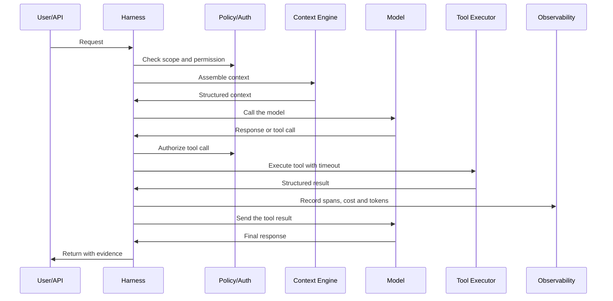

# Chapter 3.3 — Agent runtime and agent harness

## 🎯 Objective

Distinguish what executes the agent (runtime) from what makes the agent operable (harness).

## 🧠 Definitions

- **Agent runtime** — receives input, assembles context, calls the model, interprets tool calls, executes tools, updates state, decides when to stop.
- **Agent harness** — the engineering around the model: orchestration, retries, timeouts, fallbacks, policies, observability, evals, sandbox, HITL, auditing.

In practical terms:

```text
Model:    predicts, classifies, generates, decides or proposes actions.
Harness:  makes the capability safe, testable, observable and operable.
Product:  harness + model + integrations + governance.
```

## 🏗️ Mandatory harness components

| Component | Responsibility |
|---|---|
| Orchestrator | Controls flow and loop |
| State manager | Maintains resumable state |
| Tool executor | Executes external actions with a timeout |
| Policy engine | Applies rules (policy-as-code) |
| AuthZ/AuthN | Controls access |
| Eval harness | Measures quality |
| Observability | Makes execution debuggable |
| Cost controller | Enforces budgets |
| Sandbox | Isolates dangerous execution |
| Human approval | Mitigates critical actions |

## 🔁 Basic loop



## 📚 References

- Anthropic — *Effective harnesses for long-running agents*: <https://www.anthropic.com/engineering/effective-harnesses-for-long-running-agents>
- OpenAI Agents SDK — *Tracing*: <https://openai.github.io/openai-agents-python/tracing/>

---
