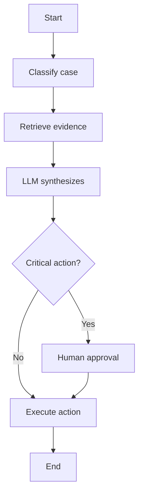

# Chapter 3.4 — Architecture patterns

## 🎯 Objective

Map patterns with their when-to-use and when-to-avoid.

## 📊 Pattern table

| Pattern | When to use | When to avoid | Risks | Controls |
|---|---|---|---|---|
| Single-agent | Short task, few tools | Long critical process | Tool misuse | Tool limits, evals |
| Planner-executor | Auditable multi-step task | Trivial task | Bad/expensive plan | Structured plan, approval |
| Router | Several models/pipelines | Little variation | Wrong routing | Metrics and fallback |
| Evaluator/Critic | Quality and safety | As the only guarantee | Judge bias | Golden set and human |
| Multi-agent | Real parallelism | Simple automation | Cost and coordination | Supervisor, budgets |
| Workflow-first | Corporate process | Open exploratory task | Rigidity | Exceptions and HITL |
| Event-driven | Asynchronous operation | Immediate response | Duplication | Idempotency |
| Agent as a service | Corporate reuse | Local prototype | Broken contract | Versioned API |
| Supervisor | Specialized subagents | Team without the need | Bottleneck | Policies and tracing |
| State machine + LLM | Critical processes | Creative exploration | Complexity | Workflow engine |

## 🛠️ Workflow-first as a defensible pattern

For most enterprise cases, a **workflow-first agent** (a deterministic workflow controlling the flow, with the LLM at specific points) tends to be more defensible than free autonomous agents.

## 🚨 About multi-agent

Multi-agent multiplies cost, latency and risk. Use it only if there is:

- real decomposition;
- useful parallelism;
- necessary specialization;
- a communication protocol;
- a stopping mechanism;
- supervision.

---
