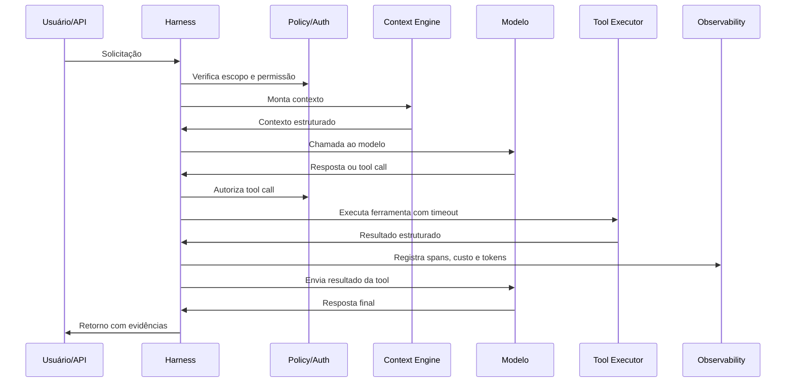

# Capítulo 3.3 — Agent runtime e agent harness

## 🎯 Objetivo

Distinguir o que executa o agente (runtime) do que torna o agente operável (harness).

## 🧠 Definições

- **Agent runtime** - recebe input, monta contexto, chama modelo, interpreta tool calls, executa ferramentas, atualiza estado, decide quando parar.
- **Agent harness** - engenharia ao redor do modelo: orquestração, retries, timeouts, fallbacks, policies, observabilidade, evals, sandbox, HITL, auditoria.

Em termos práticos:

```text
Modelo:   prediz, classifica, gera, decide ou propõe ações.
Harness:  torna a capacidade segura, testável, observável e operável.
Produto:  harness + modelo + integrações + governança.
```

## 🏗️ Componentes obrigatórios do harness

| Componente | Responsabilidade |
|---|---|
| Orquestrador | Controla fluxo e loop |
| State manager | Mantém estado resumível |
| Tool executor | Executa ações externas com timeout |
| Policy engine | Aplica regras (policy-as-code) |
| AuthZ/AuthN | Controla acesso |
| Eval harness | Mede qualidade |
| Observability | Torna execução depurável |
| Cost controller | Impõe budgets |
| Sandbox | Isola execução perigosa |
| Human approval | Mitiga ações críticas |

## 🔁 Loop básico



## 📚 Referências

- Anthropic - *Effective harnesses for long-running agents*: <https://www.anthropic.com/engineering/effective-harnesses-for-long-running-agents>
- OpenAI Agents SDK - *Tracing*: <https://openai.github.io/openai-agents-python/tracing/>

---
