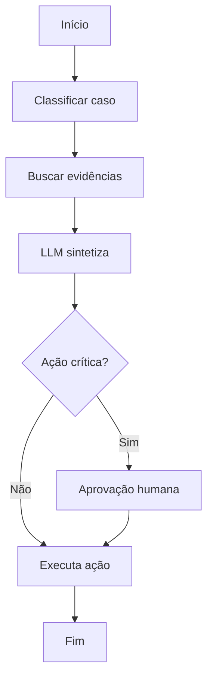

# Capítulo 3.4 — Padrões de arquitetura

## 🎯 Objetivo

Mapear padrões com seus quando-usar e quando-evitar.

## 📊 Tabela de padrões

| Padrão | Quando usar | Quando evitar | Riscos | Controles |
|---|---|---|---|---|
| Single-agent | Tarefa curta, poucas tools | Processo crítico longo | Tool misuse | Tool limits, evals |
| Planner-executor | Tarefa multi-etapa auditável | Tarefa trivial | Plano ruim/caro | Plano estruturado, approval |
| Router | Vários modelos/pipelines | Pouca variação | Roteamento errado | Métricas e fallback |
| Evaluator/Critic | Qualidade e segurança | Como única garantia | Viés do juiz | Golden set e humano |
| Multi-agent | Paralelismo real | Automação simples | Custo e coordenação | Supervisor, budgets |
| Workflow-first | Processo corporativo | Tarefa aberta exploratória | Rigidez | Exceções e HITL |
| Event-driven | Operação assíncrona | Resposta imediata | Duplicidade | Idempotência |
| Agent as a service | Reuso corporativo | Protótipo local | Contrato quebrado | API versionada |
| Supervisor | Subagentes especializados | Equipe sem necessidade | Gargalo | Políticas e tracing |
| State machine + LLM | Processos críticos | Exploração criativa | Complexidade | Workflow engine |

## 🛠️ Workflow-first como padrão defensável

Para a maioria dos casos enterprise, **workflow-first agent** (workflow determinístico controlando o fluxo, com LLM em pontos específicos) costuma ser mais defensável do que agentes autônomos livres.

## 🚨 Sobre multi-agent

Multi-agent multiplica custo, latência e risco. Use apenas se houver:

- decomposição real;
- paralelismo útil;
- especialização necessária;
- protocolo de comunicação;
- mecanismo de parada;
- supervisão.

---
