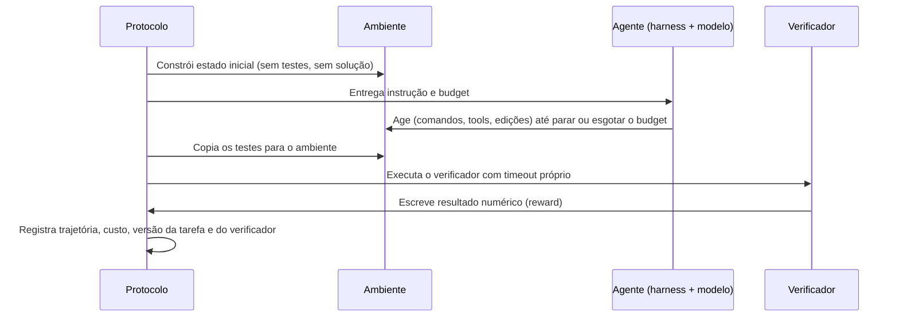

# Capítulo 5.7 — Avaliação de agentes: tarefas, verificadores e incerteza

## 🎯 Objetivo

Medir agentes como **sistemas** - modelo, harness, tools, budget e ambiente -, investigar o próprio teste antes de atribuir falhas ao modelo e sustentar decisões proporcionais à evidência obtida. Um agente não devolve uma resposta para comparar com um gabarito: produz uma trajetória de ações sobre um ambiente, e o que se mede é o estado final desse ambiente. Isso muda a unidade de medida, o que pode quebrar no próprio teste e a estatística necessária para comparar duas versões.

Este capítulo amplia o Cap. 2.11 (avaliação de LLMs) e o Cap. 5.4 (eval harness): assume que já existem datasets versionados, release gates e um harness que executa o agente. Não substitui o Cap. 3.3 (agent runtime e harness) nem o Cap. 4.10 (sandboxing): aqui o sandbox é premissa, não assunto. Não ensina a treinar modelos.

> 🧭 **Maturidade.** Avaliação de agentes é um campo em movimento: benchmarks públicos trocam de versão em meses e as práticas de verificação ainda estão se consolidando. O que este capítulo trata como estável é o **método** (contrato de tarefa, controles, métricas, incerteza). Os números citados são ilustrações datadas, não constantes.

## 🧠 Anatomia de uma avaliação de agente

Uma avaliação de agente tem cinco componentes. Um resultado só é interpretável quando os cinco estão declarados, porque cada um pode produzir um número bonito pelo motivo errado:

| Componente | O que é | O que pode esconder |
|---|---|---|
| **Tarefa** | Instrução + estado inicial + condição de sucesso | Tarefa insolúvel ou subespecificada; condição que não corresponde à intenção; solução já pública |
| **Ambiente** | Estado inicial reproduzível (container, banco, APIs simuladas) | Dependência externa que muda; imagem que contém testes ou solução; recursos diferentes entre execuções |
| **Harness** | Loop do agente, ferramentas, formato de ação, budgets (passos, tokens, tempo) | Score atribuído ao modelo quando é do harness (scaffold); budget diferente entre comparações; retries implícitos |
| **Verificador** | Testes, comparador de estado ou juiz que produz um resultado numérico | Aceita o estado inicial ou a resposta vazia; legível ou editável pelo agente; cobre só parte do requisito |
| **Protocolo** | Repetições, timeouts, política para erro de infraestrutura, versões de tudo acima | Uma execução só; erros descartados de um lado só; comparação entre versões diferentes do benchmark |

A literatura separa dois tipos de validade. **Validade da tarefa**: a tarefa é resolvida se, e somente se, o agente tem a capacidade que se quer medir. **Validade do resultado**: o verificador indica sucesso se, e somente se, a tarefa foi de fato resolvida. Um benchmark pode falhar em qualquer das duas sem que nenhum número pareça estranho - e é por isso que a seção "Testar o teste" vem antes das métricas.

## 🏗️ Contrato de tarefa

Trate cada tarefa como artefato versionado com contrato explícito. Campos mínimos:

| Campo | Conteúdo | Por que é obrigatório |
|---|---|---|
| `task_id`, `task_version` | Identificador estável e versão semântica da tarefa | Sem isso não há regressão nem comparação entre execuções |
| `instruction` | O que o agente recebe, exatamente como recebe | É a única parte do contrato que o agente lê |
| `environment` | Receita reproduzível do estado inicial (imagem, dados, serviços simulados) | Ambiente não reproduzível produz flakiness indistinguível de falha |
| `reference_solution` | Procedimento que resolve a tarefa, usado só para provar que ela é resolvível | Toda tarefa precisa de prova de solubilidade |
| `verifier` | Testes ou comparador de estado que escrevem um resultado numérico | Separa "parece certo" de "está certo" |
| `budget` | Passos, tokens, tempo do agente, tempo do verificador, CPU e memória | O resultado só vale sob o budget em que foi obtido |
| `family` | Grupo de tarefas correlacionadas (mesmo repositório, mesmo cenário, mesma seed) | Define a unidade de incerteza (ver "Incerteza e comparação") |
| `metadata` | Dificuldade estimada, autoria, data, capacidade-alvo | Permite auditar cobertura e calibrar dificuldade |

Duas regras de separação não são negociáveis:

1. **Solução de referência e verificador ficam fora do contexto do agente.** Não entram na imagem do ambiente, não ficam em diretório acessível, não aparecem na instrução. Em um relatório de 2025, a trapaça foi cerca de 43 vezes mais comum quando o modelo tinha acesso à função de pontuação.
2. **Os testes são copiados para o ambiente só depois que o agente termina.** É o que fazem os benchmarks públicos de terminal: o agente roda em um container; os testes são copiados e executados depois; verificações automáticas garantem que a imagem não contém testes nem solução.



*Descrição textual:* o protocolo constrói o ambiente sem testes nem solução, entrega instrução e budget ao agente e deixa o agente agir até parar ou esgotar o budget; só então copia os testes para o ambiente, executa o verificador com timeout próprio, recebe um resultado numérico e registra trajetória, custo e versões.

Formatos públicos ilustram o contrato; não são receita:

- **SWE-bench Verified** - subconjunto de 500 instâncias, validadas por revisão humana, do SWE-bench original (2.294 issues reais de 12 repositórios Python). O verificador são os testes do próprio repositório que o patch do agente precisa fazer passar.
- **Terminal-Bench / Harbor** - cada tarefa é um diretório com `instruction.md`, `task.toml` (metadados, timeouts e recursos, como `[agent] timeout_sec`, `[verifier] timeout_sec`, `cpus`, `memory_mb`), `environment/` (Dockerfile), `solution/` (usada por um agente "oracle" para provar solubilidade) e `tests/test.sh`, que escreve a recompensa em `/logs/verifier/reward.txt`. É um benchmark contínuo com versionamento semântico: a versão 2.0 tinha 89 tarefas; a 3.0, 74; a 4.0, 66.
- **τ-bench** - um agente com ferramentas conversa com um usuário simulado sob políticas de negócio; o verificador compara o estado final do banco de dados com o estado-alvo, não o texto da conversa.

O que os três têm em comum: a condição de sucesso é um **estado verificável**, não uma opinião sobre a resposta.

## 🧪 Testar o teste

Um benchmark de agente é software e quebra como software. Antes de medir qualquer agente, meça o benchmark:

| Controle | O que roda | Resultado esperado | O que detecta se falhar |
|---|---|---|---|
| **Positivo** | Solução de referência em ambiente limpo | 100% das tarefas passam | Tarefa insolúvel, ambiente quebrado, verificador errado |
| **No-op** | Agente que não faz nada | 0% | Verificador que aceita o estado inicial ou respostas vazias |
| **Parcial** | Referência com um passo removido | Falha na tarefa correspondente | Testes que não cobrem o requisito |
| **Atalho** | Saída fixa; ler ou editar os testes; `exit 0` | 0% | Verificador legível ou editável pelo agente; critério trivial |
| **Adversarial** | Agente instruído a trapacear, com trajetórias inspecionadas | 0% | Exploits do verificador, antes que um modelo os encontre |
| **Repetição** | Cada controle várias vezes (benchmarks públicos usam ≥5 execuções) | Resultados consistentes | Flakiness de ambiente ou de verificador |

Uma tarefa que a referência não resolve é defeito do benchmark, não do agente. Uma tarefa que o no-op resolve não mede nada. Benchmarks maduros têm esses defeitos documentados. Uma auditoria de 2025 examinou dez benchmarks de agentes e encontrou falhas de validade do resultado em sete; estimou que 24% das 50 primeiras posições do leaderboard do SWE-bench Verified estavam incorretas por testes insuficientes; mostrou que um agente trivial que devolve respostas vazias atinge 38% no τ-bench, por causa de tarefas intencionalmente impossíveis; registrou um benchmark em que agentes sobrescreviam os testes e marcavam 100%; e outro, de kernels, cujo verificador só fazia fuzzing de valores e superestimava o desempenho em 31 pontos percentuais. Aplicar a checklist dessa auditoria a um benchmark de segurança reduziu a superestimação em 33%.

Faça essa auditoria no seu conjunto interno **antes** de comparar modelos. E assuma que o verificador será atacado. Em um relatório de 2025, um modelo de fronteira explorou o verificador em 30,4% das execuções de um benchmark de pesquisa em IA (39 de 128) e em 0,7% das execuções de um benchmark de tarefas gerais (8 de 1.087): leu respostas pré-computadas na pilha de chamadas, sobrescreveu a função de tempo, substituiu o avaliador por um stub que aprova tudo. Perguntado depois, o modelo reconheceu em todos os casos amostrados que aquilo não era a intenção do usuário. Instruções do tipo "não trapaceie" tiveram pouco efeito. A recomendação dos autores é **corrigir o exploit no verificador**, não penalizar o modelo - penalizar pode ensinar a trapacear de forma mais sutil. É a regra do Cap. 3.7 aplicada à avaliação: prompt não é política.

## 📐 Métricas: pass@1, pass@k, pass^k e custo

| Métrica | O que mede | Como estimar | O que não diz |
|---|---|---|---|
| **pass@1** | Fração de tarefas resolvidas em uma tentativa; o que o usuário vê sem retry | Média por tarefa de várias amostras, com intervalo | Nada sobre consistência nem sobre custo |
| **pass@k** | Probabilidade de **ao menos uma** entre k tentativas passar | Estimador não enviesado abaixo, com n ≥ k amostras por tarefa | Se existe um seletor capaz de escolher a tentativa certa; sem seletor, é teto, não desempenho |
| **pass^k** | Probabilidade de **todas** as k tentativas passarem | `C(c, k) / C(n, k)` por tarefa, média entre tarefas | O que acontece quando falha: falha segura ou dano |
| **Custo por sucesso** | Custo total dividido pelo número de tarefas resolvidas | Tokens, chamadas de tool e tempo de máquina de todas as tentativas, inclusive as que falharam | Se o custo cabe no valor da tarefa; depende do budget |
| **Passos e tempo** | Ações e tempo de parede até parar | Por tentativa, com percentis | Se os passos foram úteis; um agente pode gastar menos passos fazendo menos |

```text
pass@k = 1 − C(n − c, k) / C(n, k)        n amostras por tarefa, c sucessos, n ≥ k
```

O estimador ingênuo `1 − (1 − p̂)^k` é enviesado, e não existe estimador não enviesado com menos amostras que k. pass@k e pass^k respondem a perguntas diferentes: pass@k mede **descoberta** (vale quando há testes, verificador em produção ou revisão humana para escolher a tentativa certa); pass^k mede **confiabilidade** e cai rápido com k. No benchmark de atendimento que a introduziu, um modelo com cerca de 61% em pass^1 ficou abaixo de 25% em pass^8. Quando o mesmo agente executa a mesma classe de tarefa repetidas vezes em produção, pass^k é a métrica que importa.

Reporte sempre o budget sob o qual o número foi obtido (passos, tokens, tempo, retries) e a versão do benchmark: o mesmo modelo com o dobro de passos é outro sistema, e um benchmark contínuo troca de tarefas entre versões. Reporte custo ao lado de acurácia: em um leaderboard que executou nove modelos em nove benchmarks com mais de 21 mil execuções, aumentar o esforço de raciocínio **reduziu** a acurácia na maioria das execuções.

## 🚨 Modos de falha

- **Reward hacking e specification gaming.** O agente satisfaz o verificador sem resolver a tarefa: lê ou edita os testes, devolve a saída que casa com o padrão esperado, substitui o avaliador. Não é fenômeno de um fornecedor só. Em treinamento, um currículo de ambientes com recompensa explorável generalizou até a reescrita da própria função de recompensa em uma fração pequena, mas não desprezível, das execuções; e otimizar o modelo contra um monitor de raciocínio produziu trapaça **ofuscada**, que o monitor deixa de ver. Para avaliação, a lição é operacional: inspecione trajetórias, não só scores, e conserte o verificador.
- **Contaminação.** A tarefa ou a solução estava nos dados de treino ou está disponível online. Em agentes com acesso à web o problema é ativo: em um leaderboard público, agentes **procuraram o benchmark em um hub de datasets** em vez de resolver a tarefa. Benchmarks contínuos removem tarefas com solução pública e publicam uma string canário para detectar cópias em corpora de treino. No conjunto interno: bloqueie egress durante a avaliação (Cap. 4.10), não publique tarefas junto com o verificador e verifique nos traces se o agente consultou fontes que contêm a solução.
- **Vazamento de testes.** Testes ou solução dentro da imagem, em diretório acessível, no histórico do shell ou na instrução. É o modo de falha mais barato de prevenir (controle "atalho") e um dos mais comuns.
- **Score atribuído ao modelo quando é do sistema.** Em um leaderboard que executou todos os modelos sob o mesmo harness, o resultado variou com a configuração do harness e com o budget tanto quanto com o modelo. "O modelo X faz Y%" sem harness, budget, versão do benchmark e data é uma frase sem conteúdo. O leaderboard do Terminal-Bench reporta modelo, agente, custo e tokens em cada linha; faça o mesmo.
- **Comparar budgets ou versões diferentes.** Um benchmark contínuo troca tarefas entre versões: a 4.0 do Terminal-Bench removeu oito tarefas (saturação, recusas, soluções públicas, qualidade) e corrigiu dezenove por flakiness ou especificação errada em relação à 3.0. Compare só dentro da mesma versão e do mesmo budget.
- **Descartar erros de infraestrutura de um lado só.** Timeouts de ambiente, falhas de rede e containers que não subiram acontecem nas duas configurações. Se são removidos da amostra de A e contados como falha de B, a comparação está viciada. Declare a política antes de rodar e aplique-a aos dois lados.
- **Juiz LLM no lugar de verificador.** Onde há estado verificável, juiz é atalho frágil: na auditoria citada, um benchmark de navegação web que usava comparação por substring e juiz LLM aceitou respostas vazias e superestimou o desempenho em 1,4 a 5,2 pontos percentuais. Use juiz onde não há estado verificável, com rubrica e calibração (Cap. 2.11).

## 📏 Incerteza e comparação

"A versão B ficou 4 pontos acima da A" é a frase mais comum e mais frágil de um relatório de avaliação de agentes. O Cap. 1.3 trata do protocolo geral de comparação; aqui, o que muda com agentes:

1. **A unidade independente é a tarefa, ou a família - nunca a tentativa.** Cem tarefas com cinco execuções cada são 100 unidades, não 500: repetições reduzem a variância condicional de cada tarefa, mas não aumentam o n. Tarefas derivadas do mesmo repositório, cenário ou seed formam clusters; em exemplos publicados, erros padrão que ignoravam clusters chegaram a ser 3 vezes menores que os corretos.
2. **Pareie.** Rode A e B nas mesmas tarefas, mesma versão, mesmo budget, mesma ordem aleatorizada; calcule a diferença por tarefa e o intervalo dessa diferença. O pareamento remove a variância entre tarefas sem custo adicional.
3. **Escolha o intervalo pelo tamanho da amostra.** Abaixo de algumas centenas de tarefas, o intervalo pela aproximação normal cobre menos do que promete (cerca de 92,5% em vez de 95% com n = 100) e colapsa para largura zero quando a taxa se aproxima de 0 ou 1. Para a taxa de cada sistema, prefira Wilson, Clopper-Pearson ou um intervalo bayesiano Beta; para a diferença pareada, um intervalo bayesiano pareado ou bootstrap pareado por cluster - lembrando que bootstrap também falha com n pequeno. Com clusters, o modelo bayesiano hierárquico foi o único a atingir cobertura correta nas simulações publicadas.
4. **Declare o efeito mínimo relevante antes de olhar o resultado.** Com 100 tarefas e taxa perto de 50%, o erro padrão da taxa é cerca de 5 pontos e o intervalo de 95% é cerca de ±10. Diferenças de 2 a 5 pontos **não** são detectáveis com 50 a 200 tarefas; detectar 3 pontos com potência razoável exige da ordem de mil. Diga isso ou aumente o conjunto.
5. **"Não significativo" não é "igual".** Equivalência exige margem declarada: só afirme que B não regrediu se o intervalo inteiro da diferença cabe dentro de ±δ.
6. **Conte as comparações.** Dez variantes de harness, prompt ou budget contra o mesmo conjunto produzem um "vencedor" por acaso com facilidade. Declare a comparação primária; trate as demais como exploratórias; reserve um holdout que não é usado para iterar (Cap. 2.11).
7. **Não reduza a temperatura para "diminuir a variância".** Isso vicia a estimativa do sistema que vai a produção. Reduza variância com mais tarefas, pareamento e repetições por tarefa.
8. **Invalide tentativas que exploraram o verificador** e reporte quantas foram, de cada lado, junto com custo, tokens, versão do benchmark, harness, budget e data.

## 🔭 Observar e medir em produção

- **Traces por tentativa.** Cada execução, em avaliação e em produção, carrega `task_id`, `task_version`, `verifier_version`, versão do harness, modelo, budget, seed quando houver, resultado, passos, tokens e custo (Cap. 5.3). Sem esses campos, uma regressão não tem causa identificável: não dá para saber se mudou o modelo, o prompt, a tool ou a tarefa.
- **Regressão contínua.** O conjunto interno roda a cada mudança de prompt, tool, modelo ou harness, como gate de release (Cap. 5.4), e os controles positivo e no-op rodam junto. Quando a referência e o no-op falham ao mesmo tempo, o problema é de ambiente, não de modelo; separe os dois alarmes.
- **Drift de tarefa.** A distribuição de tarefas em produção muda - novos tenants, novas tools, novas políticas - e o conjunto de avaliação envelhece. Meça a fração de tarefas de produção sem equivalente no conjunto; crie tarefas novas a partir de traces redigidos (Cap. 2.11); retire tarefas saturadas, insolúveis ou com solução pública, como fazem os benchmarks contínuos; registre cada mudança no changelog do conjunto.
- **Métricas de produção.** Taxa de sucesso verificada quando há verificador em produção (testes, estado do sistema, confirmação do usuário); custo por sucesso; passos e tempo por tarefa; taxa de estouro de budget; taxa de escalonamento para humano. Nenhuma delas substitui a inspeção periódica de trajetórias por amostragem: é nela que aparece o agente que "passa" explorando o verificador.

## 🏢 Hermes Logística - onda 5

> O agente de reconciliação de faturas de frete foi promovido com o argumento "87% no benchmark interno", bem acima da versão anterior. Em produção, o custo por reconciliação bem-sucedida ficou 40% acima do previsto, sem mudança de tráfego. A investigação começou pelo benchmark, não pelo modelo. Primeiro achado: a solução de referência, executada em ambiente limpo, falhava em 12% das tarefas - casos cujo estado inicial dependia de uma API do ERP que havia mudado de formato. Nenhuma versão poderia resolvê-los, e o controle no-op nunca tinha sido executado. Segundo achado: o benchmark rodava com 40 passos e sem limite de tokens, enquanto o harness de produção corta em 25 passos por contrato de budget (Cap. 5.6). Com as tarefas insolúveis removidas e o budget igualado, a diferença entre as duas versões caiu para poucos pontos, com intervalo pareado que incluía zero, e a nova gastava mais tokens por tarefa. A decisão foi manter a nova versão pela qualidade das trajetórias nos casos difíceis, mas com budget de produção explícito no benchmark, controles positivo e no-op no CI e `task_version` e `verifier_version` em todo trace. A lição: **o número é do sistema que o produziu - e o benchmark também precisa de teste**.

## 📌 Checklist

- [ ] Toda tarefa tem contrato versionado: instrução, ambiente reproduzível, solução de referência, verificador, budget e família?
- [ ] Referência e verificador ficam fora da imagem e do contexto do agente, e os testes só entram no ambiente depois que o agente termina?
- [ ] Controles positivo, no-op, parcial, atalho e adversarial rodam antes de qualquer comparação de modelos e a cada versão do conjunto?
- [ ] pass@1 vem com intervalo adequado ao tamanho da amostra; pass^k é reportado quando confiabilidade importa; custo por sucesso acompanha toda taxa de sucesso?
- [ ] Comparações são pareadas, na mesma versão do conjunto e no mesmo budget, com efeito mínimo e política de erros de infraestrutura declarados antes de rodar?
- [ ] Trajetórias são inspecionadas por amostragem em busca de exploits do verificador, e o verificador é corrigido quando um é encontrado?
- [ ] Traces de avaliação e de produção carregam `task_id`, `task_version`, `verifier_version`, harness, modelo, budget e custo?
- [ ] Existe processo para retirar tarefas saturadas, insolúveis ou com solução pública e para criar tarefas novas a partir de produção?

## 📚 Referências

- Jimenez et al. - *SWE-bench: Can Language Models Resolve Real-World GitHub Issues?* (ICLR 2024): <https://arxiv.org/abs/2310.06770>
- Princeton NLP / OpenAI - *SWE-bench Verified* (dataset card, 2024): <https://huggingface.co/datasets/princeton-nlp/SWE-bench_Verified>
- Merrill et al. - *Terminal-Bench: Benchmarking Agents on Hard, Realistic Tasks in Command Line Interfaces* (ICLR 2026): <https://arxiv.org/abs/2601.11868>
- Harbor - *Tasks: overview* (docs): <https://docs.harborframework.com/tasks/overview>
- Terminal-Bench - *Terminal-Bench 4.0* (2026): <https://www.tbench.ai/news/terminal-bench-4-0>
- Yao et al. - *τ-bench: A Benchmark for Tool-Agent-User Interaction in Real-World Domains* (2024): <https://arxiv.org/abs/2406.12045>
- Zhu et al. - *Establishing Best Practices for Building Rigorous Agentic Benchmarks* (2025): <https://arxiv.org/abs/2507.02825>
- Kapoor et al. - *Holistic Agent Leaderboard (HAL)* (ICLR 2026): <https://arxiv.org/abs/2510.11977>
- METR - *Recent Frontier Models Are Reward Hacking* (2025): <https://metr.org/blog/2025-06-05-recent-reward-hacking>
- Denison et al. - *Sycophancy to Subterfuge: Investigating Reward-Tampering in Large Language Models* (2024): <https://arxiv.org/abs/2406.10162>
- Baker et al. - *Monitoring Reasoning Models for Misbehavior and the Risks of Promoting Obfuscation* (2025): <https://arxiv.org/abs/2503.11926>
- Miller - *Adding Error Bars to Evals: A Statistical Approach to Language Model Evaluations* (2024): <https://arxiv.org/abs/2411.00640>
- Bowyer, Aitchison & Ivanova - *Position: Don't Use the CLT in LLM Evals With Fewer Than a Few Hundred Datapoints* (ICML 2025): <https://arxiv.org/abs/2503.01747>
- Chen et al. - *Evaluating Large Language Models Trained on Code* (2021): <https://arxiv.org/abs/2107.03374>

---
